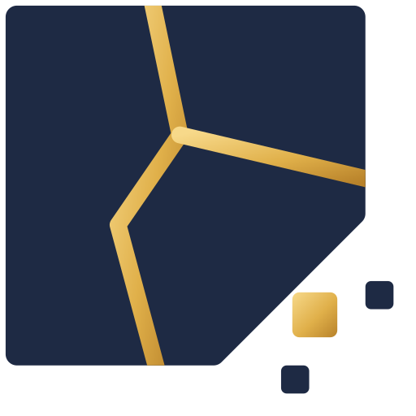
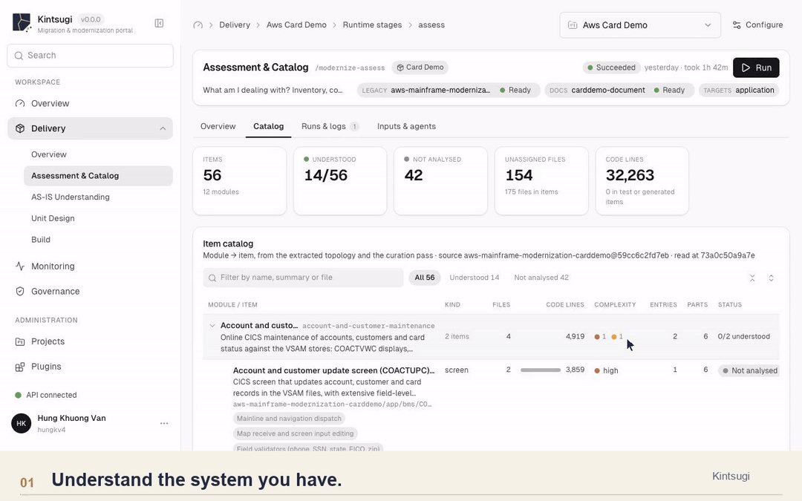
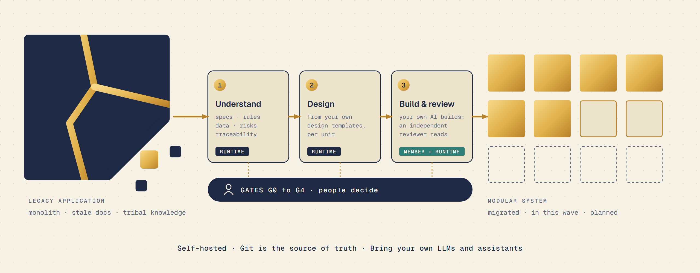
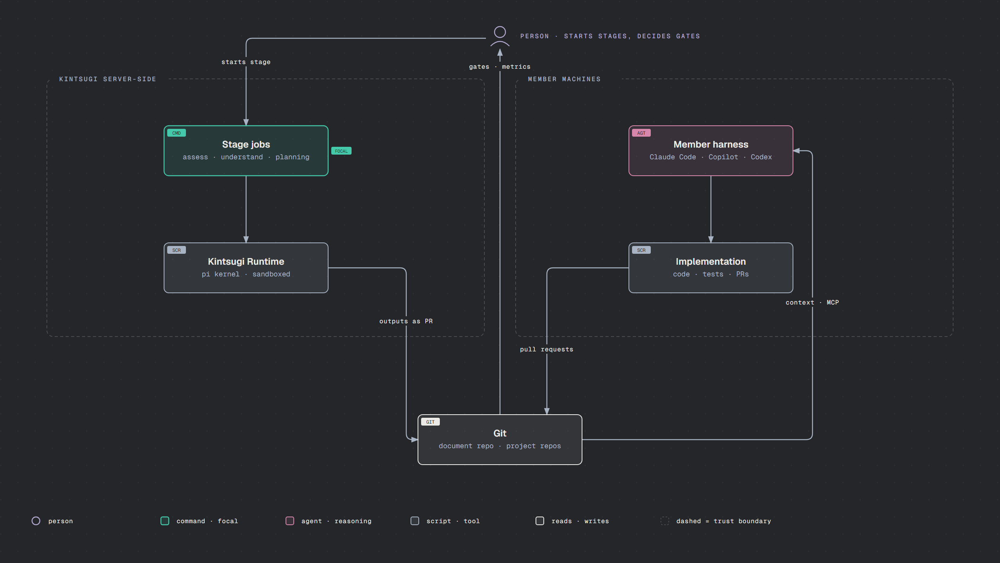
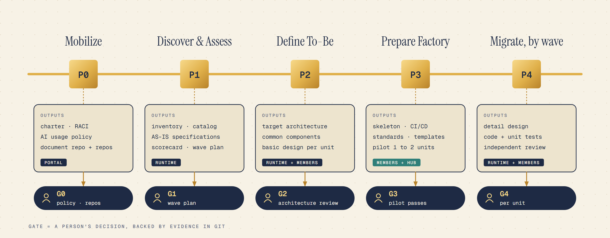
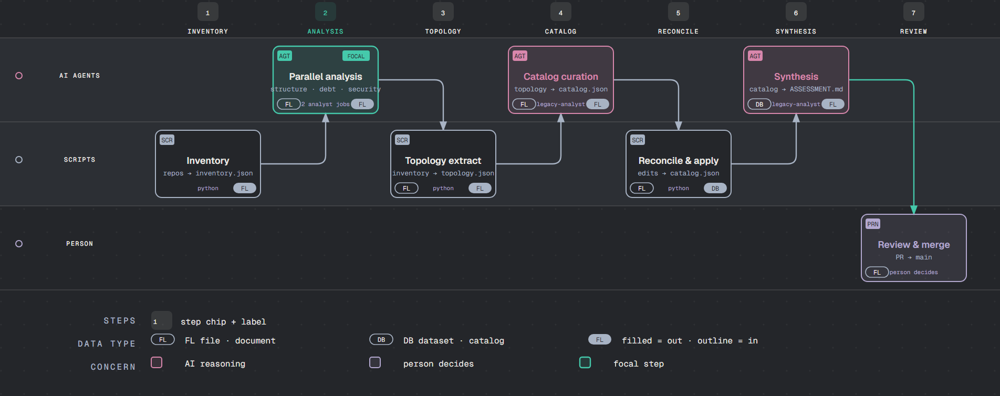
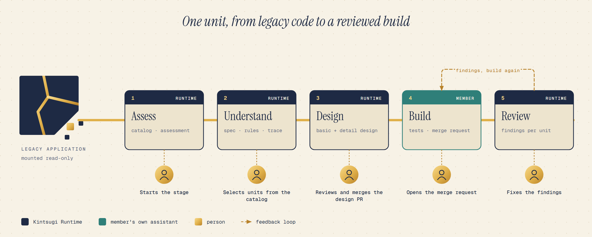
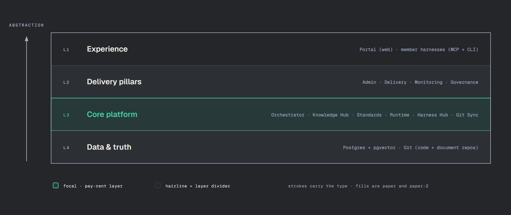
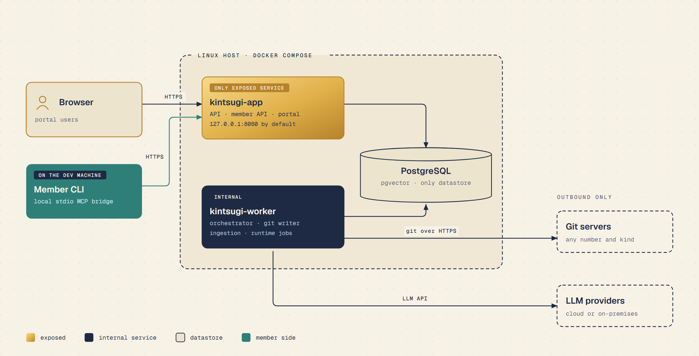

<p align="center">
  
</p>

<h1 align="center">Kintsugi</h1>

<p align="center">
  <strong>The enterprise platform for AI-driven legacy modernization.</strong><br/>
  Understand the system you have. Design the one you want. Rebuild it at portfolio scale, with people in control of every decision.
</p>

<p align="center">
  Self-hosted · Git as the source of truth · Bring your own LLMs and coding assistants · Stack-agnostic
</p>

[](https://kintsugi.evoelsewhere.asia/#product-tour)

<p align="center">
  <sub>Recorded from the product in light theme with AWS CardDemo development data. <a href="https://kintsugi.evoelsewhere.asia/">Explore Kintsugi →</a></sub>
</p>



---

## Why Kintsugi

Modernizing a portfolio of tens or hundreds of applications fails in the same places, project after project:

| Where programs stall | What Kintsugi does about it |
|---|---|
| **Nobody fully understands the legacy system.** Knowledge sits in people's heads, stale documents and the code itself. | AI agents reverse-engineer each application into reviewable, source-cited specifications: inventory, topology, business rules, data objects, security findings, traceability. |
| **Every team improvises its own process and tooling.** Scorecards in spreadsheets, prompts in private repos, a knowledge base rebuilt per project. | One governed pipeline, one document repository per project, one place to see progress. |
| **AI is adopted unevenly and cannot be measured.** Each team uses a different assistant under different rules. | Members keep the coding assistant they already license. Kintsugi gives all of them the same project context and plugins, and records what they did. |
| **Quality depends on heroics.** Design reviews and code reviews happen when someone has time. | Every phase ends at a gate decided by a person and backed by evidence in Git. An independent AI review reads each merge request against the unit's design and your standards. |
| **Nothing is auditable.** | Every output is a file in Git. Every decision, configuration change and sensitive read is written to an append-only audit trail. |

The name comes from *kintsugi* (金継ぎ), the Japanese art of repairing broken pottery with gold. The old piece is not thrown away; it becomes more valuable. The same idea applies to a legacy system: monolith to modular, with the knowledge preserved.

## What you get

- **Understand** — Reverse engineering of the as-is system. A catalog of migration units is derived from the code, then each selected unit gets a specification of its behavior, rules, data and risks.
- **Design** — Basic and detail designs for each unit, generated from **your** design templates, checked for conformance and reviewed in a pull request.
- **Build** — Developers implement and test each designed unit on their own machine with Claude Code, GitHub Copilot or ChatGPT/Codex, through the Kintsugi CLI and plugins.
- **Review** — An independent runtime reviewer reads the merge request a developer opened against the unit's rules, design and the project's standards, and proposes findings as a document.
- **Govern** — Phase gates G0–G4, role-based access, an append-only audit log, cost and token telemetry, and per-member activity.
- **Measure** — AI coverage, outcome ratio, time saved and defect rate of AI output, computed from real activity rather than self-reports.

## Working model

Kintsugi separates the **brain** from the **hands**, and keeps **people** in charge of every decision.



| | **Kintsugi Runtime** (the brain) | **Member harnesses** (the hands) |
|---|---|---|
| Runs | On the Kintsugi installation, as server-side jobs | On the developer's machine |
| Engine | A generic agent kernel built on [pi](https://github.com/earendil-works/pi), behind a provider-neutral SDK | Claude Code, GitHub Copilot, ChatGPT/Codex: whichever the member already uses |
| Does | Assess, understand, design, review. Always read-only on source | Implement and test the unit in the target repository |
| Writes | Only to the job's output. The platform's writer opens a pull request on the **document repository** | Normal commits and merge requests on the **code repositories** |
| LLM cost | Providers you configure in the portal | The member's or the customer's existing licenses |

The platform never drives implementation itself, and its agents never write to your project's code repositories. Both worlds meet in Git.

### Who does what

| Role | Works mainly in | Typical actions |
|---|---|---|
| **Program / delivery lead** | Portal: Delivery, Monitoring, Governance | Starts stages, tracks waves and gates, watches cost and AI metrics |
| **Business analyst** | Portal: results views, knowledge assistant | Confirms inventory and catalog, reviews AS-IS specifications |
| **Architect / review board** | Portal and document repo | Defines standards and design templates, decides gates G2 and G3, approves design pull requests |
| **Developer / QC** | Their own coding assistant, via the Kintsugi CLI | Reads project documents, runs `/modernize:build`, fixes review findings |
| **AI enablement** (champion, engineer, KM lead) | Portal: Agent Builder, Plugins, Telemetry | Builds and tunes agents, plugins and skills, controls who may use what |
| **Installation admin** | Portal: Administration | Connects Git servers and LLM providers, manages roles, permissions and budgets |

## Delivery pipeline

A project moves through **P0–P4**. Each application is rebuilt on a new architecture from what its legacy system actually does, and every phase closes with a **gate**: a person's decision, backed by evidence in Git.



| Phase | Outcome | Gate |
|---|---|---|
| **P0 Mobilize** | Team, RACI, AI usage policy, document repo, legacy and target repos registered | G0 |
| **P1 Discover & Assess** | Inventory, catalog of units, AS-IS specifications, scorecard, wave plan | G1 |
| **P2 Define To-Be** | Target architecture, common components, ADRs, basic design of every unit in scope | G2 (architecture review) |
| **P3 Prepare Factory** | Skeleton, CI/CD, standards, design templates and plugins piloted on 1–2 units per kind | G3 |
| **P4 Migrate, by wave** | Detail design, implementation and tests, code review, per unit | G4 (per unit) |

Not every application fits the standard shape. A project can declare its own **pipeline definition** (phases, stages, performers, gates) and its own **design sets** in the document repository. Details: [delivery pipeline](docs/methodology/delivery-pipeline.md).

### Inside one stage

Take **P1 Discover & Assess**. A person starts it in the portal. Kintsugi runs it as jobs in an isolated workspace: script steps and AI reasoning steps alternate, handing inventory, topology, catalog and assessment files along a chain. The result arrives as a pull request that a person reviews and merges.



Across stages, one unit travels from legacy code to a reviewed build: the runtime understands and designs it, a member builds it, and the runtime reviews the merge request.



The **catalog is the menu**: people choose which units to understand next, several selections can run in parallel, and a failed run resumes where it stopped.

## Architecture

Four pillars on a shared core. Modules talk through APIs and events, so any of them can later be split into its own service.



| Layer | Component | Responsibility |
|---|---|---|
| **Admin** | Projects, Identity & Access, Connectors, LLM Providers, Agent Builder, Templates | One installation per organization. Git servers (any number and kind), trackers and wikis, encrypted credentials, role and permission bundles, every pi-supported LLM provider plus custom ones, model binding per agent, budgets |
| **Delivery** | Portfolio & Assessment, Architecture Studio, Factory Setup, Migration Workbench | Maps one-to-one onto pipeline phases; catalog, scorecard, wave plan, unit board, build and review pages |
| **Monitoring** | Run observability, delivery dashboard, AI metrics, cost | Live job events, spans per job, turn and tool call, tokens, cache hit rate and cost, activity per member |
| **Governance** | Quality gates, review and approval, audit and traceability, policy | G0–G4, append-only audit, `repo@commit:path` traceability, model allowlists, tool permissions, budgets |
| **Core** | Orchestrator, Knowledge Hub, Standards & Assets, Runtime, Harness Hub, Git Sync & Writer, Events | Described below |

**Core platform**

- **Workflow Orchestrator.** pg-boss job queue and a phase / stage / gate state machine driven by the application's pipeline definition. Retries, fan-out per wave.
- **Knowledge Hub.** Sources stay in Git; text chunks and embeddings (pgvector) live in Postgres. No code graph and no language parsers: the engine stays small.
- **Standards & Assets.** Reads `kintsugi.yaml`, `01-standards/` and `plugins/` from the document repository at a fixed commit and combines them with built-in assets for each job.
- **Kintsugi Runtime.** A generic agent kernel that knows no agent. Each job carries its [agent definition](docs/reference/runtime-agents.md), so built-in agents and the ones admins create in the Agent Builder run the same way.
- **Harness Hub.** The member API, the local MCP bridge and plugin distribution to members' assistants.
- **Git Sync & Writer.** Syncs repositories across Git servers. The writer is the only component that commits to project repositories, one write per repository at a time.
- **Events.** Domain events through a transactional outbox and `LISTEN/NOTIFY`.

Full detail: [arc42 architecture](docs/architecture/README.md), [building block view](docs/architecture/05-building-block-view.md), [runtime and member harnesses](docs/architecture/concepts/runtime-and-member-harnesses.md).

### Design principles

- **Git is the source of truth.** Specifications, designs, standards and plans are plain Markdown in one **document repository** per project. Postgres holds only operational state and indexes.
- **A common engine, project-built rules.** Kintsugi ships no stack-specific content. Conventions, mappings, review rules, design templates and member plugins are written by the project, versioned by pull request and only deliberately copied to other projects.
- **Agents are data.** A job supplies its agent whole: instructions, skills, commands, workflows, scripts and hooks, packaged as Claude Code agent files and Agent Skills. There is no agent configuration in project repositories.
- **Humans decide.** AI produces the first pass; people review pull requests and decide gates.
- **Measured from day one.** Provenance, cost and activity are recorded as the work happens.
- **Simple to operate.** Docker Compose, no Kubernetes, no multi-tenancy, Postgres as the only datastore.

## The document repository

Everything except code lives in one numbered, reading-order repository of Markdown documents:

```
00-project/        charter, RACI, AI strategy, scorecard, wave plan
01-standards/      conventions, mappings, review rules, design templates
02-architecture/   target architecture, common components, ADRs
03-transition/     co-existence, data migration, shared data
10-applications/<app>/
  01-legacy/       the old system: inventory, catalog, per-unit specs, rules, trace
  02-modern/       the new system: unit cards and design sets, same <module>/<unit> paths
plugins/           project-authored member plugins
kintsugi.yaml      repositories and pipelines
```

Every unit has a card whose front matter holds its state, and the same `<module>/<unit>` path in `01-legacy/` and `02-modern/` gives end-to-end traceability from legacy behavior to new design to code. See the [document repository layout](docs/reference/document-repo.md) and [document formats](docs/reference/document-formats.md).

## Member experience

Developers connect once and keep working in the assistant they already know.

```bash
kintsugi login my-project            # project-scoped browser sign-in (PKCE)
kintsugi init                        # set up your AI clients with the local MCP bridge
kintsugi install plugin modernize    # add a plugin your project permits
```

Then, inside Claude Code, Copilot or Codex: read project documents through the bridge, and run `/modernize:build` to implement and test a designed unit and record the merge request. One hook reports who ran what, with how many tokens and for how long.

- Short-lived access tokens held in memory; a rotating refresh credential in the OS credential store; revocation in the portal.
- The bridge has no inbound listener and runs only when the AI client starts it.
- Kintsugi decides **who may use which plugin, per project and member**, and observes its use per member.

Reference: [member CLI](docs/reference/member-cli.md) · [client capabilities](docs/reference/member-client-capabilities.md).

## Security and governance

| Concern | How it is handled |
|---|---|
| **Untrusted legacy input** | Legacy repositories are treated as hostile. Jobs run in a per-job workspace with source mounted read-only, writes confined to the job's output and scratch directories |
| **Credentials** | LLM keys and Git tokens are encrypted in Postgres (`KINTSUGI_SECRET_KEY`), never returned by the API, decrypted per job in memory only. Scripts run with a cleared environment |
| **Restricted data** | Sensitive findings are stored encrypted; every read is audited fail-closed |
| **Tool control** | Each agent gets an allowlist of kernel tools, path-confined; MCP servers are registered by administrators; shell and git run under the same limits as scripts |
| **Access** | Permission codes in a catalog, route protection by default, project-scoped member tokens, explicit Project Access |
| **Audit** | Append-only audit log enforced by database triggers; sensitive reads, stage runs, configuration, access and gate decisions are recorded |
| **Cost control** | Per-agent model binding, allowlists, per-job limits on turns and cost, telemetry by project, agent and model |
| **Data residency** | Self-hosted. LLM providers include Azure OpenAI, Bedrock, Vertex and any OpenAI-compatible endpoint, including on-premises |

The threat model and its known limits are stated plainly in [Security](docs/architecture/concepts/security.md).

## Deployment

Kintsugi ships as a **self-hosted Docker Compose package**: an app container (API, member API and portal), a worker container (orchestrator, Git sync and writer, ingestion, runtime launcher) and PostgreSQL with pgvector. Only the app is exposed.



Suggested sizing: 4 vCPU, 16 GB RAM, 100 GB disk. See the [deployment view](docs/architecture/07-deployment-view.md) and the [installation guide](docs/guides/installation.md).

## Status

Kintsugi is under active development. Today's built-in content covers reverse engineering of the as-is system, runtime-generated unit designs, member builds and independent merge-request review; the plans in [`docs/product/roadmap.md`](docs/product/roadmap.md) describe the milestones that remain (PR continuation, policy-as-code governance, Entra ID sign-in). Where a guide describes planned behavior, it says so at the top.

## Documentation

Start at the [documentation map](docs/README.md). It is organized by purpose (Diátaxis), with arc42 for architecture and ADRs for decisions.

| Section | Content |
|---|---|
| [Product](docs/product/) | [Overview](docs/product/overview.md), [roadmap](docs/product/roadmap.md) |
| [Methodology](docs/methodology/) | [Delivery pipeline](docs/methodology/delivery-pipeline.md) (P0–P4, gates), [AI metrics](docs/methodology/ai-metrics.md) |
| [Architecture](docs/architecture/README.md) | arc42 chapters 1–11 and crosscutting concepts |
| [Decisions](docs/decisions/README.md) | Decision register and ADRs |
| [Reference](docs/reference/) | Glossary, runtime agents, member CLI, data model, document repo, configuration |
| [Guides](docs/guides/) | Installation, build a project, design templates, LLM providers |

## Repository layout

```
apps/        portal (React SPA) · api (REST + OpenAPI)
services/    orchestrator (pg-boss jobs, git sync/writer) · knowledge (KB) · runtime (agent kernel on pi + launcher) · harness-hub (local MCP bridge, connector generation)
packages/    domain · manifest · agents (builtin plugins: reverse_engineering, modernize) · git · runtime-sdk · harness-sdk · kintsugi-client · cli · secrets
templates/   document repo starter (neutral standards and plugin samples)
deploy/      Docker Compose package
assets/      brand marks · README diagrams
docs/        documentation (Diátaxis) and ADRs
```

## Development

Requires Node ≥ 22 and pnpm 10.

```bash
pnpm install
pnpm lint
pnpm typecheck
pnpm build
pnpm test
make dev      # API on :3000 + worker, portal on :5173
```

Contributors and coding agents: read [AGENTS.md](AGENTS.md) first. Architecture changes need an ADR (copy [`docs/decisions/template.md`](docs/decisions/template.md)). Commits follow [Conventional Commits](https://www.conventionalcommits.org/).

## License

Kintsugi is licensed under the [Apache License 2.0](LICENSE).
