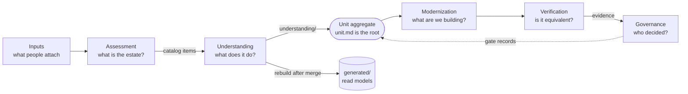

# Document repo contexts

> The document repo, read as bounded contexts around the unit. Decision: [ADR-0042](../../decisions/0042-markdown-only-document-repo-by-bounded-context.md). Formats: [Document formats](../../reference/document-formats.md).

A project's document repo holds everything except code ([ADR-0028](../../decisions/0028-remove-rulebook-single-document-repo.md)). Its folders are not stages or tools but the **contexts** of the method: each answers one question, owns its documents and its words, and is written by one kind of job. The **unit** is the aggregate that the contexts share.

## Context map

| Context | Folder | Owns | Written by |
|---|---|---|---|
| Inputs | `applications/<app>/inputs/` | `INTENT.md`, `graph/`, `telemetry/` | people |
| Assessment | `applications/<app>/assessment/` | the inventory, the topology, the item **catalog**, `ASSESSMENT.md`, the extraction script | the `assess` stage |
| Understanding | `applications/<app>/understanding/`, `units/<module>/<unit>/understanding/` | the plan of what to read next; per unit the AS-IS specification, rules, data objects, verdicts, findings, topology, trace and the understanding record | the `plan-understand` and `understand` stages; people for `rules-review.md` |
| Modernization | `to-be/`, `units/…/task.md`, `design.md` | requirements, design, the modernization brief | member harnesses |
| Verification | `units/…/verify/` | golden cases, equivalence runs, the proof pack | member harnesses (a later phase moves them to Markdown) |
| Governance | `gates/`, `units/…/reviews/` | gate records | people, through pull requests |
| Read models | `applications/<app>/generated/` | aggregates rebuilt from the units after a merge | the rebuild script, auto-committed |

Contexts talk through the aggregate and the catalog, never through each other's files: the planning stage reads the catalog cards, not the topology; the verification context reads only the source commit recorded in `inventory.md`.

## The Unit aggregate

`applications/<app>/units/<module>/<unit>/` is one aggregate. `unit.md` is its root: the state, the gates and the links, changed through the API. Each context writes into its own subfolder (`understanding/` today), so a pull request of one context never touches another's documents.

An **item** is a catalog entry (`<module>/<item>`); it becomes a **unit** (`<app>/<module>/<unit>`) when it is selected for understanding. Item status (`not-analysed`, `running`, `in-pr`, `failed`, `understood`, `stale`, `retired`) is derived, never stored: `understood` is the presence of `understanding/understanding.md` on the default branch, `stale` is a digest that moved.

## Ubiquitous language

| Term | Meaning |
|---|---|
| Application | One legacy system with a repository; `applications/<app>/` |
| Module | A domain of the topology; the first segment of an item id |
| Item | A catalog entry, two levels (module → item); what a person selects for analysis |
| Unit | An item once selected; the aggregate with a full id `<app>/<module>/<unit>` |
| Leaf | A node of the extracted topology (a program, job, screen) or a data store |
| Catalog | The set of items of an application, with their links; `assessment/catalog/` |
| Understanding record | `understanding.md`: digest, commit and run an item was understood at |
| Plan | `understanding/plan.md`: batches of items to understand next, advice replaced by every planning run |
| Rule, finding | Items of the AS-IS knowledge with stable ids (`RULE-<module>.<unit>-<hash>`, `SEC-<module>.<unit>-NN`) |
| Verdict | A person's `confirmed`, `refuted` or `clarify` on a rule, in `rules-review.md` |
| Read model | A document rebuilt from the units; never edited by hand |
| Scratch | The JSON a run passes between its steps; never committed |
