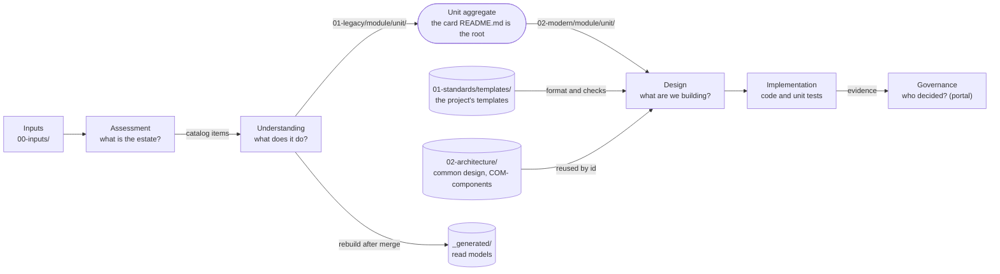

# Document repo contexts

> The document repo, read as bounded contexts around the unit. Decisions: [ADR-0042](../../decisions/0042-markdown-only-document-repo-by-bounded-context.md) (Markdown, contexts), [ADR-0051](../../decisions/0051-document-repo-layout-legacy-and-modern.md) (the numbered layout). Formats: [Document formats](../../reference/document-formats.md).

A project's document repo holds everything except code ([ADR-0028](../../decisions/0028-remove-rulebook-single-document-repo.md)). Its folders are not stages or tools but the **contexts** of the method: each answers one question, owns its documents and its words, and is written by one kind of job. Inside an application the contexts fall into two halves a reader can tell apart at a glance: `01-legacy/` answers "what does the old system do?", `02-modern/` answers "what are we building?". The **unit** is the aggregate that the contexts share, on the same `<module>/<unit>` path in both halves.

## Context map

| Context | Folder | Owns | Written by |
|---|---|---|---|
| Inputs | `10-applications/<app>/00-inputs/` | `INTENT.md`, `graph/`, `telemetry/` | people |
| Assessment | the top of `10-applications/<app>/01-legacy/` | the inventory, the topology, the item **catalog** (`_catalog/`), `assessment.md`, the extraction script (`_tools/`) | the `assess` stage |
| Understanding | `01-legacy/plan.md`, `01-legacy/<module>/<unit>/` | the plan of what to read next; per unit the AS-IS specification, rules, data objects, verdicts, findings, topology, trace and the understanding record | the `plan-understand` and `understand` stages; people for `rules-review.md` |
| Design | `02-architecture/` (with `common/`), `02-modern/requirements.md`, `02-modern/design.md`, `02-modern/_design/<set>/`, `02-modern/<module>/<unit>/<set>/`, `01-standards/templates/` | the common design and its components, the application's requirements and design, each unit's design documents, and the project's templates for them ([ADR-0044](../../decisions/0044-design-phase-common-basic-detail.md), [ADR-0045](../../decisions/0045-design-templates-are-project-data.md)) | the `design` stage for the design sets ([ADR-0049](../../decisions/0049-design-sets-generated-by-the-runtime.md)); member harnesses for the common design; people for the templates |
| Implementation | `02-modern/<module>/<unit>/task.md`, the target repositories | the task pack; the code and its unit tests | member harnesses |
| Governance | the portal (Governance → Gates) | gate decisions, audited; the repo holds no gate records | people |
| Transition | `03-transition/` | coexistence, data migration, data shared across applications | people |
| Read models | `10-applications/<app>/_generated/` | aggregates rebuilt from the units after a merge | the rebuild script, auto-committed |

Contexts talk through the aggregate and the catalog, never through each other's files: the planning stage reads the catalog cards, not the topology.

## The Unit aggregate

A unit is one aggregate in two folders: `10-applications/<app>/01-legacy/<module>/<unit>/` (what is known about it) and `10-applications/<app>/02-modern/<module>/<unit>/` (its card, its design sets, its task pack). The card `README.md` is its root: the state, the source and target, the links and the waived design files, changed through the API (and `waived` by a person). Each context writes into its own folder, so a pull request of one context never touches another's documents.

An **item** is a catalog entry (`<module>/<item>`); it becomes a **unit** (`<app>/<module>/<unit>`) when it is selected for understanding. Item status (`not-analysed`, `running`, `in-pr`, `failed`, `understood`, `stale`, `retired`) is derived, never stored: `understood` is the presence of `understanding.md` in the unit's legacy folder on the default branch, `stale` is a digest that moved.

## Ubiquitous language

| Term | Meaning |
|---|---|
| Application | One legacy system with a repository; `10-applications/<app>/` |
| Legacy half, modern half | `01-legacy/` (the old system as understood) and `02-modern/` (the new system as designed) of an application |
| Module | A domain of the topology; the first segment of an item id |
| Item | A catalog entry, two levels (module → item); what a person selects for analysis |
| Unit | An item once selected; the aggregate with a full id `<app>/<module>/<unit>` |
| Unit card | `02-modern/<module>/<unit>/README.md`: the unit's state, source → target and waivers |
| Leaf | A node of the extracted topology (a program, job, screen) or a data store |
| Catalog | The set of items of an application, with their links; `01-legacy/_catalog/` |
| Understanding record | `understanding.md`: digest, commit and run an item was understood at |
| Plan | `01-legacy/plan.md`: batches of items to understand next, advice replaced by every planning run |
| Rule, finding | Items of the AS-IS knowledge with stable ids (`RULE-<module>.<unit>-<hash>`, `SEC-<module>.<unit>-NN`) |
| Verdict | A person's `confirmed`, `refuted` or `clarify` on a rule, in `rules-review.md` |
| Design set | A group of documents written together for a unit (`screen`, `api`, `batch-job`, `test`, …); defined by the project in `01-standards/templates/<set>/` |
| Common component | Something every unit reuses, designed once by the foundation team: `02-architecture/common/COM-<AREA>-<NN>.md` |
| Design item | A row with an `ID` in a unit's design document; a later set refers to it by id |
| Read model | A document rebuilt from the units; never edited by hand |
| Scratch | The JSON a run passes between its steps; never committed |
