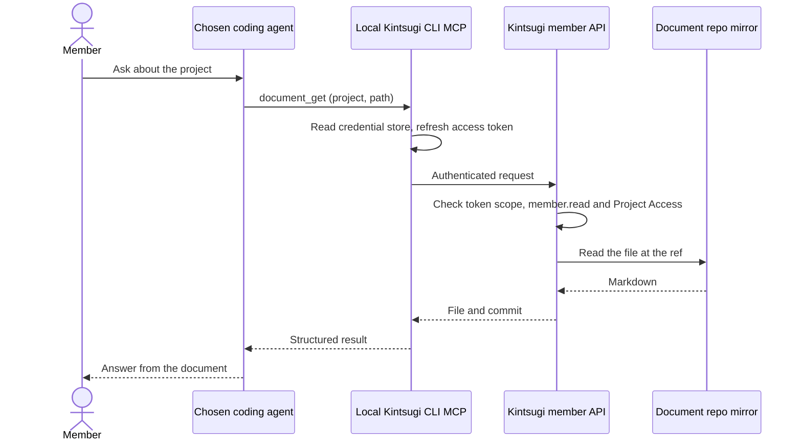

# Runtime and member harnesses

Kintsugi has two agent execution worlds with separate ownership ([ADR-0023](../../decisions/0023-runtime-as-generic-agent-kernel.md), [ADR-0069](../../decisions/0069-common-member-base-and-plugin-distribution.md)).

| | **Kintsugi Runtime (pi)** | **Member harnesses** (Claude Code, GitHub Copilot, ChatGPT/Codex) |
|---|---|---|
| Where it runs | The Kintsugi installation, in the worker, in a per-job workspace | The member's machine; the installed CLI starts a local stdio MCP bridge that calls the HTTPS member API |
| Who drives it | Kintsugi's orchestrator, automatically or from the portal | The member's chosen AI works interactively |
| What it does | Platform intelligence: assess, understand, generate selected design sets, request decisions at the gates | Whatever the installed plugins describe; the common base only signs in and reads projects and documents |
| Writes to project repos | The runtime writes only to job output; the worker commits or opens a PR in the document repo | The member works in normal repos with their own tools |
| Builds a unit | Never: it designs units and reviews the merge request a member opened | Implements and tests the unit in the target repository (`/modernize:build`) and records which unit and which merge request, and what the command used |
| LLM license / cost | Providers configured in Kintsugi | The member's or customer's existing licenses |

## The common member base

The CLI and the MCP bridge are a base that every member plugin shares ([member CLI reference](../../reference/member-cli.md)):

- **Auth.** Project-scoped browser authorization with PKCE: a five-minute access token in memory, a rotating refresh credential in the operating system credential store, an administrator-set maximum connection age and revocation in the portal.
- **Get resource.** `/api/member/v1` returns the projects the connection covers and the project's document repository (tree and file at a branch or commit). The server checks the token's project scope, `member.read` and explicit Project Access on every request.
- **Receive plugins.** The member API serves the member plugins a member may use in a project as text bundles with hashes; the CLI installs them into the client's Kintsugi package, and removes them again.
- **Update information.** One bounded write: a plugin records a short, named fact about its work (`activity_record`). Other writes are added only with a security review.

The bridge runs only when the AI client starts it and has no inbound listener. Plugins plug into it: Kintsugi generates the connector for each kind of harness, and a member plugin carries the flow. Kintsugi decides who may use which plugin (`admin.plugin_access`, per project and member) and observes its use per member (`monitoring.member_activity`, shown in Monitoring → Members); see [ADR-0069](../../decisions/0069-common-member-base-and-plugin-distribution.md). Project plugins from the document repository's `plugins/` are not served yet. The member harness never receives a Kintsugi service credential.

## After the design: members build, the runtime reviews

Once a unit's design is merged, the member implements and tests it on their own machine, in the target repository, with the member command `build` of the `modernize` plugin ([ADR-0071](../../decisions/0071-members-build-runtime-reviews.md)), installed by `kintsugi login`, `init` and `install plugin` as a plugin of its own ([ADR-0072](../../decisions/0072-init-install-and-plugins-as-plugins.md)). The command carries one hook that reports who ran it, with how many tokens and for how long. Kintsugi only collects which unit was built in which merge request and at which commit (`activity_record`, kinds `build.test` and `build.mr`). The portal's Build page then lets a person send that merge request to the runtime: the target repository is mounted read-only at the recorded commit, an independent `code-reviewer` job per unit reads the code and the tests against the unit's rules, design and the project's standards, and the findings are proposed as a document (`_build/review.md`) in a pull request on the document repository. The runtime changes nothing in the merge request and runs none of its code; the member fixes the findings and runs the command again. The proof that a merged unit builds and passes from clean (`verify`) is a later stage.

## Why pi for the runtime

| Runtime need | What pi offers |
|---|---|
| Embeddable, TypeScript | SDK createAgentSession, used by a Node runner inside the job container |
| Kintsugi-specific tools | Extensions via registerTool; skills in the Agent Skills format |
| Control and audit | Tool-call and tool-result hooks |
| Multi-provider, on-prem capable | Anthropic, OpenAI, Azure OpenAI, Bedrock, Vertex and OpenAI-compatible providers |
| Small core | The runtime kernel stays generic; Kintsugi owns orchestration, job isolation and policy |

The runtime remains generic and does not write to code repositories.

Reference: [runtime agents](../../reference/runtime-agents.md).
