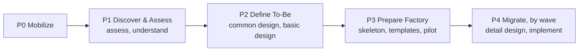
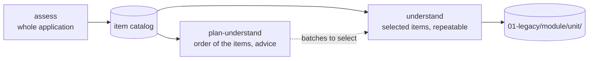
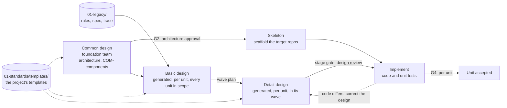

# Delivery pipeline

This page explains the delivery method Kintsugi supports: every application is **rebuilt** on a new architecture from what its legacy system does. How the system implements it is described in the [architecture](../architecture/README.md).

> **Where Kintsugi stands today.** The built-in runtime covers reverse engineering of the as-is system (the `assess`, `understand` and `plan-understand` stages of P1) and the generation of each unit's basic and detail design from the project's own design templates (the `design` stage, [ADR-0049](../decisions/0049-design-sets-generated-by-the-runtime.md)); people review its pull requests. Members carry out the common design, the skeleton and the implementation in their own harness with the `modernize` plugin's commands (`design-architecture`, `scaffold`, `implement`); the runtime stages that plan and review designs (`plan-design`, `design-review`) are planned.

## 1. The big picture

An as-is → to-be migration project combines three layers:

| Layer | Content | What Kintsugi does |
|---|---|---|
| **Factory** | Strategy & mobilization, solution enablement, operation & control, core infrastructure / automation, migration tools, with **governance** across all of them | The module structure of the portal |
| **Lifecycle** | Discover → Requirement / Preparation → Migrate | Workflow engine: phase → stage → task, with quality gates |
| **Workforce** | Humans and AI working together: AI does the first pass, humans review and finish. New AI roles join the RACI (AI champion, AI engineer, prompt engineer, KM lead/engineer, AI practice owner) | RACI-based permissions and human-in-the-loop. The Kintsugi Runtime prepares and reviews; members implement with their own AI harnesses |

The key idea: **invest first in the knowledge base and the project's rules, then run migration at scale** ("design for auto-migration").

## 0. Building the project

Kintsugi is a common engine. Before a project can run the pipeline below, the team **builds** it.
- Everything stack- and project-specific lives in the project's single **document repo** ([ADR-0028](../decisions/0028-remove-rulebook-single-document-repo.md)): unit kinds and pipelines in `kintsugi.yaml`; target conventions, mappings and review rules as plain documents in `01-standards/`; member plugins in `plugins/`.
- Standards have no maturity: one applies once it is merged.

| Build step | Runs during | Done when |
|---|---|---|
| **Bootstrap**: create or join the document repo, register the AS-IS (`legacy`, `legacy-data`) and TO-BE (`target`) repos, choose or declare pipelines | P0 | Gate G0 |
| **Standards**: write `01-standards/` and `plugins/` | P1–P2 | The standards the pilots need are merged |
| **Pilot**: run 1–2 pilot units per unit kind and fix the standards | P3 | Gate G3 |
| **Evolve**: feed lessons learned back as PRs to `01-standards/` and `plugins/` | P4 | Continuous |

Details: [document repository](../reference/document-repo.md) · how-to: [build a project](../guides/build-project.md).

## 2. Standard pipeline (P0 → P4)

One pipeline takes an application from understanding the as-is system to its rebuilt replacement.

### P0 — Mobilize
- **Activities**:
  - set up the program/project, team and RACI;
  - choose the SDLC template;
  - define the AI strategy (scope, tools, KPIs);
  - choose the allowed harnesses and models;
  - **bootstrap the project build**: document repo, legacy and target repos registered.
- **Inputs**: statement of work, system list, customer constraints (security, data residency), scaffolded target base (or the plan to build it).
- **Outputs**: project charter, RACI, AI strategy for engineering, KPI baseline, document repo with `kintsugi.yaml` and starter `01-standards/`.
- **Gate G0**: AI usage policy and tool list approved; document repo and repos declared.

### P1 — Discover & Assess
- **Activities**:
  - Inventory of the environment (apps, infrastructure, dependencies, databases) and of the migration units: drafted by agents from repos and documents, confirmed by people.
  - AS-IS ingestion into the **AS-IS knowledge base**: source code, documents (xlsx/docx → md), knowledge-transfer recordings (transcribed), DB schemas.
  - Generate requirements from KT recordings and the running application. Detect the **gap list** between docs, code and app.
  - Score the **transformation scorecard** (business value, technical value, feasibility, cost, risk; weighted) to get a priority.
  - Group applications by what they share (stack, domain, dependencies) and build the **wave plan**.
- **Outputs**: inventory, AS-IS KB, AS-IS docs, gap list, scorecard, wave plan.
- **Gate G1**: the order in which applications are rebuilt (the wave plan) approved by the steering committee.

#### Reverse engineering the AS-IS system (runtime stages)
The current built-in runtime plans perform application assessment in two stages, each delivered as a pull request to the document repo that a person reviews and merges ([ADR-0027](../decisions/0027-builtin-modernization-content.md), [ADR-0031](../decisions/0031-understand-stage-as-is-specification.md), [ADR-0033](../decisions/0033-assess-catalog-understand-selection.md)):

The previous `map`, `extract-rules` and `harden` activities are not independent built-in plan stages now; their topology, rule-extraction and security-review work is performed within `assess` and `understand`.

| Stage | Answers | Main outputs |
|---|---|---|
| `assess` | What is there, how big, how risky, and which pieces does it consist of? | `10-applications/<app>/01-legacy/inventory.md`, `topology.md`, the catalog (`_catalog/index.md` and a document per module), `assessment.md`, `architecture.mmd`, and `_tools/extract_topology.py` (the per-file inventory, the raw topology and the catalog drafts are scratch of the run and never committed) |
| `understand` | For each selected catalog item (unit): how does it connect, which rules does it enforce, which risks does it carry, and what does it do end to end? | Per unit, under `10-applications/<app>/01-legacy/<module>/<unit>/`: `{topology,rules,data-objects,findings,spec,trace,understanding}.md`, and its card `10-applications/<app>/02-modern/<module>/<unit>/README.md` |

**The catalog is the menu.** `assess` groups source files into catalog items from extracted topology (module → item, without code parsing), lets a `legacy-analyst` job curate the grouping, and reconciles ids across re-assessments. A catalog entry id is `<module>/<unit>`; its full unit id is `<app>/<module>/<unit>`. Item status is derived by the API, not stored. See the [item catalog reference](../reference/document-repo-item-catalog.md) for the status values and reconciliation rules.

**Which items first.** A third runtime stage, `plan-understand` ([ADR-0041](../decisions/0041-ai-plan-for-understanding-order.md)), proposes the order: a script builds the item graph (who calls whom, shared data stores, cycles) from the catalog, an agent groups the open items into batches with a reason each, and a script checks and measures the batches. The plan is advice committed to `10-applications/<app>/01-legacy/plan.md`; the portal shows it above the catalog and selects a batch in one click.

**`understand` runs on a selection.** A person selects catalog items or whole modules; the run maps the selected units, extracts their rules, reviews their security, writes one AS-IS specification per unit and proposes unit state, all in one pull request. Several selections can be in flight at once: each run writes only its selected units' paths, and a unit that is running or in an open pull request cannot be selected again until the pull request is merged or abandoned. A failed run can be retried from where it stopped. After a merge, `rebuild_aggregates.py` regenerates the whole-application files under `10-applications/<app>/_generated/`; the exact filenames are in the [document repository layout](../reference/document-repo.md). These aggregates are separate from the unit files in the run's pull request.

The security review is part of `understand`. Runtime jobs do not run a scanner; the reviewer uses the assessment and topology, and the per-unit findings record cited source files and the limits of the review. `SECURITY_FINDINGS.md` is the rebuilt application-wide view of those findings.

### P2 — Define To-Be

The design phases in one view. The runtime generates the basic and the detail design of each unit from the project's own templates ([design templates](../reference/design-templates.md)) and people review the pull request; the foundation team writes the common design, members the skeleton and the code.

- **Activities**:
  - TO-BE requirements;
  - **common design** by the foundation team: the target architecture (business / application / data / technology) and the **common components** every unit reuses (authentication, logging, error handling, transactions, batch framework, data access), each with a stable id (`COM-…`);
  - co-existence options (data continuity layer, strangler, monolith → macro → mini → micro-services);
  - cost-benefit;
  - POC plan;
  - prototype or first working version;
  - **basic design of every unit in scope**, generated by a portal run from the project's own template (what the unit is: functions, inputs and outputs, data, how each business rule is handled) and reviewed in its pull request. It is needed before the waves are planned, because scope and estimates rest on it.
- **Outputs**: target architecture blueprint, the common components, ADRs, co-existence strategy, data migration strategy, POC plan, initial TO-BE KB, the basic design of each unit, **standards drafted** in the document repo (target and UI conventions, mappings, review rules, the **design templates** in `01-standards/templates/`).
- **Gate G2**: approved by the **Architecture Review Board**.

### P3 — Prepare Factory
- **Activities**:
  - base source / skeleton, landing zone and IaC, CI/CD;
  - deliverable creation guidelines;
  - **agent plugins (skills, agents, hooks), prompt libraries and task-pack templates** for members' harnesses, per type of work (reverse design, design generation, code generation, unit-test generation, test-case generation, data migration);
  - configure the runtime agents (task-planner) and their eval sets;
  - run pilot units, each through basic design, detail design and code, and fix the standards and the design templates where they were unclear or wrong.
- **Outputs**: runnable base source, CI/CD pipeline, piloted agent plugins and task-pack templates, piloted design templates, configured runtime agents, complete TO-BE KB.
- **Gate G3**: a pilot of 1–2 units per unit kind meets quality, and the architect confirms the target repos are scaffolded and the standards are written (a human decision; there is no automatic readiness check).

### P4 — Migrate (by wave / feature)
- **Activities**: per unit, in its wave, **detail design** (how the unit is built, from the project's template, precise enough to generate the code from; generated by a portal run and reviewed), design review, implementation with unit tests on the target architecture, code review; data migration; design ↔ code sync (when the code has to differ, the design is corrected in the same pull request); fixing static-check and runtime errors.
- **How the work is done**:
  1. Members work in their own AI harness, following the **task pack** produced by the runtime.
  2. Each unit runs the stages `detail-design` (the runtime `design` stage, run from the portal) → `design-review` → `implement` → `unit-test` → `code-review`; the review points between them are stage gates (`stage:<id>`), and a pipeline may name the design set a stage produces (`produces:`).
  4. A human approves.
- **Outputs**: new source code and unit tests, detail designs, migration scripts, PRs.
- **Gate G4** (per unit): green build, static checks, AI code review, human PR approval.

## 3. Cross-cutting concerns

| Area | Content | In Kintsugi |
|---|---|---|
| **Governance** | Organization alignment, program management, portfolio management, change & release, risk & benefit, upskilling, data curation, cloud financial management, architecture review board | Governance pillar: gates, policies, risk register, audit |
| **Knowledge** | AS-IS KB, TO-BE KB (vector + graph), chatbot, MCP access | Knowledge Hub shared by every phase and every harness |
| **AI metrics** | Coverage, active rate, SDLC coverage, time saved, cost reduction, outcome ratio, AI vs. human defect rate | See [AI metrics](ai-metrics.md) |
| **Workforce / RACI** | PM, core team, dev, QC, BA, AI practice owner, AI champion, AI engineer / prompt engineer, KM lead / engineer | Project roles named in pipelines (open set, ADR-0024); every task has R/A/C/I |

## 4. Pipeline definitions

Not every application needs every stage of P0–P4 the same way.
- Each application follows a **pipeline definition**: the one Kintsugi ships for a rebuild, or one declared under `pipelines:` in `kintsugi.yaml`. It lists phases, stages, performers and gates.
- A project that needs a different shape declares its own: add custom phases (mapped to a built-in category for reporting) or remove stages.
- A stage may name the **design set** it produces (`produces: detail`), and the design sets are the project's own: how many there are, which documents they hold and what each must contain is defined in `01-standards/templates/` ([design templates](../reference/design-templates.md)). The design levels above are the starter's, not the engine's.

### Scorecard → rebuild priority
The scorecard combines five criteria groups: business, technical, feasibility, cost and risk. Each criterion is scored 1–10 and weighted; the weights sum to 1 (`ScorecardCriterion` in [`packages/domain`](../../packages/domain/src/index.ts)).

The weighted total maps to a priority for the wave plan:

| Total | Priority |
|---|---|
| ≥ 7 | Low |
| 4–7 | Medium |
| < 4 | High |

## 5. Implications for Kintsugi

1. **The pipeline is a configurable template** (a project may declare its own), not hard-coded.
2. **A unit** is a feature, screen, module or data object moving through stages, and has its own design documents (`02-modern/<module>/<unit>/<set>/`). Each unit has a card in the document repo (`02-modern/<module>/<unit>/README.md`) whose frontmatter holds its state (ADR-0012, ADR-0051). Each stage is performed by a member (with an AI harness), a runtime agent (preparation / review) or a tool.
3. **The knowledge base is first-class.** Runtime agents and members' harnesses both read it, and merged results flow back into it (continuous TO-BE KB enrichment).
4. **Project knowledge is built, versioned and verified**: standards are written per project in the document repo, changed by PR, and only deliberately copied to other projects.
5. **AI metrics are measured from day one.**
6. **Separate the "brain" from the "hands".** Platform intelligence runs on the Kintsugi Runtime; implementation stays in the harnesses members already use.
7. **Every output is a file in Git**, referenced as `repo@commit:path` ([ADR-0007](../decisions/0007-git-as-source-of-truth.md)).
