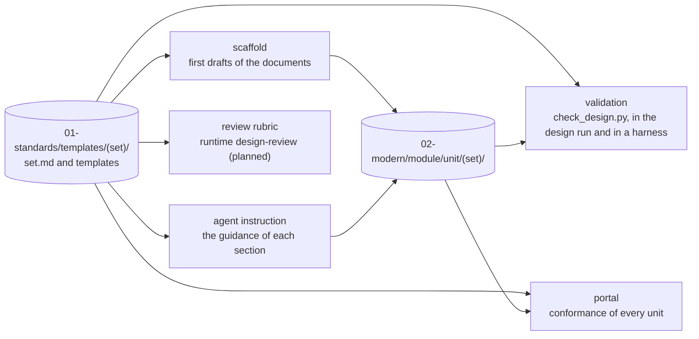

# Design templates

> What a project writes in `01-standards/templates/` so that every unit's design documents have the format and the content the project requires. Decisions: [ADR-0044](../decisions/0044-design-phase-common-basic-detail.md), [ADR-0045](../decisions/0045-design-templates-are-project-data.md). How to define your own: [guide](../guides/define-design-templates.md).

The design phase has levels (common design, basic design, detail design, then implementation). What each level contains differs from project to project, so Kintsugi does not fix it: the project defines **design sets** as Markdown in its document repo, and one definition does five jobs: it scaffolds the documents, instructs the designer agent of the portal's design run (ADR-0049), validates the result, is the rubric of the review, and drives the portal's conformance view.



## Where things live

| Path | Content |
|---|---|
| `01-standards/templates/<set>/set.md` | the set: identity, scope and the documents it holds |
| `01-standards/templates/<set>/<template>.md` | one template per document of the set |
| `02-architecture/common/<COM-id>.md` | the common components every unit reuses (the foundation team's design) |
| `10-applications/<app>/02-modern/<module>/<unit>/<set>/<path>` | the unit's design documents, one folder per set of scope `unit` |
| `10-applications/<app>/02-modern/_design/<set>/<path>` | the application's own design documents, one folder per set of scope `application` ([ADR-0050](../decisions/0050-design-sets-scope-and-instructions.md)) |
| `10-applications/<app>/02-modern/<module>/<unit>/README.md` | `waived`: files the unit does not need, with a reason |

## `set.md`

Front matter (scalars and short lists, as every document of the repo):

| Field | Meaning |
|---|---|
| `id` | the set's name and its folder name: lowercase letters, digits and hyphens, starting with a letter |
| `title` | the name people read |
| `version` | a positive integer, raised on a change that affects the designs already written |
| `scope` | `unit` (the default): a design per unit; `application`: one design for the whole application |
| `appliesTo` | unit kinds (from `unitKinds` in `kintsugi.yaml`) the set is for; `[]` means every kind; always `[]` for a set of the application |
| `needs` | sets that must be written first; a set cannot need itself, directly or through others; a set of the application may need only sets of the application |
| `stage` | the pipeline stage that produces the set (optional) |
| `reads` | documents the designer also reads when it generates the set: relative paths or folders of the document repo, `{app}` allowed, no `..` (optional) |

The body holds the documents of the set as a table, then a description for people:

| Column | Meaning |
|---|---|
| `Path` | the document, relative to the unit's `<set>/` folder (`10-applications/<app>/02-modern/<module>/<unit>/<set>/`): a relative `.md` path, no `..` |
| `Template` | a file in the set's folder |
| `Required` | `yes` or `no` |
| `When` | unit kinds that need the file (comma separated); empty means every kind the set applies to |

A section `## Instructions` in the body is addressed to the designer: how this kind of design is written, what to look at first. It is not part of the description people read.

A pipeline stage names the set it writes with `produces: <set>` ([manifest](document-repo-manifest.md)).

### A set of the application

With `scope: application` the set is written once for the application and generated from the portal for the application itself (`@app` where a unit goes). The set is reported as faulty when: `appliesTo` or a `When` is not empty; it needs a set of units; a template uses `{{unit.id}}`, `{{unit.title}}` or `{{kind}}`, `seed: rules`, `covers-rules` or `refs-resolve(… -> rules)` (rules are per unit). A set of units may need a set of the application, and the design items of the application's documents resolve for it.

## A template

A template is a Markdown file. Under a heading, an HTML comment (not shown when rendered) holds that section's contract, one directive per line. A heading without a directive block is only structure.

```markdown
## Business rule coverage
<!--
required
table: Rule | Function | Notes
seed: rules
check: covers-rules(Rule)
check: no-placeholder
guidance: Every business rule of the unit appears once; name the function that handles it.
-->
```

| Directive | Meaning |
|---|---|
| `required` | the section must be present and not empty |
| `table: A \| B` | the section is a table with exactly these columns (names are compared without case) |
| `seed: rules` | the scaffold fills the section's table from the unit's rules (see below) |
| `check: name(args)` | a check, repeatable |
| `guidance: text` | what to write; read by people, and the agent's instruction |

The heading text identifies the section; a design's heading matches it without case, at any level. Variables the scaffold fills in anywhere in a template: `{{unit.id}}`, `{{unit.title}}`, `{{app.id}}`, `{{kind}}`, `{{set.id}}`, `{{set.version}}`.

### Checks

A closed vocabulary: a project chooses and parameterises checks, it cannot add code. A check that needs a column is skipped while the table or the column is missing (that fault is reported once, by the table).

| Check | Passes when |
|---|---|
| `no-placeholder` | the section holds no `TODO` or `TBD` |
| `covers-rules(Column)` | every business rule of the unit (from its `rules.md` in `01-legacy/<module>/<unit>/`) appears in the column (ids separated by space, comma or semicolon) |
| `refs-resolve(Column -> source)` | every id in the column exists. `source` is `rules`, `requirements` (the `REQ-` sections of `02-modern/requirements.md`), `components` (the `COM-` files of `02-architecture/common/`), or the id of a set this one needs, whose **design items** are the cells of any `ID` column in the unit's documents of that set. `-`, `n/a`, `TODO` and `TBD` are skipped |
| `id-pattern(Column, pattern)` | every non-empty cell matches the whole pattern; use a basic regular expression, which means the same in JavaScript and Python |
| `max-length(n)` | the section's text, without comments, has at most `n` characters |
| `one-of(Column, a\|b\|c)` | every non-empty cell is one of the options, without case |

## What the scaffold writes

`scaffold_design.py` creates each required document the set lists for the unit's kind (`--all` adds the optional ones, `--file` writes one). The front matter names the template and the unit (`template: "detail@2"`); the template is copied with its variables filled; each directive block is replaced by what the author writes: a table section by its header (and, when it is `required`, a `TODO` row, or one row per rule when it is seeded), a `required` section without a table by `TODO`. Text under a section's heading in the template is not carried over: guidance lives in the directive. A file that exists is never overwritten.

A seeded table gets one row per rule of the unit, the rule id in the column that `covers-rules` names (else the first), `TODO` in the others.

## Conformance

A document **conforms** when it has none of these faults. `check_design.py` and the API report them with the same wording.

| Code | Message |
|---|---|
| `missing-template-ref` | `front matter has no template reference (template: <set>@<version>)` |
| `wrong-template-ref` | `template reference "<ref>" does not name this set (expected <set>@<version>)` |
| `missing-section` | `missing section "<heading>"` (a `required` section) |
| `empty-section` | `section is empty` |
| `missing-table` | `no table; expected columns: A \| B` |
| `table-columns` | `columns "X \| Y" do not match "A \| B"` |
| `placeholder` | `unfinished text left: TODO` |
| `uncovered-rules` | `rules without a design item: R-1, R-2` |
| `unresolved-reference` | `references that do not resolve to <source>: …` |
| `id-pattern` | `values that do not match <pattern>: …` |
| `too-long` | `section has <n> characters; the limit is <limit>` |
| `not-allowed` | `values not among a\|b\|c: …` |

Lists show the first ten values and `and N more`.

A unit's document has one of these states:

| State | Meaning |
|---|---|
| `conformant` | present, no fault |
| `problems` | present, with faults |
| `stale` | written against an older version of its set (`template: <set>@<n>` with `n` below the set's `version`); derived when read, never stored. A stale design is also conformant or has problems |
| `missing` | a required file not written yet |
| `waived` | the unit's `waived` list names it with a reason |
| `not-applicable` | the set does not apply to the unit's kind |

A waiver is an entry `<set>/<file>: <reason>` in the `waived` list in the front matter of the unit's card (`02-modern/<module>/<unit>/README.md`), written by a person. An agent never writes one.

## Checking the sets themselves

`validate_design_templates.py` checks every set and lists each fault as `<path>: <message>`:

- `set.md`: front matter present; `id` valid and equal to its folder; `title`; `version` a positive integer; `appliesTo` and `needs` lists; `needs` names existing sets and makes no cycle; kinds in `appliesTo` and `When` are declared in `unitKinds` (and `When` is within `appliesTo`); a files table with valid, unique paths and `Required` of `yes` or `no`; every `Template` exists.
- A template: only known directives; each check known, with its parameters; a column named in a check is in the section's table; `seed` has a table; `id-pattern` compiles; `refs-resolve` names `rules`, `requirements`, `components` or a set in `needs`; no heading is listed twice; only the variables above are used.

## Tools

| Tool | Where | What |
|---|---|---|
| `scaffold_design.py <app> <module/unit> <set>` | `modernize` plugin | writes the first drafts |
| `check_design.py <app> <module/unit> [--set SET] [--json]` | `modernize` plugin | checks a unit's documents; exit 1 when a required file is missing or a document has faults |
| `validate_design_templates.py` | `modernize` plugin | checks the sets |
| `hooks/reader/design.ts` | `@kintsugi/agents/reader` | the same parser and checks, run by the API |

The two implementations are held to the shared fixtures in `packages/agents/builtin/plugins/design/scripts/tests/fixtures/design/` by both test suites.
