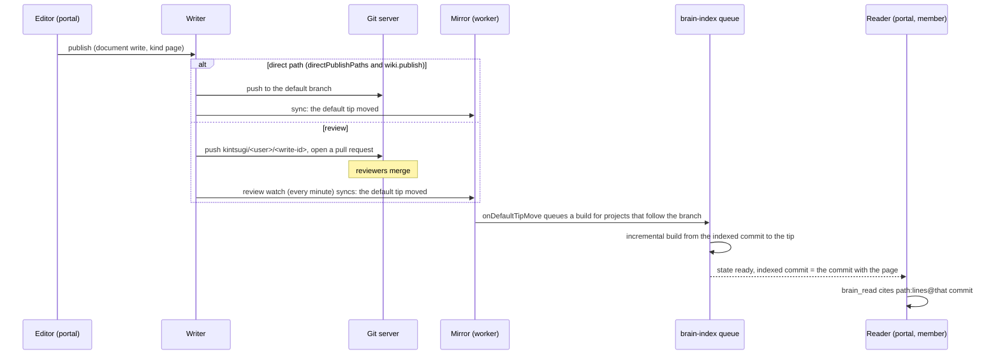

# Brain integration of the wiki

> Research, not a decision. Proposed in [ADR-0097](../../../decisions/0097-brain-indexes-wiki-pages.md). Builds on the [data model](data-model.md) ([ADR-0096](../../../decisions/0096-wiki-pages-in-the-document-repo.md)) and on the Brain as it is at `master` `07c2685c`: [ADR-0091](../../../decisions/0091-brain-vectorless-tree-index.md), the [Brain reference](../../../reference/brain.md), `packages/domain/src/brain.ts` (builder version 5), `services/orchestrator/src/brain/` and migrations `043_brain.sql`, `044_brain_changes.sql`, `049_brain_link_totals.sql`.

## Summary

A wiki page is a Markdown document of the document repo, so the Brain already indexes it: a space is a folder, a page is a document, its headings are sections, its id is a reference id, its links are `brain_link` rows. The wiki does not get a second index. The Brain grows in five places:

1. **Page attributes on nodes**: labels, status, owner, sibling order, template flag, space key and attachments, read from front matter and stored as columns, so the tree, the wiki and the tools can filter and sort by them.
2. **Incremental builds**: a page publish moves the branch far more often than stage outputs do; a build reads only what changed since the indexed commit and keeps the whole build as the fallback.
3. **A full-text index** built in the same transaction from the same commit, for people's search and as a shortcut tool, never as the primary path for agents. This amends ADR-0091's rejection of full-text ranking as the primary path, without reversing it.
4. **Archived pages and templates** are flagged and left out of the default tree, grep and search.
5. **Tools**: five tools keep their contract with added fields; one new Brain tool (`brain_search`); one comment tool outside the Brain.

Node kinds, node ids, the citation `path:lines@commit`, the one-branch rule and "no model, no embedding" stay as ADR-0091 decided them.

## What the Brain indexes for the wiki

| Wiki object | Brain node | Attributes (new in bold) | Summary source |
|---|---|---|---|
| Repository | `root` `/` | | `children` |
| System space (`00-project/`, an application) | `folder` | **`space`** (when the folder's README declares one) | `readme`, `layout` |
| Free space `20-spaces/<space>/` | `folder` | **`space`** | `readme` (the home page) |
| Page with children `…/runbooks/` + `README.md` | `folder` and its first `document` | the README's attributes are also the folder's: **`labels`, `status`, `owner`**; its **`order`** list sorts the folder's entries | `readme` |
| Page `…/deploy.md` | `document` | `ids` (the page id), `changed`, **`labels`, `status`, `owner`, `template`, `attachments`** | `front-matter` (`summary`), else the existing chain |
| Heading in a page | `section` | | existing chain |
| Heading that starts with an id | `card` | `ids` | existing chain |
| Macro block (`kintsugi-children`, `kintsugi-toc` …) | none: text of the enclosing node | | skipped by summaries, like a code block |
| Panel (`> [!NOTE]`) | none: text of the enclosing node | | the alert marker is dropped from the summary text |
| Attachment `_attachments/x.png` | none: an attachment reference on the page node | name, media type, bytes, alt text | |
| Draft, pending pull request | not indexed | | |
| Comment, mention, watch, reaction, view | not indexed (Postgres) | | |
| `restricted/`, `scratch/`, `plugins/`, hidden folders, ledgers | not indexed (unchanged) | | |

### Why no `space` or `page` node kind

New kinds would change the member tools' contract (`kind` is part of every tree and read result, and agents are told what each kind means) for no gain: every document is a page, and a space is a folder with one more attribute. Clients that do not know the new attributes ignore them. The kind list stays `root`, `folder`, `document`, `section`, `card`.

### Sibling order

Today folders come first, then documents (`README.md` or `index.md` first), each in name order. With wiki pages, the folder's `README.md` may carry `order:`, a list of entry names in the folder (decided in the board thread on authoring follow-ups, so a reorder changes one file):

1. `README.md` / `index.md` first, as today (it is the parent page itself);
2. then the entries the list names, **folders and documents together**, in list order;
3. then the entries it does not name, in today's order (folders, then documents, by name); names that match nothing are ignored.

The third rule keeps the order of every existing repository unchanged, since no README has `order:` today. Mixing folders and documents among listed entries is what lets a page with children sit between two leaf pages, as in a Confluence page tree, where `position` orders a page among its siblings.

### Summaries

The summary chain of the [reference](../../../reference/brain.md#where-summaries-come-from) applies unchanged, with four additions:

| Addition | Effect |
|---|---|
| A fenced block whose info string starts with `kintsugi-` is skipped when looking for the first paragraph, like a code block | A page that opens with a table-of-contents macro is summarised by its first paragraph, not by the macro's parameters |
| A blockquote that starts with `[!NOTE]`, `[!TIP]`, `[!IMPORTANT]`, `[!WARNING]` or `[!CAUTION]` is read without the marker | An opening warning panel summarises as its text |
| `archived` joins the status words that start a summary (`superseded`, `deprecated` …) | A reader of the tree sees that the page no longer holds |
| A document with front matter `type: template` starts its summary with `Template.` | A template is not mistaken for a page |

Pages written for the tree (a `summary` in front matter, a first paragraph that says what the page is for, headings every screen or so) make the Brain better. The page templates of `01-standards/page-templates/` should model that; this is the "agent-friendly pages" follow-up named in ADR-0091's consequences.

### Links and backlinks

Links come from Markdown links and id mentions as today, so the wiki's "incoming links" panel and "page references" are `brain_link` read by `to_id`. Three additions:

- **Page id mentions** (`PAGE-ONB-0007` in text) already become `id` links because the id is defined by the page's front matter: nothing to change.
- **Links to attachments** (``, `[spec](_attachments/spec.pdf)`) are kept as attachment references of the node (below), not as links, since the target is not a node.
- **`@username` mentions** are not links and are not indexed: who is mentioned is collaboration state ([data model](data-model.md#postgres-tables)).

The move dialog of the wiki uses the incoming links of the moved node at the indexed commit to know which pages to rewrite, then confirms by scanning the mirror at the branch tip, because the index can lag behind the tip ([data model](data-model.md#links-moves-and-renames)).

### Attachments

The build lists the tree of the commit already (`listDocuments` in `services/orchestrator/src/brain/indexer.ts` reads names, blobs and sizes). It also keeps the files under `_attachments/` folders that an indexed page links to: path, media type (from the extension allowlist), size in bytes and the link's alt text or title. A read of the page returns them, so an agent knows that `deploy.md` has a sequence diagram as a PNG and can tell the member where it is, without the Brain reading bytes. Attachments nothing links to are not recorded. No image is described by a model.

## When a page appears in the Brain

| Publish | In the Brain after | Citation commit |
|---|---|---|
| Direct commit to the default branch | The writer's own sync moves the tip, which queues the build (`onDefaultTipMove`, `services/orchestrator/src/worker.ts:257`); seconds for an incremental build | The publish commit, or a later one if the branch moved again before the build |
| Pull request | The merge, seen by the review watch within a minute, then the build | The merge commit (or the squashed commit) on the default branch |
| A member's own pull request | The merge, seen by the next sync (the poll interval) or the minute check | The merge commit |
| Draft | Never | — |

This holds only when the Brain follows the **default branch**, which is where wiki pages are published. ADR-0097 makes it a rule: turning the wiki on for a project turns the Brain on for the default branch, and a manager cannot point the Brain of a wiki project at another branch. The portal's page view reads the text at the branch tip from the documents read path; when the Brain's indexed commit is behind the tip, the wiki shows "index updating" next to the tree and search, so a reader knows search may miss the newest edit.

## Incremental builds

ADR-0091 said incremental builds were possible later without changing the contract. Wiki publishing is that later: the branch moves on every direct publish and merge, and a whole build reads every Markdown blob of the commit (up to 20,000 documents).

**When.** A build is incremental when the stored tree was built by the same builder version, the indexed commit is an ancestor of the tip, and the diff between them touches at most 2,000 indexed files or a fifth of them. Otherwise, and on every Rebuild, the build is whole, as today.

**What it reads.** `git diff --name-status -M` from the indexed commit to the tip, restricted to indexed paths (and to `_attachments/` files), the blobs of the added, modified and renamed documents, and the history walk for those documents' `changed` only.

**What it changes, in one transaction** (the same guarantee as today: readers see either the old or the new commit, never a mix):

1. Delete the nodes, links and text-index rows of deleted, renamed-away and modified documents; insert the rebuilt ones from the same `buildBrainDocument` as a whole build.
2. Recompute the folders on the paths from each changed document up to the root: `children`, `ordinal`, ranges and tokens of the subtree, `changed`, and the summaries that depend on children (`children`, `layout`, `readme` when the README changed).
3. Re-resolve links. A link from an unchanged page to a page that was just added was dropped by the earlier build (its target did not exist), and a link to a page that was deleted must go. So the build keeps every page's **raw references**, resolved or not, in a new table `knowledge.brain_ref` (from node, target path and anchor, or id). Resolution becomes a join of `brain_ref` with `brain_node`, re-run for the references whose target path or id is among the changed ones, with the 50-link cap applied after it as today.
4. Update `knowledge.brain_source`: indexed commit, counts, `build_mode` (`full`, `incremental`) and the number of documents read.

**Proof that it is right.** A whole build and an incremental build of the same commit must give identical rows. The builder test suite gains that property test over random sequences of add, modify, rename and delete; the worker can also run a whole build after every N incremental ones (default 50) and record a mismatch as a build failure. Neither changes a read.

**Cost.** A publish of one page reads one blob, rebuilds one document's nodes and a handful of folders, and re-resolves the references to that page: milliseconds of work and a few hundred rows written, against seconds and the whole repository for a whole build. Storage grows by `brain_ref` (one row per reference, unresolved included: at most about 1.2 times `brain_link`).

## Full-text search

Decided in the discovery thread: people searching the wiki expect ranked results across all pages, and `brain_grep` (every word on one line, at most 50 lines) is not that. The Brain therefore keeps a full-text index next to the tree:

| Item | Proposal |
|---|---|
| Table | `knowledge.brain_text (project_id, node_id, document tsvector)`, GIN index; one row per `document`, `section` and `card`, for the node's own text (not its subtree), so a hit names the deepest node |
| Weights | Title A, the node's headings and its labels B, body C (`setweight`) |
| Text configuration | `simple` by default (no stemming, any language); an installation setting may choose a Postgres language configuration |
| Build | In the same build and transaction, from the same blobs, rebuilt incrementally like the nodes; no text is stored, only lexemes and positions, so the text stays in Git as ADR-0091 item 4 requires |
| Query | `websearch_to_tsquery`, ranked by `ts_rank_cd`; archived pages and templates left out unless asked for; optional filters `under` (a node), `labels`, `space` |
| Result | Up to 20 nodes per page with breadcrumb, summary and the first matching line, found by reading the node's lines from the mirror at the indexed commit; each with its citation `path:lines@commit` |
| Size | A `tsvector` is smaller than its text; for a document repo of a few thousand pages it is a few to tens of megabytes |

**What it is not.** It does not replace tree navigation for agents. The MCP instructions keep the order of ADR-0091 (tree, summaries, read, cite) and present `brain_search` as a shortcut for words no summary shows, next to `brain_grep`; a hit is a node in the tree that the agent then reads and cites like any other. Nothing is embedded and no model is called. ADR-0091 rejected full-text ranking *as the primary path* because a ranked list hides why a passage was chosen; that stays true and is why every hit comes back as a node with its place in the tree.

## Access

The collaboration thread decided that **viewing has one boundary, Project Access to the whole repository**, and that no view restriction is offered on Git content ([data model](data-model.md#access)). For the Brain this means:

- The tree is **not filtered per reader**. Nothing that a project member may not read is in Git, so nothing can leak through tree summaries, grep hits, links, search hits or `brain_changes`. This is the simplest and the only leak-free option.
- `restricted/` stays out at any depth (`isBrainIndexedPath`, `packages/domain/src/brain.ts:127`), as do `scratch/`, `plugins/`, hidden folders and identifier ledgers. A page moved into `restricted/` shows as `deleted` in `brain_changes`, as today.
- Restricted pages of a later phase (encrypted Postgres records) are never in Git and never in the Brain; they would be read only through their own audited route.
- The portal's Brain routes check Project Access, like the member routes (`member.read` with Project Access); the portal document routes that need only a session are a gap to close before the wiki ships (see the data model's open points).

## Comments and other Postgres data

Comments, mentions, watches, reactions, favourites and view counts live in Postgres ([data model](data-model.md#postgres-tables)) and are **not** part of the tree:

- They are conversation, not reviewed text. A decision taken in a comment thread belongs in the page, through a publish, before an agent should rely on it.
- They have no commit, so they cannot be cited as `path:lines@commit`, and they change without the branch moving, so they would break the rule that a tree is the state of one commit.
- Mixing them into `brain_read` would make a page read return text that is not in the page.

Agents that need the discussion of a page call `wiki_comments` (below) with the page's node id or page id. It returns the threads with their status, authors, dates and, for an inline comment, its quote and the node it anchors to, so the agent can relate a comment to a passage it read. A comment is cited by its id and the commit its anchor was made on, never as page lines. Open comment counts may be shown next to a page in the portal by a join at read time; they are never written into `brain_node`.

## Tools and tables

### Member tools and routes

| Tool (member route, portal route) | Status | Change |
|---|---|---|
| `brain_tree` | Extended | Children carry `labels`, `status`, `owner`, `space`, `template`; new sibling order; archived pages and templates left out unless `includeArchived=true` (the count of what was left out is returned) |
| `brain_read` | Extended | The node carries the same attributes and its `attachments`; `linksOffset` pages through links beyond the first 20 each way (the backlinks panel) |
| `brain_lookup` | Extended | Also takes `label:<name>` (the nodes with that label, paged) and `space:<key>` (the space's folder); a page id already works, as any reference id |
| `brain_grep` | Extended | Archived pages and templates left out unless `includeArchived=true`; otherwise unchanged |
| `brain_changes` | Unchanged | A page publish is a change like any other; it already reports renames |
| `brain_search` | **New** | `GET /api/member/v1/brain/search?projectId&query&under&labels&offset`, portal `GET …/brain/search`: ranked full-text hits as nodes with breadcrumbs, the first matching line and the citation |
| `wiki_comments` | **New, outside the Brain** | `GET /api/member/v1/wiki/comments?projectId&page&status`: the comment threads of one page, with each inline comment's quote and its node, never mixed into `brain_read`; recorded as member activity `wiki.comments.read`; defined with the collaboration proposal (ADR-0099) |

Each read stays recorded as member activity (`brain.read` today); `brain_search` adds `brain.search` with the query's length and hit count, not its text.

### Tables

| Table | Status | Change |
|---|---|---|
| `knowledge.brain_source` | Extended | `build_mode` (`full`, `incremental`), `documents_read`, `full_after` (incremental builds left before the next whole one) |
| `knowledge.brain_node` | Extended | `labels text[]` (GIN), `status text`, `owner text`, `space text`, `template boolean`, `attachments jsonb` (name, type, bytes, alt; at most 50 per node) |
| `knowledge.brain_link` | Unchanged | Now derived from `brain_ref` |
| `knowledge.brain_ref` | **New** | `(project_id, from_id, kind, target_path, target_anchor, target_id)`: every reference of a node, resolved or not, for incremental resolution |
| `knowledge.brain_text` | **New** | `(project_id, node_id, document tsvector)`, GIN: the full-text index |

`BRAIN_BUILDER_VERSION` goes from 5 to 6, so the minute check rebuilds every existing index once with the new columns, as it does for every builder change today.

### Portal

- The **Brain page** stays the index's page (state, branch, build, tree, read, lookup, grep) and gains search and the attribute columns.
- The **wiki** uses the same reads: its page tree is `brain_tree`, its search box is `brain_search` (with `brain_lookup` for ids and paths), its label pages are `brain_lookup label:`, its "incoming links" panel is `brain_read` links. The page body is read at the branch tip from the documents read path, so a just-published page shows at once even while the index catches up. When the Brain is not `ready`, the wiki falls back to the documents tree (`GET …/documents/tree`) with file names as titles and no search.

## What stays as ADR-0091 decided

| ADR-0091 decision | Stays? |
|---|---|
| 1. A tree, not chunks; node kinds and ids | Stays (no new kinds) |
| 2. No model and no embedding builds it | Stays |
| 3. One branch, chosen per project | Stays, narrowed: a project with the wiki on indexes its default branch |
| 4. The text stays in Git; Postgres keeps the tree and links | Stays; the full-text index holds lexemes, not text |
| 5. The worker builds it whole when the branch moves | **Amended**: incremental when safe, whole as the fallback and on Rebuild |
| 6. Members' agents reason; five read tools; no similarity ranking | **Amended**: a sixth tool, `brain_search`, ranks by full-text match as a shortcut; tree navigation stays the instructed path |
| 7. People see the same tree | Stays; the wiki is a second view of it |
| 8. Accuracy measured before it is claimed | Stays; the Brain eval gains wiki questions (label lookups, moved pages, search-only answers) and compares answers with and without `brain_search` |

## Risks

| Risk | Mitigation |
|---|---|
| An incremental build drifts from a whole build | Property test of equality; a whole build every N incremental ones, a mismatch fails the build |
| Agents use `brain_search` as a vector-search substitute and stop navigating | Instructions keep the tree first; the eval compares citation quality with and without the tool; the tool can be withheld per installation |
| Many small publishes queue many builds | One build per project at a time already; a build picks the tip when it starts, so a burst of publishes collapses into one or two builds |
| Wiki pages crowd the root of the tree | Free spaces sit under one root folder, `20-spaces/`, after the numbered roots |
| Large pages (over 2 MiB) are invisible | The editor warns well below the limit; the limit stays |

## Open points

1. Whether `brain_search` should be offered to members' agents by default, or only to people in the portal until the eval shows it helps.
2. Whether the language configuration of the full-text index is per installation or per project.
3. Whether a page's open comment count should appear on its node in the portal (a join at read time, never stored in the tree).
