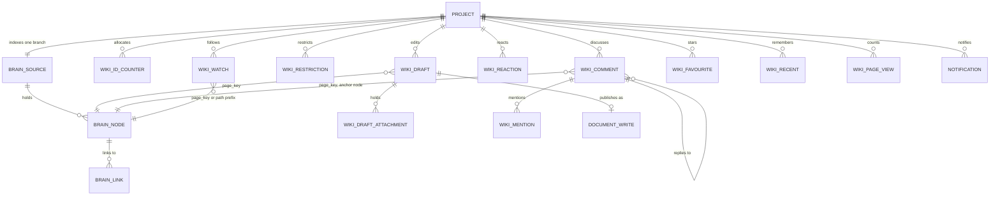

# Wiki data model

> Research, not a decision. It applies the decisions of the board threads on authoring, collaboration and discovery constraints (owner: the platform architect, recorded in `constraints-and-fit.md` of this folder). Proposed in [ADR-0096](../../../decisions/0096-wiki-pages-in-the-document-repo.md); how the Brain indexes the result is in [Brain integration](brain-integration.md) and [ADR-0097](../../../decisions/0097-brain-indexes-wiki-pages.md). Written against `master` at `07c2685c`.

## Summary

The wiki is **a view over the project's one document repository**, not a second store. A wiki page is a Markdown file with front matter; a space is a folder with a home page; the page tree is the folder tree; version history is the file's Git history. Everything people review and want to cite stays in Git and is what the Brain indexes. Everything conversational or per person (drafts, comments, mentions, watches, notifications, reactions, favourites, view counts) and every edit restriction lives in Postgres, keyed by a stable page id so that it survives moves and renames. Viewing has one boundary, Project Access to the whole repository, because a Git repository cannot hide one page from someone who can clone it. No new datastore, no binary store and no second index are needed; the one extension of the repository's Markdown-only rule (attachments) is called out as its own decision.

## Principles

| # | Principle | Why | Source |
|---|---|---|---|
| P1 | Reviewed page content (body, title, labels, order, template, status) is Markdown in the document repo | Git is the source of truth for documents; one document repo per project | [ADR-0007](../../../decisions/0007-git-as-source-of-truth.md), [ADR-0028](../../../decisions/0028-remove-rulebook-single-document-repo.md) |
| P2 | Conversation, working state and access live in Postgres, keyed by page id | Postgres is the only datastore and already holds state and indexes; a commit per comment would flood history and need a pull request each | [ADR-0010](../../../decisions/0010-postgres-only.md) |
| P3 | The Brain indexes Git only, at one branch | Its citations `path:lines@commit` must open on the same lines anywhere | [ADR-0091](../../../decisions/0091-brain-vectorless-tree-index.md), [Brain](../../../reference/brain.md) |
| P4 | Files stay plain Markdown that a Git viewer renders and an agent reads; nothing is stored rendered | Diffs and agents read the source; the repository holds no JSON | [ADR-0042](../../../decisions/0042-markdown-only-document-repo-by-bounded-context.md), [document formats](../../../reference/document-formats.md) |
| P5 | Paths are built only in `packages/domain/src/document-layout.ts` | One owner of the layout | [document layout](../../../reference/document-repo.md) |
| P6 | Every write goes through the existing writer: validated files, auto-commit or a `kintsugi/*` branch and pull request | One write path, fast-forward only, audited in `workflow.document_write` | [write path](../../../reference/document-repo-write-path.md), [ADR-0019](../../../decisions/0019-workspace-repo-write-path.md) |

## Concept map

Every row says where the concept lives, what represents it and whether anything exists today. "Derived" means it is computed from Git (by the Brain build or on demand), never stored as a second truth.

| Confluence concept | Kintsugi representation | Store | Today |
|---|---|---|---|
| Space | A folder with a home page `README.md` whose front matter carries `space` (key) and `title`: the numbered roots as *system spaces*, free spaces under `20-spaces/<space>/` | Git | Folders exist; no space notion |
| Space home page | `<space>/README.md` | Git | READMEs exist |
| Page | `<slug>.md`, or `<slug>/README.md` when it has children | Git | Every Markdown file |
| Page tree, parent | The folder tree; the parent of `a/b.md` is `a/README.md` | Git (derived by the Brain) | Brain tree, portal file tree |
| Sibling order | The parent page's `README.md` front matter `order`: a list of entry names in the folder; unlisted entries after it | Git | Name order only |
| Page id (permalink) | Front matter `id: PAGE-<KEY>-0001` | Git; counter in Postgres | Ids for cards and documents ([ADR-0075](../../../decisions/0075-compact-stable-document-reference-ids.md)) |
| Title | Front matter `title`, else the top `#` heading | Git | Brain reads it |
| Body | CommonMark + GFM + Mermaid + fenced directives (macros) | Git | Markdown and Mermaid |
| Macro | Panels as GitHub alerts (`> [!NOTE]`, `> [!WARNING]`); dynamic and data macros as fenced blocks `kintsugi-<macro>` with YAML parameters (`kintsugi-children`, `kintsugi-toc`, `kintsugi-labels`); stored as the macro, never its output | Git | Mermaid fences only |
| Page link | Relative Markdown link, rewritten on move | Git (links derived by the Brain) | Brain links and backlinks |
| Attachment, image | File beside the page in `_attachments/` (needs an amendment of the Markdown-only rule, see [Attachments](#attachments)) | Git | Not allowed today |
| Label | Front matter `labels` list | Git (index derived by the Brain) | None |
| Version, history | The commits that changed the file | Git (derived on demand) | `changed` on Brain documents; `brain_changes` |
| Version message, minor edit | Commit subject; trailer `Kintsugi-Minor: true` | Git | Trailers exist |
| Author of a version | Trailer `Kintsugi-Actor`, else the commit author | Git | Trailer exists |
| Draft, unpublished changes | One row per user and page: full Markdown, the base commit and the base file hash | Postgres | None |
| Publish | One document write of kind `page`: a pull request by default; a direct commit only on `directPublishPaths` (a new `kintsugi.yaml` key) for a holder of `wiki.publish` | Git through the writer | Writer exists |
| Presence ("being edited") | Draft rows touched in the last 2 minutes | Postgres (derived) | None |
| Footer comment, reply | Comment row on the page id, threaded | Postgres | None |
| Inline comment | Comment row with a text-quote anchor at a commit | Postgres | None |
| Resolve comment | Comment status | Postgres | None |
| Mention | `@username` in the text (pages in Git, comments in Postgres), resolved at read; a row per mentioned user for the notification | Postgres (+ text in Git) | None |
| Watch | Row per user and page, subtree or space | Postgres | None |
| Notification, digest | Row per recipient; delivery state | Postgres | Live updates over SSE ([ADR-0059](../../../decisions/0059-live-updates-over-sse.md)) |
| Reaction, like | Row per user and target | Postgres | None |
| Favourite, recently viewed | Row per user | Postgres | None |
| Page views | Counter per page and day, no user ids | Postgres (`monitoring`) | Member activity only |
| Space permission (view) | Project Access to the whole repository ([ADR-0062](../../../decisions/0062-coding-agent-context-and-project-access.md)) | Postgres | Project Access exists; portal document routes check a session only |
| Edit restriction (space, folder or page) | Row per path prefix and principal (user or access role) | Postgres | None |
| View restriction on one page | Not offered for Git content; a later phase may add restricted pages as encrypted Postgres records, never in Git or the Brain | — | `restricted/` is never committed or served |
| Template, blueprint | `<space>/_templates/<name>.md` or `01-standards/page-templates/<name>.md`, front matter `type: template`; instantiated in the editor, published `createOnly` | Git | Design sets only (a different thing) |
| Page owner | Front matter `owner` (a username) | Git | None |
| Archive | Front matter `status: archived` | Git | Status prefixes in Brain summaries |
| Trash, delete, restore | `git rm`; restore = a write of the old text from history | Git | Writer exists |
| Content properties | Short scalar front matter keys | Git | Front matter |
| Blog post | Out of scope of the pack; would be `20-spaces/<space>/blog/<yyyy>/<mm-dd>-<slug>.md` with `kind: blog` and `date` | Git | None |
| Search | The Brain (tree, lookup, grep, labels) plus a full-text index built in the same Brain build ([ADR-0097](../../../decisions/0097-brain-indexes-wiki-pages.md)) | Postgres index derived from Git | Brain reads |

## Layout

Spaces reuse the numbered layout of [ADR-0051](../../../decisions/0051-document-repo-layout-legacy-and-modern.md). Nothing existing moves.

```text
00-project/            system space "Project"        (home: 00-project/README.md)
01-standards/          system space "Standards"
02-architecture/       system space "Architecture"
03-transition/         system space "Transition"
10-applications/<app>/ one system space per application
20-spaces/             free spaces, made by people
  <space>/
    README.md          home page: front matter space, key, title
    _templates/        page templates of this space
    _attachments/      files of the home page
    onboarding.md      a leaf page
    runbooks/          a page with children
      README.md        the parent page itself
      _attachments/    files of the pages in this folder
      deploy.md
```

Rules, all enforced by functions in `document-layout.ts` (for example `spaceDir(space)`, `spaceHomePath(space)`, `pageAttachmentsDir(pageDir)`):

1. A space key is a segment that matches the existing `SEGMENT_PATTERN` (`^[a-z0-9][a-z0-9-]{0,62}$`); its uppercase short form (`ONB`, at most 10 characters, given in the home page's `key`) is the page-id scope.
2. A page file name is a slug of the same pattern plus `.md`. A title change does not rename the file unless the user asks to move it; the id keeps permalinks valid either way.
3. A folder whose name starts with `_` is never a page (the same rule as for applications today): `_templates/`, `_attachments/`.
4. System spaces keep their owners: a stage-written folder (`01-legacy/`, `_generated/`, unit cards, design sets) is shown in the wiki read-only, and the wiki editor refuses paths a stage writes; people keep correcting those through pull requests as today.
5. Never editable in the wiki, and never pages: `_generated/`, `restricted/`, `plugins/`, `scratch/`, hidden folders and the identifier ledgers `identifiers/` (a hand edit would break the allocation of [ADR-0075](../../../decisions/0075-compact-stable-document-reference-ids.md)). The list lives in `document-layout.ts` next to the Brain's `isBrainIndexedPath`, so the two never drift.

## Page front matter

The format follows the existing [building blocks](../../../reference/document-formats.md#building-blocks): scalars and short lists only.

| Key | Type | Required | Meaning | Used by |
|---|---|---|---|---|
| `id` | `PAGE-<KEY>-<nnnn>` | Written on first portal save | Stable identity across moves and renames | Permalinks, comments, watches; Brain reference id |
| `title` | string | No (falls back to the `#` heading) | The page title | Tree, search, breadcrumbs |
| `summary` | string, at most 240 characters | No, recommended | One-line description | Brain summary (`front-matter` source) |
| `labels` | list of `[a-z0-9-]` strings, at most 20 | No | Labels | Label index, label macro, search filter |
| `order` | list of entry names (`deploy.md`, `runbooks`) | Only in a folder's `README.md` | Manual order of the folder's pages and subfolders; one file changes per reorder | Page tree order |
| `status` | `current` (absent) or `archived`; the existing `superseded`, `deprecated` … | No | Lifecycle | Brain summary prefix, tree filter |
| `owner` | username | No | Who keeps the page current | Page header, stale-page lists |
| `template` | template name | No | The template the page was made from | Template usage |
| `type` | `template` on a template file only | Templates | Marks a template | Search and the tree leave templates out by default |
| `space`, `key` | home page only | Home page | The space name and its uppercase id scope | Space list, page ids |

A reorder changes one file, the parent's `README.md`, as Docusaurus does with `_category_` files and MkDocs with per-folder `.nav.yml` (see [Comparison](#comparison-with-other-wikis)); a move or rename rewrites the old and the new parent's list in the same write. Unknown names in the list are ignored.

Not in front matter: authors, dates of change, version numbers (Git has them), comments, watchers, restrictions and the publish policy (Postgres and `kintsugi.yaml`, so a page cannot grant itself rights), and any unbounded list ([document formats](../../../reference/document-formats.md#building-blocks)).

## Identifiers

Page ids follow the shape of [ADR-0075](../../../decisions/0075-compact-stable-document-reference-ids.md): `PAGE-ONB-0001`. The shape already matches the Brain's reference-id pattern (`packages/domain/src/brain.ts:169`), so a document with a front matter `id` defines the id and every mention of it in another page becomes an `id` link with no builder change.

Allocation differs from the rule and finding ledgers on purpose. Those are allocated by one job per unit, so a Markdown ledger never sees two writers; wiki pages are created by many people at once, and a ledger file would conflict on every second publish. So:

- `knowledge.wiki_id_counter (project_id, scope, next)` hands out the next number in a transaction;
- the counter is a cache of Git, not a truth: when it is missing or behind, it is set to the highest `PAGE-<scope>-n` in `brain_node.ids` plus the ids of open writes, plus one;
- the writer refuses a publish whose `id` is already defined by another path at the base commit, and the Brain build reports two documents that define the same id (both stay readable; `brain_lookup` returns both, as it does today for any id).

A page written outside the portal (a member's pull request) may have no id. It is still a page, addressed by path; it gets an id on its first portal save, and Postgres rows that point at it by path are re-keyed then.

## Links, moves and renames

- A link is a relative Markdown link (`[Deploy](runbooks/deploy.md#rollback)`), because Git viewers and the Brain follow only those ([Brain](../../../reference/brain.md#the-tree)). The editor may offer `[[` completion that inserts one; no `[[Page]]` syntax is stored.
- A link to a page by id is plain text `PAGE-ONB-0007`; the Brain links it, and the portal renders it as a link through the permalink route.
- A move or rename is one write that renames the file (Git detects it) and rewrites the relative links of every page that points at it. The set of pages to rewrite is the Brain's incoming links of the moved node (`brain_link` indexed by `to_id`); pages the Brain does not index (over its bounds, outside its branch) keep a broken link, which the move dialog lists.
- Postgres rows keep pointing at the page id, so comments and watches follow the move. For a page without an id they are re-keyed from the old path to the new one when the Brain build sees the document as `renamed` (the same rename detection `brain_changes` uses).

## Versions and history

Version history is the Git history of the file, read from the mirror on demand like `brain_changes` (never copied into Postgres):

| Confluence | Kintsugi |
|---|---|
| Version *n* | The *n*-th commit that changed the file, following renames; shown with its short commit id |
| Version comment | The commit subject; the publish dialog's message becomes it |
| Minor edit (no notification) | Trailer `Kintsugi-Minor: true`; watchers are not notified |
| Author | `workflow.document_write.actor` joined by commit for portal publishes; the review watch also records the merge commit it saw, so a squash merge still finds its write; else the `Kintsugi-Actor` trailer (the commit author is `kintsugi-bot`, see [commit conventions](../../../reference/document-repo-commit-conventions.md)); else the commit author for members' own commits |
| Compare versions | `git diff` of the file between two commits |
| Restore | A new write with the old text; history is never rewritten |
| Page history list | `git log --follow` on the path, bounded and paged, served by the documents read path (not the Brain: the Brain keeps only the last change, [ADR-0091](../../../decisions/0091-brain-vectorless-tree-index.md) item 6) |

A portal publish adds the trailers `Kintsugi-Actor: <user>` (existing), `Kintsugi-Page: <page id>` and, for a minor edit, `Kintsugi-Minor: true`. Squash merges on the Git server may drop trailers, which is why the author is joined from `workflow.document_write` first.

## Postgres tables

Wiki state goes in the `knowledge` schema, which already holds the Brain (migration `043_brain.sql`), with a `wiki_` prefix; the inbox goes in `core` because gates, runs and member activity can notify too; view counts go in `monitoring` with the telemetry retention. Every table is keyed by `project_id` and deleted with the project, like `knowledge.brain_source`. Names and columns are the proposal of [ADR-0096](../../../decisions/0096-wiki-pages-in-the-document-repo.md); the collaboration behaviour on top of them is the platform's ADR-0099.

`page_key` is the page id when the page has one, else its path (re-keyed on the first save or on a rename, see [Links, moves and renames](#links-moves-and-renames)).

| Table | Key | Columns | Notes |
|---|---|---|---|
| `knowledge.wiki_id_counter` | `(project_id, scope)` | `next` | A cache of Git, see [Identifiers](#identifiers) |
| `knowledge.wiki_draft` | `id` | `project_id`, `user_id`, `page_key`, `path`, `new_path` (a move), `title`, `content` (Markdown), `base_commit`, `base_hash` (SHA-256 of the file at the base, the write's `expectedHash`), `revision`, `status` (`editing`, `publishing`, `published`, `discarded`), `document_write_id`, `created_at`, `updated_at`; unique `(project_id, user_id, page_key)` | Autosave bumps `revision` (a stale revision answers 409); rows touched in the last 2 minutes are the page's presence; dropped 30 days after publish or discard |
| `knowledge.wiki_draft_attachment` | `id` | `draft_id`, `name`, `media_type`, `size`, `content` (bytea), `created_at` | The one place bytes sit in Postgres: a file pasted into a draft before it has a commit; same allowlist and 5 MiB per file, 20 MiB per draft; deleted with the draft or when its publish write is committed (the bytes move into the write); never indexed |
| `knowledge.wiki_restriction` | `(project_id, path_prefix, principal_kind, principal)` | `principal_kind` (`user`, `access-role`), `level` (`edit`, `manage`), `granted_by`, `granted_at` | Edit restrictions (editing and publishing) per space, folder or page path; a restriction covers its subtree, and a restriction on a child adds to its parent's (a writer must satisfy both), a stated difference from Confluence; a path with no restriction is editable by whoever holds `wiki.write` and Project Access; a grant never widens Project Access |
| `knowledge.wiki_comment` | `id` | `project_id`, `page_key`, `parent_id` (reply), `kind` (`footer`, `inline`), `anchor` (jsonb, below), `body` (Markdown, at most 32 KiB), `status` (`open`, `resolved`, `orphaned`), `resolved_by`, `resolved_at`, `author`, `created_at`, `edited_at`, `deleted_at` | Soft delete keeps the thread shape; deletion is audited |
| `knowledge.wiki_mention` | `id` | `project_id`, `user_id`, `source_kind` (`comment`, `page`), `source_id` (comment id, or page key and commit), `created_at` | Page mentions are found at publish, in the added lines only |
| `knowledge.wiki_watch` | `(user_id, project_id, target_kind, target)` | `target_kind` (`page`, `subtree`, `space`), `created_at` | A subtree or space watch is a path prefix |
| `knowledge.wiki_reaction` | `(project_id, target_kind, target_id, user_id, emoji)` | `created_at` | Pages and comments |
| `knowledge.wiki_favourite` | `(user_id, project_id, page_key)` | `created_at` | |
| `knowledge.wiki_recent` | `(user_id, project_id, page_key)` | `viewed_at` | The last 50 per user |
| `monitoring.wiki_page_view` | `(project_id, page_key, day)` | `views` | Aggregated, without user ids |
| `core.notification` | `id` | `user_id`, `project_id`, `kind` (`mention`, `comment`, `reply`, `page-published`, `page-moved`, `restriction`), `subject`, `link`, `payload` (jsonb, no page text), `created_at`, `read_at` | Comments, replies and mentions are written when they happen; page changes are written after the Brain build that indexed them, by a `wiki-notify` job the build queues through the worker's outbox, which matches the changed documents against `wiki_watch` with a unique key per recipient, page and commit so each change notifies once, whether it came from the portal or from a member's own pull request; delivered over the change feed (scope = the user, no content, [ADR-0059](../../../decisions/0059-live-updates-over-sse.md)) and an inbox page; e-mail later |

Not stored in Postgres: page text, titles, labels, owners, order, history and links. They are in Git, or derived by the Brain build into `knowledge.brain_*`.

Comment and notification text is project data like the documents. Agents see comments only through an explicit read tool, never inside `brain_read` ([Brain integration](brain-integration.md#comments-and-other-postgres-data)).



`DOCUMENT_WRITE` is the existing `workflow.document_write`; the `BRAIN_*` entities are the existing `knowledge.brain_*` tables. The relations to `BRAIN_NODE` are logical (a page key is resolved through the node's `ids` or `path`), not foreign keys, because the Brain is rebuilt from Git and may be off.

### Inline comment anchors

An inline comment anchors to text that changes. The anchor names the Brain node that held the text (a heading anchor or a card id), the commit it was made on, and the quoted text with what surrounds it, after the W3C Web Annotation text-quote and text-position selectors:

```json
{ "node": "20-spaces/ops/runbooks/deploy.md#rollback", "commit": "9f1c2ab", "lineStart": 41, "lineEnd": 43, "exact": "retries three times", "prefix": "The job ", "suffix": " before it fails" }
```

On read, the portal finds `exact` in the current text of the node (falling back to the whole page), choosing the occurrence whose prefix and suffix match and that is nearest the line hint. When the text is gone the comment becomes `orphaned`: it stays at the end of the page with its quote, as Confluence keeps inline comments whose highlighted text was deleted. Nothing is written into the Markdown, so commenting never makes a commit.

### Drafts and publishing

```mermaid
sequenceDiagram
  participant P as Portal editor
  participant A as API (wiki)
  participant D as knowledge.wiki_draft
  participant W as Writer (document-write)
  participant G as Document repo
  participant B as Brain build
  P->>A: autosave(page, content, revision)
  A->>D: upsert, revision + 1 (stale revision: 409)
  P->>A: publish(message, minor)
  A->>A: check Project Access, restrictions, wiki.publish for a direct path
  A->>G: read the file at the branch tip
  alt tip hash differs from base_hash
    A->>A: 3-way merge base / draft / tip; conflict: 409 with the three texts
  end
  A->>W: document write, kind page, expectedHash
  W->>G: commit to the default branch, or to kintsugi/<user>/<write-id> with a pull request
  A->>D: status publishing, document_write_id
  G-->>B: the indexed branch moves (after the merge, for a pull request)
  B->>B: build the changed documents
  A->>D: status published when the write is committed or merged
```

The draft holds the whole Markdown, so a crash loses at most one autosave. Autosaves never go through the writer queue, which serialises one write per repository and must stay free for runtime writes. Several people editing one page each have their own draft; the second to publish merges against the first. Real-time co-editing is out of scope.

## Attachments

The document repo holds Markdown only today ([ADR-0042](../../../decisions/0042-markdown-only-document-repo-by-bounded-context.md)). Pages with images need one of:

| Option | For | Against |
|---|---|---|
| **A. Files in Git beside the page** (`_attachments/`), an allowlist of media types, the writer's caps | One source of truth; a move carries its files; Git viewers render images; the writer already carries base64 content; no new infrastructure | Repository growth (Git keeps every version); amends ADR-0042 |
| B. Bytes in Postgres (`bytea`), referenced from the page | Small repository | Pages no longer render in a Git viewer and members' clones lack the images; a second source of truth |
| C. Object storage | Scales | A new infrastructure dependency ([ADR-0006](../../../decisions/0006-self-hosted-package.md), [ADR-0010](../../../decisions/0010-postgres-only.md)) |

Decided in the authoring thread and proposed in [ADR-0096](../../../decisions/0096-wiki-pages-in-the-document-repo.md): **A**. `_attachments/` beside the page (`<page folder>/_attachments/<file>`), media types PNG, JPEG, GIF, WebP and PDF; SVG only sanitised or served as a download; 5 MiB per file and 50 MiB per write (the writer's caps); no Git LFS (servers differ, and the mirror does not fetch it). Every other committed file stays Markdown. Serving needs a raw route with a fixed content type, `Content-Disposition`, `nosniff` and a CSP (the platform's ADR-0098). The Brain does not index attachments but records them on the page node ([Brain integration](brain-integration.md#attachments)).

## Access

- **Viewing** has one boundary: Project Access to the whole repository ([ADR-0062](../../../decisions/0062-coding-agent-context-and-project-access.md)). A view rule on one page of a Git repository is not a control: members' clones, the Git server and every mirror still hold the text, and each read path (tree, grep, links, folder summaries, changes) would need a filter that can leak. The portal's document routes today need a session only ([`documents.controller.ts`](../../../../apps/api/src/modules/delivery/documents/interface/documents.controller.ts), lines 1-4); wiki routes check Project Access, and the existing routes must too.
- **Editing and publishing** are restricted per space, folder or page path in `knowledge.wiki_restriction`, checked by the API on draft and on publish. That is a real control because every portal commit goes through the writer; branch protection or code owners on the Git server are the Git-level backstop for members' own pull requests.
- **Direct publish** needs the path in `directPublishPaths` (`kintsugi.yaml`, reviewed) and the permission `wiki.publish`; everything else is a pull request.
- **Secret content** is never a wiki page in Git. `restricted/` stays never committed, never served and never indexed; restricted pages as encrypted Postgres records are a later phase with an ADR of their own.

## Comparison with other wikis

Public documentation only. The model above takes the Confluence concepts and stores them the way Git-backed wikis do.

| Concern | Confluence Cloud | Git-backed and open-source wikis | This model |
|---|---|---|---|
| Space, page, parent | Space with `homepageId`; page with `parentId`, `position`, `status` (current, draft, archived, trashed …) ([REST v2 pages](https://developer.atlassian.com/cloud/confluence/rest/v2/api-group-page/), [spaces](https://developer.atlassian.com/cloud/confluence/rest/v2/api-group-space/)) | Gollum: a page is its file path ([Gollum wiki](https://github.com/gollum/gollum/wiki)); BookStack: shelves, books, chapters, pages ([content overview](https://www.bookstackapp.com/docs/user/content-overview/)) | Folder with a home `README.md`; page = file; parent = folder |
| Sibling order | `position` per page; a move takes before, after or append ([content children v1](https://developer.atlassian.com/cloud/confluence/rest/v1/api-group-content-children-and-descendants/)) | Docusaurus `sidebar_position` and `_category_` files ([autogenerated sidebars](https://docusaurus.io/docs/sidebar/autogenerated)); MkDocs `nav`, awesome-nav per-folder `.nav.yml` ([awesome-nav](https://lukasgeiter.github.io/mkdocs-awesome-nav/features/nav/)) | `order:` list in the parent's `README.md` |
| Page links on rename | Links are stored by page title and space key ([storage format](https://confluence.atlassian.com/doc/confluence-storage-format-790796544.html)); native links are rewritten on rename, links in macros and pasted URLs are not ([renaming a page](https://confluence.atlassian.com/spaces/CONF56/pages/658736992/Renaming+a+Page)) | Gollum `[[Page]]` resolves by name in the same folder ([Gollum wiki](https://github.com/gollum/gollum/wiki)) | Relative links rewritten on move; a stable page id for permalinks and mentions |
| Metadata | Labels with prefixes; content properties as JSON key/values ([labels](https://developer.atlassian.com/cloud/confluence/rest/v2/api-group-label/), [content properties](https://developer.atlassian.com/cloud/confluence/rest/v2/api-group-content-properties/)) | Wiki.js keeps title, description, tags in YAML front matter ([Git storage](https://docs.requarks.io/s/en/storage/git)) | Front matter: `labels`, `owner`, `status`, short scalars |
| Versions | Version number, message, `minorEdit`, author ([REST v2 pages](https://developer.atlassian.com/cloud/confluence/rest/v2/api-group-page/)) | Wiki.js: Git commits; Outline and BookStack: revision rows in the database | Git history of the file; message = commit subject; trailer for minor edits |
| Drafts | A draft is a page never published; unpublished changes on a published page can be reverted ([create, edit and publish](https://confluence.atlassian.com/confcloud/create-edit-and-publish-724764831.html)); live docs autosave without a publish step ([live docs](https://support.atlassian.com/confluence-cloud/docs/create-and-collaborate-in-real-time-with-live-docs/)) | Outline: `publishedAt` null for drafts | Draft rows in Postgres; publish = one document write |
| Comments | Footer and inline comments are separate; an inline comment anchors by the selected text and which occurrence of it; statuses open, reopened, resolved, dangling ([comments](https://developer.atlassian.com/cloud/confluence/rest/v2/api-group-comment/)) | Outline anchors with a mark inside the document content; BookStack marks a comment outdated when its text changes ([v25.05](https://www.bookstackapp.com/blog/bookstack-release-v25-05/)); Wiki.js does not sync comments to Git | Postgres rows; inline anchor as a W3C text-quote selector ([Web Annotation model](https://www.w3.org/TR/annotation-model/)); `orphaned` is Confluence's dangling; nothing written into the page |
| Attachments | Attachment entities with media type, size and their own versions ([attachments](https://developer.atlassian.com/cloud/confluence/rest/v2/api-group-attachment/)) | Gollum stores uploads in `/uploads/` or beside the page ([Gollum](https://github.com/gollum/gollum)) | `_attachments/` beside the page; Git keeps versions |
| Restrictions | Per page: open, edit-restricted or view-restricted, per user or group ([REST v2 spec](https://dac-static.atlassian.com/cloud/confluence/openapi-v2.v3.json)) | Wiki.js keeps permissions out of Git | Edit restrictions per path in Postgres; viewing = Project Access |
| Search | Not part of the model | Outline: Postgres full-text search ranked by `ts_rank`; BookStack: its own weighted terms table | The Brain's tree and a full-text index built with it ([Brain integration](brain-integration.md#full-text-search)) |

## What changes in the existing code

| Area | Change | Size |
|---|---|---|
| `packages/domain/src/document-layout.ts` | Root `20-spaces/`; space, home, page, `_attachments/`, `_templates/` and `01-standards/page-templates/` path functions; `describeDocumentFolder` texts for them | Small |
| `docs/reference/document-repo.md`, `document-formats.md` | The space layout, the page front matter, the macro fences, the attachment allowlist | Small |
| `apps/api/migrations/` | The `knowledge.wiki_*`, `monitoring.wiki_page_view` and `core.notification` tables; the permission codes of ADR-0099 (`wiki.comment`, `wiki.write`, `wiki.publish`, `wiki.manage`) | Medium |
| `apps/api/src/modules/` | A wiki module (drafts, publish, comments, watches, restrictions) on the shared kernel; the documents module stays the reader and gains history, diff and the raw attachment route | Large |
| `packages/domain/src/manifest.ts` | `directPublishPaths` | Small |
| `services/orchestrator` writer | Kind `page`; trailers `Kintsugi-Page`, `Kintsugi-Minor`; the attachment allowlist; the merge commit recorded by the review watch | Medium |
| `packages/domain/src/brain.ts` and the Brain build | See [Brain integration](brain-integration.md) | Medium |

## Open points

1. **Restricted pages** for content some project members must not see: encrypted Postgres records, own ADR, later phase.
2. **Project Access on the existing portal document routes** is a prerequisite fix, not a wiki feature; the gap analysis should carry it.
3. **Notification delivery** beyond the portal (e-mail, chat webhook): no data-model change, a new outbound dependency with its own ADR.
4. **Pages over 2 MiB** are not served and not indexed today; the editor should warn well below that.
