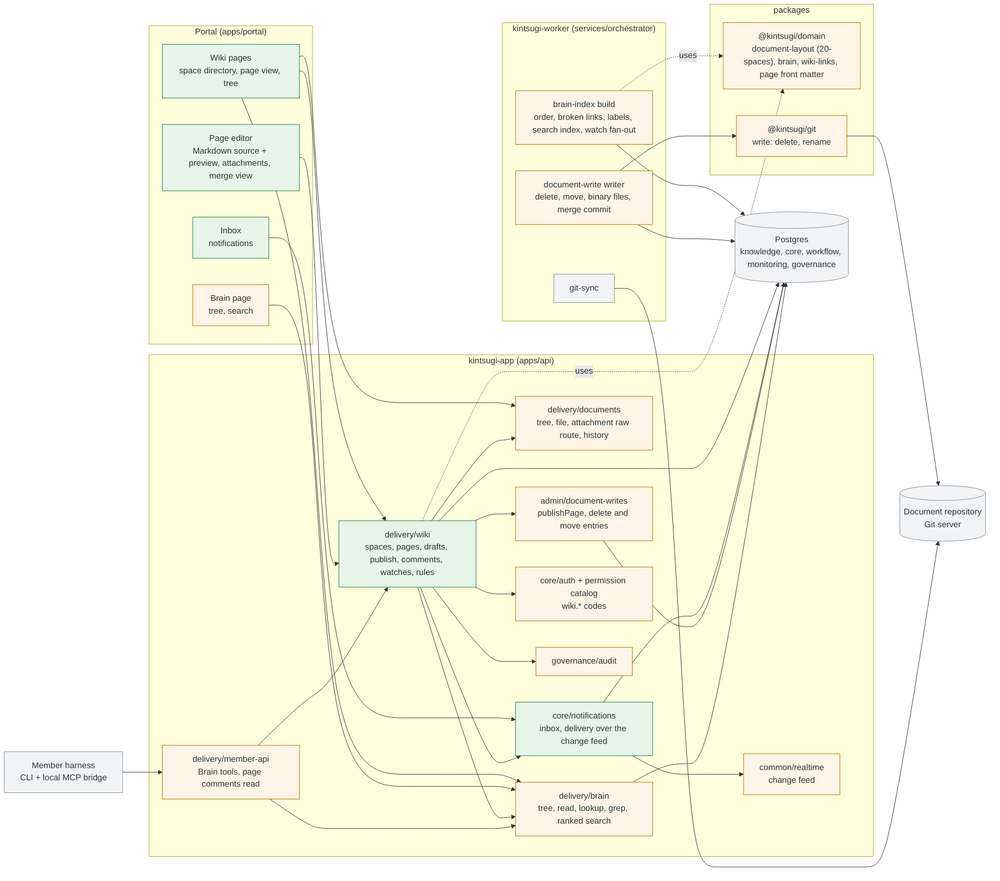
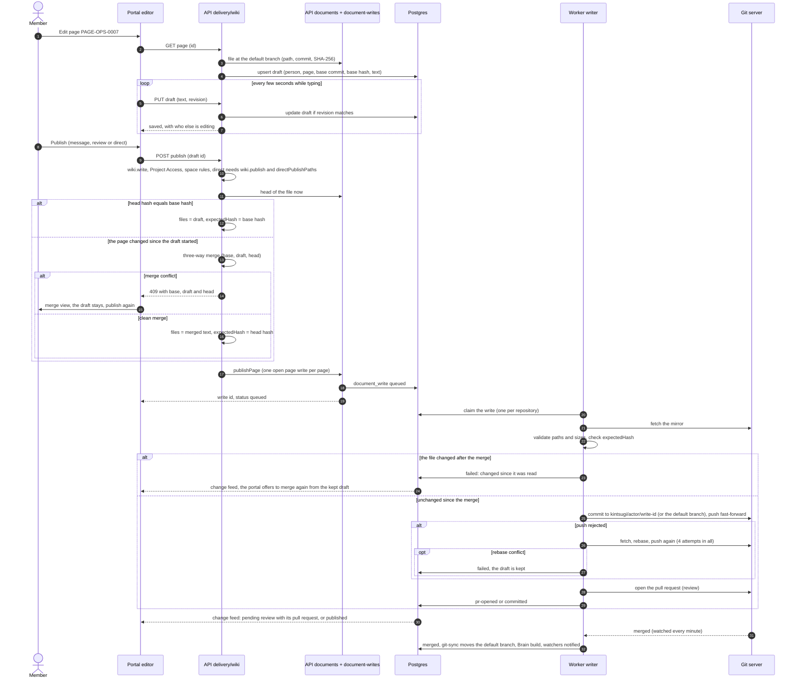

# Target architecture

> Research page. The building blocks a Confluence-like wiki adds to Kintsugi, where each sits in the DDD anatomy of `apps/api` and in which database schema, the write path from a portal edit to a commit, and how notifications and the member surface work. It follows the rules of [constraints and fit](constraints-and-fit.md); the tables and columns are in the data model (`data-model.md`) and the Brain side in the Brain integration (`brain-integration.md`). The decisions are proposed in ADR-0096, ADR-0097, [ADR-0098](../../../decisions/0098-wiki-page-editing-and-publishing.md) and [ADR-0099](../../../decisions/0099-wiki-collaboration-and-access.md).

## In one paragraph

The wiki is a **view and an editor over the document repository**, not a second store. People read pages rendered from the mirror at the default branch and navigate them by the Brain's tree. They edit in the portal; every keystroke is saved as a draft in Postgres, and publishing is one `document-write` that the worker's writer commits, to a pull request by default. Comments, watches, notifications, favourites and drafts are rows in Postgres. The Brain indexes a page when its change is merged, and members' agents read it with the Brain tools they already have. Nothing new is deployed: the wiki is code in `kintsugi-app` (API and portal) and the worker, on the one Postgres and the Git servers Kintsugi already uses.

## Building blocks

Green is new, orange is extended, grey is unchanged.

### API modules

Every module keeps the anatomy of [apps/api](../../../../apps/api/README.md): `domain/` (entities and ports), `application/` (use cases), `infrastructure/` (adapters), `interface/` (controllers and zod DTOs). The wiki module reaches other modules only through their `index.ts`.

| Block | State | Domain | Application | Infrastructure | Interface | Schema |
|---|---|---|---|---|---|---|
| `delivery/wiki` | new | `Space` (a folder with a home page), `Page` (a Markdown document with front matter `id`, `title`, `labels`, `status`, `order`), `Draft`, `Comment` (anchor: page id, node id, quote, commit), `Watch`, `SpaceRule` (who may edit under a path prefix); ports `DraftStore`, `CommentStore`, `WatchStore`, `RuleStore`, `PageSource` (reads through documents and brain), `PagePublisher` (writes through document-writes) | `SpacesService`, `PagesService` (resolve id to path, render data), `DraftsService` (autosave, presence), `PublishService` (permission and rule check, three-way merge, move and rename with link rewrite, delete), `CommentsService` (re-anchoring), `WatchesService` | `Pg*Store` adapters; a three-way text merge adapter (a pure JavaScript library, no new service) | `WikiController` (spaces, pages, drafts, publish), `CommentsController`, `WatchesController`; zod DTOs | `knowledge` (`wiki_*` tables) |
| `core/notifications` | new | `Notification` (recipient, kind, subject, read flag, no page text); port `NotificationStore` | `NotificationsService` (create, list, mark read), used by other modules through `index.ts` | `PgNotificationStore`; a change-feed topic `notifications` with the user id as scope | `NotificationsController` (inbox), an SSE stream like the other live views | `core` |
| `delivery/documents` | extended | `DocumentHistory` (commit, date, actor, message) | `history(path)` and `diff(a, b)` from the mirror, bounded and paged; `attachment(path)` | `git-mirror.reader.ts`: `log --follow`, `diff`, raw blob read | `GET documents/history`, `GET documents/diff`, `GET documents/raw` (allowlisted types, fixed `Content-Type`, `Content-Disposition`, `X-Content-Type-Options: nosniff`, a content security policy); every route checks Project Access | none (reads Git) |
| `admin/document-writes` | extended | `DocumentWriteFile` gains `encoding: "base64"` (the worker has it) and a `delete` entry; a kind `page` | `publishPage(projectId, files, actor, options)` next to `proposeCorrection`: one open page write per page, like one open correction per specification ([ADR-0094](../../../decisions/0094-one-open-correction-per-specification.md)) | unchanged store; the queue payload carries deletes | unchanged | `workflow` (`document_write` gains the merge commit) |
| `delivery/brain` | extended | search hit with rank | ranked search beside grep; labels, status and order in node data | `pg-brain.index.ts` reads the search index | `GET brain/search?q&space&label` | `knowledge` (owned by ADR-0097) |
| `delivery/member-api` | extended | none | a read of a page's open comments (`page_comments`), recorded as member activity | none | `/api/member/v1/.../comments` | none |
| `core/auth` | extended | none | none | migration of the permission codes `wiki.comment`, `wiki.write`, `wiki.publish`, `wiki.manage` | none | `core` |
| `governance/audit` | extended | new actions: `wiki.publish`, `wiki.page.delete`, `wiki.comment.delete`, `wiki.rule.set`, `wiki.rule.clear` | none | none | none | `governance` |
| `monitoring/telemetry` | extended | page views per page and day, without user ids by default | aggregate and prune with the telemetry retention | none | none | `monitoring` |
| `delivery/runtime-jobs`, `admin/agents`, `services/runtime` | unchanged | the wiki adds no job, no agent and no kernel tool | | | | |

### Worker

| Block | State | Change |
|---|---|---|
| `services/orchestrator/src/document-write` | extended | Deletes and renames (`git rm`, `git mv`) validated like writes; binary files from the API; the watch step records the merge commit it saw, so a squash merge can still be joined to the write and its actor |
| `services/orchestrator/src/brain` | extended | Front matter `order`, `labels`, `status` and the page id kept on nodes; links it cannot follow recorded as broken instead of dropped; the search index written in the same transaction (ADR-0097); after a build of the default branch, the documents that changed are matched against `knowledge.wiki_watch` and notifications are recorded through the worker's outbox (`services/orchestrator/src/outbox`) so each change notifies once |
| `services/orchestrator/src/git-sync` | unchanged | It already moves the mirror and requests a Brain build when the default branch moves |

### Packages

| Block | State | Change |
|---|---|---|
| `packages/domain/src/document-layout.ts` | extended | The root `20-spaces/<space>/` and its helpers; `describeDocumentFolder` names a space (ADR-0096) |
| `packages/domain` (new file `wiki-links.ts`) | new | Parse, resolve and rewrite relative Markdown links of a page, used by the publish path and the Brain builder, so both read links the same way |
| `packages/domain/src/manifest.ts` | extended | `directPublishPaths` next to `autoCommitPaths` |
| `packages/git/src/write.ts` | extended | Delete and rename entries, with the same `expectedHash` check per entry |

### Portal

| Page | State | Built from |
|---|---|---|
| Wiki: space directory, page view with the tree sidebar, labels, backlinks, history and compare | new | The Brain tree for navigation, `results/markdown.tsx` and `mermaid-diagram.tsx` for rendering (with heading anchors, GitHub alerts and `kintsugi-*` fenced macros), `documents/history` |
| Page editor | new | `components/code/code-editor.tsx` (CodeMirror) with a side-by-side preview, an attachment panel, a publish dialog (message, review or direct), a three-way merge view on conflict, presence ("also editing") |
| Inbox | new | `core/notifications`, live over the change feed |
| Brain page | extended | Ranked search beside lookup and grep |
| Delivery and project document views | unchanged | They keep the file browser |

## Edit and save a page

What each outcome leaves:

| Outcome | Page in Git | Draft | What the person sees |
|---|---|---|---|
| Clean publish, review | On the `kintsugi/*` branch and its pull request | Kept and linked to the write until it is `merged` or `closed` | *Pending review* with the pull request; the page view shows the default branch version and a banner |
| Clean publish, direct | Committed on the default branch | Deleted when the write is `committed` | The page, in the Brain after the next build |
| Conflict found by the API | Nothing written | Kept | A three-way merge view; publishing again starts over |
| `expectedHash` refused by the writer | Nothing written | Kept | *Changed since you started*; the portal reloads the head and offers the merge view |
| Push rejected, rebase clean | Written after a retry | As for a clean publish | Nothing special |
| Push rejected, rebase conflict | Nothing written | Kept | *Could not publish* with the redacted error and the merge view |
| Pull request declined | Nothing on the default branch | Kept | *Declined*, with the option to edit and publish again or discard |
| A second publish while a pull request is open | Refused | Kept | *Pending review in PR #n*: change it there or wait (a later phase can add commits to the open branch) |

Moves, renames and deletes follow the same path: the publish carries a rename or delete entry plus the rewritten inbound links (`wiki-links.ts` finds them from `knowledge.brain_link` at the base commit and confirms them in the mirror), all in one write, so the default branch never holds a page with broken links that the move created.

## Notifications

| Event | Where it is detected | Who is told |
|---|---|---|
| A comment or a reply | `delivery/wiki`, in the transaction that stores it | The page's watchers, the thread's participants, the people mentioned |
| A mention in a comment | `delivery/wiki` | The person mentioned, if they have Project Access |
| A mention in a page body | The Brain build that indexes the merged page, as for a watch | The person mentioned |
| A page or space a person watches changed on the default branch | The worker after a Brain build, from the documents that changed between the two indexed commits | Its watchers, once per change, through the outbox |
| A person's publish was merged, declined or failed | The writer's status change of a `page` write | The author |

A notification holds the kind, the subject (page id, path, comment id) and the recipient, never the page text. The portal learns of new rows through the change feed topic `notifications` (scope: the user id) and reads them through the API, which applies the access checks. Mail and webhooks are a later decision ([constraints and fit](constraints-and-fit.md#open-questions-for-the-owner), OQ-4).

## The member surface

Members' agents keep the five Brain tools; published pages are documents of the tree like any other ([ADR-0091](../../../decisions/0091-brain-vectorless-tree-index.md)). The Brain carries the page id, labels and status on the node, so `brain_lookup PAGE-OPS-0007` and a label filter work without a new tool. One read tool is added, `page_comments` (the open comment threads of a page, with their anchors), because comments are not in Git. Members write pages from their own Git clone and pull requests, as they write any document; the member API stays read-only ([ADR-0069](../../../decisions/0069-common-member-base-and-plugin-distribution.md)).

## Security

| Concern | Answer |
|---|---|
| Who reads a page | A person with Project Access to the project (the portal's document routes must check it, [OQ-5](constraints-and-fit.md#open-questions-for-the-owner)); a member's agent with `member.read` and Project Access |
| Who changes a page | `wiki.write` and the space rules of its path; direct publish also `wiki.publish` and `directPublishPaths`; the Git server's branch protection stays the last gate |
| Stored scripts in pages | The renderer drops raw HTML (`skipHtml`) and renders only Markdown, GitHub alerts, Mermaid and `kintsugi-*` fenced macros |
| Stored scripts in attachments | Allowlisted types only; SVG served as a download or sanitized; `nosniff`, `Content-Disposition` and a content security policy on the raw route |
| Imported files (Word, HTML) | Converted in the API by a pure JavaScript library under size limits, sanitized, into a draft that a person reviews |
| Audit | Publish, delete, rule changes and comment deletion in `governance.audit_event`; ordinary reads are not audited |

## What is deliberately not here

- No real-time co-editing service, no WebSocket server: presence and the three-way merge cover concurrent edits.
- No object store, search engine or cache: attachments are in Git, search is a Postgres index.
- No server-side PDF or Word converter in an image.
- No runtime job, agent or kernel tool for the wiki.
- No per-page view restriction on content in Git ([constraints and fit](constraints-and-fit.md#open-questions-for-the-owner), OQ-1).
