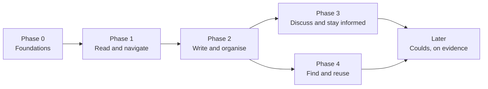

# Roadmap of a Confluence-like wiki in Kintsugi

> Research, not a plan of record. This page orders the features of the [feature matrix](00-scope-and-priorities.md#feature-matrix) into phases that each leave Kintsugi with something usable, names the decisions each phase needs and how to tell it is done. A phase starts only when the ADR proposals it depends on are Accepted.

## Shape

Each phase adds one ability for the people of a project, on top of the one before:

Phases 3 and 4 do not depend on each other and can run side by side. Every Must of the matrix is in exactly one of phases 1 to 3; every Should is in one of phases 1 to 4, where it is cheapest; Coulds wait for evidence; Won'ts are on no phase.

| Phase | Musts | Shoulds | Decisions it needs |
|---|---|---|---|
| 0 Foundations | none (prerequisites only) | none | ADR-0096 to ADR-0099 Accepted |
| 1 Read and navigate | 18 | 11 | ADR-0096, ADR-0097 |
| 2 Write and organise | 23 | 22 | ADR-0096, ADR-0098, ADR-0099 |
| 3 Discuss and stay informed | 7 | 9 | ADR-0099 |
| 4 Find and reuse | none | 10 | ADR-0097 |

## Phase 0: Foundations

**Goal.** Nothing a reader sees yet; what every later phase stands on is in place and safe.

| Prerequisite | Why | Where |
|---|---|---|
| The four ADR proposals are reviewed and Accepted, or changed | Each phase builds on them; a rejected one changes the phases after it | [ADR-0096](../../decisions/0096-wiki-pages-in-the-document-repo.md), [ADR-0097](../../decisions/0097-brain-indexes-wiki-pages.md), [ADR-0098](../../decisions/0098-wiki-page-editing-and-publishing.md), [ADR-0099](../../decisions/0099-wiki-collaboration-and-access.md) |
| The portal's document and Brain routes check Project Access | Today they need a session only (`apps/api/src/modules/delivery/documents/interface/documents.controller.ts`), so any signed-in user can read any project's documents through them; a wiki would widen that exposure. The member API already checks it ([ADR-0099](../../decisions/0099-wiki-collaboration-and-access.md)). | `delivery/documents`, `delivery/brain` |
| One catalog of `wiki.*` permission codes, added by migration | The research names the codes; the migration makes them grantable ([ADR-0008](../../decisions/0008-authentication.md)) | `core.permission` |
| Page ids, `20-spaces/` and the `_attachments/` folder in `packages/domain/src/document-layout.ts` and each plugin's `scripts/paths.py` | Paths are built in one place only (AGENTS.md); the layout gains team spaces ([ADR-0051](../../decisions/0051-document-repo-layout-legacy-and-modern.md) extended by ADR-0096) | `packages/domain` |
| One heading slug function in `packages/domain`, used by the Brain builder without changing any anchor | The Brain, the portal renderer and the link checker must agree on anchors before pages link to headings ([ADR-0097](../../decisions/0097-brain-indexes-wiki-pages.md), [ADR-0098](../../decisions/0098-wiki-page-editing-and-publishing.md)) | `packages/domain` |
| A Brain eval baseline on a wiki-shaped sample repository | ADR-0097 changes the Brain; [ADR-0091](../../decisions/0091-brain-vectorless-tree-index.md) item 8 asks for accuracy to be measured before it is claimed | [Brain eval](../../development/brain-eval.md) |

**Exit.** The Project Access check is covered by a test that a user without access, an administrator included, gets 403 on every document and Brain route; the codes exist in `core.permission`; the layout functions have tests for the new paths and both `paths.py` mirror them, proven by a shared case file; the Brain builds the same anchors with the one slug function; the Brain eval has a recorded baseline.

## Phase 1: Read and navigate

**Goal.** Anyone with Project Access reads the document repository as a wiki: a page tree with titles, rendered pages, history, labels and search, and the Brain serves the same pages to agents. Nothing is written from the portal yet; pages still change through Git.

| Area | Musts | Shoulds |
|---|---|---|
| Authoring | AUT-04 page tree, AUT-25 code blocks, AUT-26 Mermaid diagrams, AUT-28 headings and anchors, AUT-37 panels, AUT-50 link to a heading, AUT-53 broken-link check, AUT-58 export as Markdown | AUT-02 page address by id, AUT-03 space home page, AUT-19 page properties, AUT-24 tables, AUT-38 table of contents, AUT-52 backlinks, AUT-55 print to PDF |
| Collaboration | none | COL-36 who changed what |
| Discovery | DIS-01 search box, DIS-02 words in title and body, DIS-03 hit excerpts, DIS-05 filter by space, DIS-06 filter by label, DIS-14 results respect access, DIS-21 label page, DIS-40 page history, DIS-41 an older version, DIS-42 compare versions | DIS-17 title search, DIS-45 history across moves, DIS-47 recent changes |

**Building blocks.** The rule that a wiki project's Brain follows the default branch, together with the switch that turns the wiki on ([ADR-0097](../../decisions/0097-brain-indexes-wiki-pages.md) decision 5; moved here from Phase 0 because no such switch exists before); `delivery/documents` extended (history, diff, raw attachment route with a fixed content type); the next version of the Brain builder (labels, status, space and the manual order from front matter in node data, archived and template flags, backlinks and broken links), which the page tree cannot do without, and incremental builds with their equality property test and a periodic whole build ([ADR-0097](../../decisions/0097-brain-indexes-wiki-pages.md)); one heading slug function in `packages/domain` shared by the Brain and the portal renderer, which also renders GitHub alerts and `kintsugi-*` fenced blocks; a new portal wiki reader. Search in this phase is the exact search the Brain has (`brain_grep`); ranking waits for Phase 4. No new table outside `knowledge`.

**Exit.** On a sample repository a viewer opens a page from the tree, follows a heading link, filters search by label and space, compares two versions, and an agent finds the same page with `brain_lookup` by label and cites it as `path:lines@commit`; the Brain eval shows no loss against the Phase 0 baseline.

**Status (Phase 1 built and verified on the integration branch).** Landed: the portal wiki reader, described in [the reference](../../reference/wiki-reader.md), with the page tree, rendered pages (code, Mermaid diagrams, alerts, `kintsugi-*` blocks and image attachments), links to headings across pages, the table of contents, backlinks, space home pages, label pages, search by words filtered by space and label with excerpts, page history, an older version and a comparison of two versions, recent changes, export of a page as Markdown and the broken-link report; the wiki switch and the rule that a wiki project's Brain follows the default branch, in both halves (the switch and the sync that moves the branch with the default branch); the Brain builder with labels, status, space and manual order, the lookup by `label:` and `space:` with space keys read in any case, backlinks and the stored broken links; incremental builds with their equality property test and a whole build every 50 incremental builds or a day; labels, space, status and backlinks for members' agents on the member wire without breaking installed CLIs; and the Brain eval with lookup questions, which shows no loss against the Phase 0 baseline.

Moved to Phase 2: hiding archived pages and templates from the tree and from grep by default on the API side (the portal already hides them); storing and serving the builder's warnings about invalid space keys next to the broken links; a Content-Security-Policy for the portal; and a flag on the agent's `label:` and `space:` lookup that says when more than 20 pages match (the portal's label page lists them all). The periodic whole build and the incremental one read the whole stored tree for their difference; reading only the affected part waits for measurements. Two limits are known: a default branch that was changed only at the remote is not followed until the repository is synced again, and the space home looks for its `README.md` among the first 20 documents of the `space:` lookup.

## Phase 2: Write and organise

**Goal.** Members write, move and delete pages in the portal without a Git client; every change still lands as a commit through the writer, reviewed by pull request unless the path allows a direct publish.

| Area | Musts | Shoulds |
|---|---|---|
| Authoring | AUT-11 create, AUT-12 edit, AUT-13 rename, AUT-14 move, AUT-16 delete, AUT-20 Markdown source with preview, AUT-31 autosave a draft, AUT-33 explicit publish, AUT-34 conflict detection, AUT-44 attach a file, AUT-45 insert an image, AUT-48 size and type limits, AUT-54 link integrity on move | AUT-01 team spaces, AUT-05 reorder, AUT-06 space directory, AUT-15 copy, AUT-17 restore a deleted page, AUT-32 drafts list, AUT-36 publish message, AUT-41 listing macros, AUT-46 manage attachments, AUT-49 link by title, AUT-51 link to an attachment, AUT-60 import Markdown and HTML |
| Collaboration | COL-22 three-level model, COL-23 space permissions, COL-25 page edit restriction, COL-28 restrictions only narrow, COL-34 concurrent edit handling, COL-37 audit of permission changes | COL-24 per-operation permissions, COL-29 list restricted content, COL-31 grants to access roles, COL-35 approval by pull request |
| Discovery | DIS-20 add and remove labels, DIS-22 label naming rules, DIS-30 page from a template, DIS-43 restore a version | DIS-31 project templates, DIS-32 template fields, DIS-44 warn about a draft on restore, DIS-46 trash and restore, DIS-50 archive, DIS-51 archived list |

**Building blocks.** A new `delivery/wiki` module (spaces, pages, drafts, edit rules, presence); the writer contract extended first, with `delete` and rename entries carrying `expectedHash`, binary attachments from the API and the merge commit recorded by the review watch (`packages/git`, `services/orchestrator/src/document-write`, `admin/document-writes`); the page id counter `knowledge.wiki_id_counter` and the writer's duplicate-id check, before the first page is created in the portal; `knowledge.wiki_draft` and `wiki_draft_attachment`, and the edit restriction tables; the four `wiki.*` permission codes of [ADR-0099](../../decisions/0099-wiki-collaboration-and-access.md); the editor in the portal over the existing CodeMirror; `directPublishPaths` and the never-editable paths in `kintsugi.yaml` and `document-layout.ts`.

**Exit.** Two members edit the same page; the second gets a three-way merge, not a silent overwrite. A move rewrites every inbound relative link in the same pull request and the broken-link check stays green. A member without the edit right on a space is refused at draft and at publish, and the refusal is audited. A page created from a template round-trips byte for byte through the editor.

**Status (Phase 2 built and accepted on master).** Landed: the portal editor ([reference](../../reference/wiki-editing.md)) with a draft that autosaves in Postgres, publish as a pull request by default or straight to the default branch for the paths of `directPublishPaths`, a three-way merge with a preview when the page moved meanwhile and a conflict screen written with Git-style markers from the same domain function the server merges with, one open write per page with the continued branch updating its pull request, new pages with ids and templates, move and rename that rewrite every inbound link in one write, delete with the count of links that will break, attachments and images, labels, archive and restore and the version restore, edit restrictions that only narrow and are enforced at every route that writes, refusals audited as `wiki-page.refused` ([ADR-0099](../../decisions/0099-wiki-collaboration-and-access.md) amendment), and the writer's delete, rename, binary and duplicate-id rules in `packages/git` and the worker.

Not done: a new page whose id the writer refused gets a new id instead of a failed write (P2-055). Known limits: the pages a move rewrites are found through the Brain's index, so a link added since its last build is rewritten only if the index already knew it; a write that only rewrites links is not seen as an open write of that page; an edit restriction is enforced by the API at every route that writes (draft, publish, move, delete), not by the worker, which checks the path rules and `directPublishPaths` but has no access to the restriction table.

## Phase 3: Discuss and stay informed

**Goal.** People talk about a page where they read it and hear about the changes they care about, without a second channel.

| Area | Musts | Shoulds |
|---|---|---|
| Collaboration | COL-01 page comments, COL-02 inline comments, COL-08 @mention, COL-10 a mention never reveals a page, COL-13 watch a page or a space, COL-15 in-app inbox, COL-18 notifications respect access | COL-03 resolve and reopen, COL-04 edit and delete comments, COL-07 comments by and about agents, COL-09 notify on the first mention, COL-14 autowatch, COL-17 preferences and watch list, COL-19 share a page, COL-33 presence |
| Discovery | none | DIS-12 search comments |

**Building blocks.** Comments, mentions and watches in `knowledge.wiki_*`; a new `core/notifications` module and an inbox page fed by the change feed, filled by a `wiki-notify` job once `knowledge.wiki_watch` exists; a member-API read of a page's open comments for members' agents, never inside `brain_read`.

**Exit.** An inline comment survives an edit of its paragraph and is shown orphaned when its quote is gone; a watcher is told of a merged change within a minute; a mentioned user without Project Access receives nothing and the mention reveals nothing.

## Phase 4: Find and reuse

**Goal.** Finding gets faster for people who know what they want, and Kintsugi learns which pages are read.

| Area | Shoulds |
|---|---|
| Discovery | DIS-04 ranked results, DIS-07 filter by contributor, DIS-08 filter by type, DIS-09 filter by date, DIS-23 content by label in a page, DIS-33 blueprints with an index, DIS-63 pages agents read, DIS-70 star a page, DIS-71 recently viewed |
| Authoring | AUT-21 rich-text editing, only once it passes the round-trip test of [ADR-0098](../../decisions/0098-wiki-page-editing-and-publishing.md) on the starter template and a sample repository |

**Building blocks.** The full-text index of ADR-0097 and ranking over it, always showing the matching line and citation; the index may serve people's search in the portal first, and `brain_search` is offered to members' agents only after the Brain eval with wiki questions shows it does not lower answer accuracy; `knowledge.wiki_favourite`, `knowledge.wiki_recent`; page views per day in `monitoring`.

**Exit.** A ranked search returns the page an evaluator expects in the first five hits on the known-answer set, with the line it matched; the agents' reads appear per page without user ids.

## Later, on evidence

The Coulds wait until users ask for them or a phase shows the need: among them email notifications (an outbound dependency, its own ADR), server-side PDF and Word export and Word import (a converter in the worker image), restricted pages as encrypted records outside Git (its own ADR), reactions, page analytics, a query language and bulk archive. Each is listed with its reason in the [feature matrix](00-scope-and-priorities.md#feature-matrix).

## Dependencies that must not be reordered

The architects fixed these on the board; a plan that changes the order needs a new look at the ADR it touches:

1. Project Access on the portal's document and Brain routes before any wiki route ships (Phase 0).
2. The Brain builder's next version (order, flags, attributes) before the page tree, label pages and the broken-link report (Phase 1).
3. The writer contract (deletes, renames, binaries, the recorded merge commit) before move, rename, delete and attachments (Phase 2).
4. The page id counter and the duplicate-id check before the first page is created in the portal (Phase 2).
5. Drafts before attachments pasted into drafts (Phase 2); watches before the notification job (Phase 3).
6. The Brain eval with wiki questions before `brain_search` is offered to members (Phase 4).

## Risks

| Risk | Owner | Mitigation |
|---|---|---|
| People coming from Confluence reject a Markdown source editor and keep writing elsewhere | product owner | A live preview, panels and templates from Phase 2; rich text in Phase 4 as soon as it round-trips; measure the share of portal-made commits per project |
| The editor or a move rewrites people's files in ways they did not ask for (normalised tables, reordered front matter, links changed wrongly) | architect | Byte-for-byte round-trip tests on the starter template and a sample repository before any release; every change goes through a pull request by default, so it is reviewed |
| Wiki publishes queue behind runtime writes in the one writer per repository, so saving feels slow | architect | Autosave never enters the writer (drafts in Postgres); measure the queue wait per write kind; a direct publish only where the manifest allows it |
| Access expectations: the portal's document routes miss the Project Access check today, and people expect per-page view restrictions the design does not offer | installation admin | Phase 0 closes the route gap with a test; documentation says plainly that Project Access is the read boundary and that `restricted/` content stays out of the wiki; encrypted restricted pages only after their own ADR |
| The Brain's incremental build and full-text index drift from the whole build, or agents use search instead of reasoning over the tree | architect | A property test that an incremental build equals a whole build, a periodic whole build, the Brain eval on each change, and tool descriptions that send agents to the tree first |
| Review by pull request makes small fixes slow and pages go stale | project manager | `directPublishPaths` for low-risk spaces, a clear *pending review* state in the portal, and the review state of each page write visible to its author |

## What is deliberately not on the roadmap

The Won't features of the [matrix](00-scope-and-priorities.md#feature-matrix) and the exclusions of the [scope](00-scope-and-priorities.md#out-of-scope) appear in no phase, among them real-time co-editing, view restrictions on pages in Git, anonymous access and third-party macros. Each needs a new decision, with new evidence, before it can be planned.
