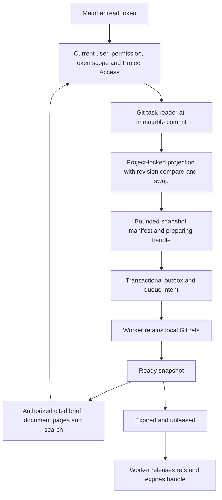

# Coding Agent Workflow integration review

Review dates: 20–21 October 2026. Status: review complete; implemented T00–T06 foundation verified against the integration baseline. No remaining known blocking findings in this scope.

## Scope and integration baseline

Review covers the implemented T00–T06 foundation against the [approved design](../specs/2026-10-20-kintsugi-coding-agent-workflow-design.md), [implementation plan](../plans/2026-10-20-kintsugi-coding-agent-workflow-implementation.md) and [testing matrix](../plans/2026-10-20-kintsugi-coding-agent-workflow-testing.md).

The feature began at `881b685` and was reviewed at `1b4771d`. Upstream was refreshed to `347548b`. Its document-write watcher and starter-publication behavior are integrated in the isolated feature branch. The worker startup conflict preserves review watching, outbox dispatch, snapshot cleanup and recovery. The shared checkout's unrelated edits are excluded.

Upstream owns migration 018. The unreleased feature migrations are now 019–023; the migrator continues to track full filenames. Migration 023 adds task-index configuration identity and invalidation. Existing installations are tested separately from empty-database startup.

## Implemented logic flow



Source availability, approval and observation availability remain distinct. A read never claims a task. Current authorization is checked even for old handles; current Git changes do not replace a snapshot's pinned inputs. Live implementation readiness still fails closed where trusted approval evidence is unavailable.

## Findings and corrections

| Finding | Correction and regression |
|---|---|
| Concurrent project refresh could fail with a duplicate key or retain the union of two Git revisions | Serialize replacement on the project row; compare the expected index UUID and source/configuration identity; retry a lost update. Real Postgres overlap and disjoint-set schedules exercise the race. |
| Application registration changes left the index stale without a Git commit | Fingerprint the registered IDs and invalidate on application insert/delete/reparent, including deletion and recreation of the same ID. |
| Application deletion raced with task replacement and produced a foreign-key failure | Lock the existing application rows before replacement, compare their configuration identity and retry a changed snapshot. A real deletion/refresh overlap reproduces the failure. |
| Accepted source metadata exceeded the wire schema | Shared strict title/assignee limits reject incompatible units into index issues. Project IDs retain the existing 100-character API contract. |
| Long linked paths exceeded source-ID or persisted-path limits, and blockers could not identify manifest sources | Share deterministic hashed source IDs between indexing and snapshots; reject document links longer than the existing 1000-character repository-path limit. Regressions cover long missing mappings and blocker-to-manifest identity. |
| A small document with a heading longer than 500 characters caused brief validation to fail | Bound section titles while retaining complete source text, line ranges and deterministic section identity. |
| Database collation and cursor ordering could disagree | Task ordering and cursor comparison use the same deterministic comparison. |
| Required deliverable IDs were always empty | Validate optional structured `requiredDeliverables` declarations and carry their IDs through manifests and briefs; do not infer declarations from Markdown. |
| Retention borrowed another connection while holding its advisory-lock connection | Use the lock-scoped connection for retention state and coordinate reads. Retention sessions also need independent bounded capacity so a mirror owner can finish its operational-pool query. |
| The first 100 leased snapshots starved cleanup | Exclude active leases before the batch limit, then recheck leases under the snapshot row lock. |
| UTF-16 offsets and code-point slicing could yield empty search excerpts; per-character lowercasing missed Greek final sigma | Preserve whole-string Unicode lowercasing for matches and map offsets back to original code points, including emoji and lowercasing expansion. |
| Oversized newer input blocked a valid historical brief | Report stale freshness while rendering the authorized pinned snapshot; preserve authorization failures. |
| Preparation timeout lost the newly created handle; lifecycle errors lacked codes | Return stable lifecycle `details.code` and `snapshotId`; preparing includes retry delay and same-handle guidance. |
| Malformed review IDs caused HTTP 500 | Validate the path parameter through the HTTP schema pipe and return 400. |
| A missing repository context escaped the stable snapshot error contract | Convert expected repository-context conflicts to `SNAPSHOT_UNAVAILABLE`; preserve access failures. |
| Upstream assessment metadata and its worker expectation omitted the architecture styling script | Include the existing script in the declared flow and expect its final artifact provenance to be `tool`. |
| The future stage-decision migration reused the planned reviews migration number | Initial allocation moved stage decisions to 027. T11 later assigned 025 to provider recovery, so the current planned sequence is provider 024–025, reviews 026, gate publication 027 and stage decisions 028. |
| A Python subprocess output decoding warning hid incomplete captured lint output on Windows | Reproduce with thread warnings treated as errors, then make the isolated child UTF-8 mode and capture encoding explicit in the test helper. |

## Verification evidence

Focused fixes were reproduced before implementation. Workspace tests ran without cached test results and with the real local Postgres configuration; all database suites executed. After the full workspace run, affected packages were rerun after their final corrections.

| Check | Result |
|---|---|
| Workspace build, typecheck and lint | 33/33 tasks passed with `--force`, zero cached tasks. API checks passed again after the final Unicode correction. |
| Domain | 8 files, 53 tests passed after final path-bound changes. |
| API | 39 files, 235 tests passed after all corrections. Includes empty-database startup, existing-installation 018→019–023 upgrade, live authorization, real Git/worker snapshots and concurrent Postgres schedules. |
| Orchestrator | 19 files, 98 tests passed, including retention lock/pool regression schedules and the merged document-write behavior. |
| Runtime | 12 files, 71 tests passed. |
| Other workspace packages and portal | Agents 58, Git 40, harness SDK 8, manifest 5, secrets 5 and portal 6 tests passed. Git has one Windows-only symlink test skipped. |
| Python scripts and hooks | Combined pytest run: 107 passed, 6 Windows symlink tests skipped, 15 subtests passed; zero test warnings with thread exceptions promoted to errors. |
| Compiled process smoke | Passed on final compiled API and worker in separate processes, including graceful shutdown. |
| Markdown links | 306 relative links checked across changed documentation; zero broken targets. |
| Independent review | The final reviewer found no remaining actionable defect in the corrected source identity, path/title bounds and Unicode search logic. Review was static; test execution is recorded separately above. |

The TypeScript runs cover 579 passing tests in total, using the final affected-package runs rather than counting repeated tests twice. Two existing portal hook dependency warnings remain in `workflow-board.tsx`; lint has zero errors. Native Windows shell verification puts Git Bash first in the test process's `PATH`, because WSL Bash changes `HOME` and is a different execution environment. No persistent system setting or runtime security rule was changed.

The six skipped Python cases require Windows symlink privileges unavailable to this process. They and the one skipped Git case require a supported environment before release security coverage is complete. The Python command is `uv run --offline --no-project --with pytest python -m pytest packages/agents/builtin/plugins/understand/scripts/tests packages/agents/builtin/plugins/understand/hooks/tests -q -ra -W error::pytest.PytestUnhandledThreadExceptionWarning`, with process-only UTF-8 settings. Local detailed logs live in the ignored plan execution directory `.superpowers/sdd/2026-10-20-kintsugi-coding-agent-workflow-implementation/`.

The repeatable process smoke command is:

```sh
corepack pnpm build
# Set KINTSUGI_TEST_DATABASE_URL privately to a loopback test server URL.
node scripts/smoke-coding-agent-context.mjs
```

The runner refuses missing configuration, creates only a randomly named `kintsugi_smoke_test_*` database and temporary Git/data directories, and cleans up its own processes and data. It boots the compiled API composition and worker core in separate processes on loopback; it does not test deployment-main environment parsing or start a model job.

The other repeatable commands are `corepack pnpm exec turbo run build typecheck lint --force` and `corepack pnpm -r --workspace-concurrency=2 --no-bail test`. Database tests require the private local `DATABASE_URL`; the test helpers create disposable databases rather than running migrations on the configured application database.

## Remaining release boundaries

T09–T17 remain planned: generated client plugins and setup, provider observations, trusted PR reviews, effective human gates, SSE, portal workflow and required CI/release evidence. The context API and SDK are unreleased and must ship together. T07 established the typed client and secure read-only CLI; T08 adds the local stdio MCP bridge. These milestones do not complete the full task-to-PR-to-effective-gate journey.

Docker/Linux deployment, real GitHub/GitHub Enterprise observations, model-driven reviews, browser workflow smoke and external AI-client interoperability were not exercised by this foundation audit. No remote branch was pushed, pull request opened, shared `master` merged or deployment performed.

## T08 implementation follow-up

On `feature/coding-agent-workflow-mcp`, the T08 implementation adds the pinned MCP server/client 2.3.1 packages, explicit-selector read-only tools, legacy and modern stdio negotiation, safe error mapping and per-request credential authorization. The compiled CLI bridge was exercised as a child process against a loopback HTTP fixture; the second call observed server-side token revocation without exposing the token. Hub tests passed 9/9, typed-client tests 12/12 and CLI tests 27/27; workspace build/typecheck/lint and host-client release probes remain separate verification gates.
