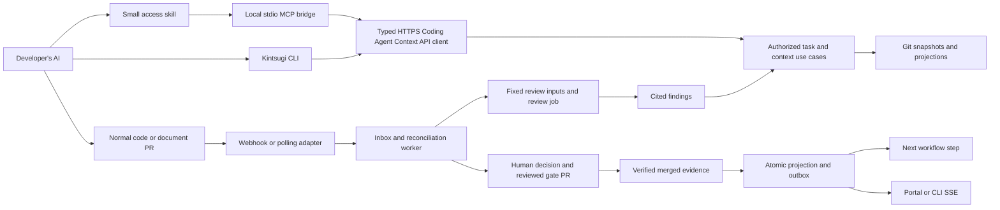

# Kintsugi Coding Agent Workflow — design v2

Date: 20 October 2026. Status: approved by the user as the basis for implementation and testing planning on 20 October 2026. This repository copy is the planning source of truth and supersedes the initial external research draft. Based on static inspection of Kintsugi `master` at `1bfa73d`, current official documentation, and three independent reviews. Research proves documented behavior and code structure, not runtime compatibility.

Implementation: [implementation plan](../plans/2026-10-20-kintsugi-coding-agent-workflow-implementation.md). Validation: [testing plan](../plans/2026-10-20-kintsugi-coding-agent-workflow-testing.md). Approval covers the design and planning phase; task checkboxes and runtime proof are tracked separately in those documents.

## 1. Outcome and confirmed scope

A developer tells their chosen AI: “Get my task, read the description and designs, explain the requirements, ask about missing decisions, then help me work.” The AI retrieves authorized Kintsugi context and reasons with the developer's own model subscription. The developer opens normal Git pull requests. Kintsugi observes them, reviews the result, presents findings, waits for the appropriate human gate and enables the next eligible workflow step.

Confirmed choices:

- Name the end-to-end capability **Coding Agent Workflow** and its user/project authorization **Project Access**. Use these names in the product and public SDK; keep `agent-context` for the API subdomain and wire-resource names.

- Read access first: tasks, basic/detailed designs, standards, evidence and review findings. No member-agent task claiming, assignment, approval or administration writes in v1.
- The developer's chosen AI answers questions. A Kintsugi-owned conversational assistant is later; server-side PR review remains part of the complete workflow.
- GitHub is the first provider family, including a specifically tested GitHub Enterprise Server version when required. GitLab, Bitbucket, Azure DevOps and exact AWS repository services are future adapters. Hosting a Git service on AWS does not change its provider protocol.
- Support Claude Code, Codex and Copilot CLI as three distinct local client targets. Prove the complete journey with one client, then pass the same contract and setup tests on the other two before claiming support. Hosted/web agents and other IDE surfaces are later targets.
- Keep self-hosted Compose, Postgres, pg-boss and Git. No broker, extra datastore, new coding-agent runner or runtime-specific business logic.

The first pilot uses one manually prepared unit, real authored designs as needed, one target code repo and the project's document repo. Automatic task generation is not a prerequisite for proving the Coding Agent Workflow.

## 2. What deeper review changed

| Priority | Earlier weakness | Revised decision |
|---|---|---|
| P1 | Portal-to-Git human gate integration was described too confidently | Implement the missing decision-to-reviewed-Git-record bridge; current DB approval is not effective delivery approval |
| P1 | Pinning reads once per request permits mixed revisions across follow-up questions | Return an explicit snapshot handle and require it on every contextual document/search call |
| P1 | A task could require the detailed design it is supposed to produce | Compute entry readiness for the requested activity; keep the task's acceptance gate as its exit condition |
| P1 | Default-branch presence was too close to an approval signal | Separate availability, publication and approval; validate the precise evidence revision covered |
| P1 | “Passing checks” and “latest PR revision” hid provider semantics | Specify producer/check identity, review/test/merge revisions, completeness and review generation |
| P1 | Recovery could miss already-merged PRs and a crash could lose next-step scheduling | Reconcile all PR states with a durable watermark; commit projection, event and queue intent atomically |
| P2 | CLI + local MCP + remote MCP + OAuth enlarged the initial surface | Ship CLI + local stdio MCP bridge using one HTTPS Coding Agent Context API/profile; defer remote MCP/OAuth |
| P2 | Bundling modernization content made simple access depend on workflows, hooks and extra tools | Publish a separate small Coding Agent Workflow plugin; keep modernization method plugins opt-in |

## 3. Evidence from the current repository

| Finding | Verified source | Consequence |
|---|---|---|
| Harness Hub is documented, not implemented | `services/harness-hub/README.md` | Build at this architectural seam; do not imply an existing MCP service |
| Shared unit model already includes assignee, dependencies, stage, targets and gate references | `packages/domain/src/index.ts:74` | Project a real task from Git rather than invent another task entity |
| Workbench CRUD is minimal and in memory | `apps/api/src/modules/delivery/workbench/domain/work-item.ts:3`, `work-items.module.ts:13` | It cannot serve as authoritative assignment/delivery storage |
| Task and unit files can be committed directly to the default branch | `packages/domain/src/document-layout.ts:17` | “On main” does not prove human approval |
| Design writers and Git gate-record automation are explicitly planned | `docs/reference/document-repo.md:38`, `:51` | Prepare pilot documents manually; implement gate record reconciliation explicitly |
| Portal gate decisions currently update Postgres and audit | `apps/api/src/modules/governance/gates/application/gates.service.ts:78` | A DB decision is a decision request/result, not proof that a Git quality gate is effective |
| Worker stage execution falls back to immediate default choices | `services/orchestrator/src/jobs/model.ts:149`, `jobs/runner.ts:680` | Procedural stage choices are not a verified human approval mechanism; required human decisions must fail closed |
| Document reads resolve Git commits and exclude restricted paths | Delivery Documents module | Reuse these services, adding scoped authorization, approved-context selection and bounded sections |
| Existing PR provider port only creates PRs | `packages/git/src/pull-requests.ts:30` | Add observation/check/review capabilities; creation adapters do not prove observation support |
| Every ordinary REST response is wrapped | `apps/api/src/common/interface/response.ts:33`, `main.ts:48` | Preserve REST envelopes; MCP has its own wire format, not wrapped JSON-RPC |
| API aliases are private; feature services have public exports | `apps/api/package.json`, `apps/api/src/modules/delivery/documents/documents.module.ts` | Inject shared ports; Harness Hub must not import API-private aliases |
| Queue library is pinned | API and orchestrator use `pg-boss` 12.37.1 | Verify that version's transaction API if used; a durable outbox avoids depending on an assumed queue API |

The gate findings require a correction to the earlier maturity assessment. Postgres gate helpers exist, but the stage runner's default decider is still the execution fallback. Do not treat either the helpers or the portal as proof of a completed approval-to-continuation path.

## 4. Architecture and transport decision



| Option | Benefit | Cost / limitation | Decision |
|---|---|---|---|
| CLI and skill only | Smallest implementation; usable by any agent with shell access | Less structured discovery and tool validation | Supported fallback |
| CLI + local stdio MCP + one HTTPS API | Structured tools, shared credentials and private-network access from developer machine | Node/CLI must be installed locally | Recommended v1 |
| Remote MCP + OAuth + CLI | Suits hosted clients and standardized connection flows | Extra auth/discovery/deployment/client-compatibility work; private network still needs reachability | Later ADR-approved phase |

This revises the remote-MCP-first direction in existing documentation and therefore needs an ADR amendment before implementation. It preserves the eventual endpoint without requiring it in the first release. Portable packaging does not guarantee portable credential expansion; Copilot's portable remote MCP values are passed literally, while clients provide different authentication helpers. [Copilot plugin reference](https://docs.github.com/en/copilot/reference/copilot-cli-reference/cli-plugin-reference), [Codex MCP](https://learn.chatgpt.com/docs/extend/mcp?surface=cli).

Proposed ownership:

```text
packages/domain                 existing units, roles, phases and document path helpers
packages/harness-sdk            validated wire DTOs, snapshot/query schemas, CodingAgentWorkflowPort
packages/kintsugi-client        proposed typed HTTPS implementation of CodingAgentWorkflowPort
packages/cli                    commands, formatting, local profile and credential-store adapter
services/harness-hub            stdio MCP adapter, Coding Agent Workflow plugin generators, client capability data
apps/api                        authorized member use cases, domain ports and adapter composition
packages/git                    provider-specific Git/PR observation operations
services/orchestrator           reconciliation, review scheduling, Git writer and outbox dispatch
packages/agents                 canonical small access skill; existing method plugins remain separate
```

`CodingAgentWorkflowPort` is framework-neutral. The local MCP adapter receives a typed HTTPS client implementing it. API use cases delegate to feature modules through their public exports. A future server-hosted MCP adapter can receive an in-process implementation at the API composition root; no Harness Hub import of `@kintsugi/api`, private `#modules` aliases, Postgres or server mirrors. The API can compose adapters without depending on them for domain behavior. Shared validators are built before consumers; use common utilities and domain vocabulary rather than duplicating them.

REST retains `{success:true,data}` and the established error envelope. CLI JSON uses the same payload contract. MCP translates use-case values/errors into native structured results and tool errors; it does not put the REST envelope around the MCP protocol. Future remote MCP must also bypass the current REST response interceptor and HTML SPA fallback deliberately. SSE remains its documented streaming exception.

## 5. Authoritative tasks, design roles and readiness

Read `unit.md` as `WorkItemFile`, validate with shared domain schemas, resolve `task.md` and explicit design/evidence references through shared layout helpers, then build a rebuildable task projection. There is one Git task identity per full project/application/module/unit. The in-memory Workbench API is not the source.

`task list --mine` matches an authenticated immutable user identity against a validated assignment. Normalize legacy names explicitly; an ambiguous username is not an identity match. Unassigned ready tasks can be listed and selected, but reading one does not claim it. Assignment writes and task generation remain outside the member token's scope.

Use basic design and detailed design as document roles, not hardcoded aliases or duplicate documents. The application's TO-BE design/brief and the unit's design are current candidates. Explicit references and shared layout helpers determine the actual sources.

Readiness is a deterministic projection with reasons, not an LLM judgment or a new phase state machine:

| Requested activity | Entry conditions | Expected output / exit |
|---|---|---|
| Understand or draft a design | Assigned/selected unit, source behavior and required upstream decisions available | Proposed design and its review; detailed design may legitimately be missing |
| Implement code | Applicable predecessor gates satisfied; required basic/detailed designs and standards approved at the referenced revisions | Code/document PRs, tests and evidence; the unit's G4 acceptance remains an exit gate |
| Verify | Candidate implementation revisions and test plan available; prerequisite approvals satisfied | Verification evidence and applicable acceptance gate |

Represent `readyFor`, `blockers`, required inputs and expected outputs using shared contract types; reuse existing phase/stage identifiers. Do not require a future G4 record to begin producing the G4 evidence. A human G3 readiness decision is not replaced by an inferred automatic pass.

Every source reports availability and approval independently: missing/present, draft/published, pending/approved/rejected/unknown under the applicable policy. Approved means a validated authorized decision/merged record covers the exact artifact revision. A pending scaffold, commit ancestry, default-branch presence or an `approved` string in arbitrary content is insufficient. Existing task auto-commit behavior stays; approval eligibility is checked separately.

The task declares stable required deliverable IDs, repository/artifact roles and completion rules. One PR covers one unit in the pilot; several PRs may fulfill that unit's required code and document deliverables. Completion is evaluated against the approved checklist, not against whichever PRs happen to have been discovered.

## 6. Snapshot and retrieval contract

The brief is a deterministic view of approved sources, not an AI-generated replacement for the specification. `task brief` returns an explicit immutable `snapshotId`, required-context index and citations. All contextual document/search requests require the handle. No hidden “active task” or per-connection project state is used by MCP tools. This follows the current MCP guidance for explicit application handles. [MCP stateful tools](https://modelcontextprotocol.io/specification/2026-07-28/server/tools#stateful-tools).

Illustrative payload inside the ordinary REST envelope:

```json
{
  "schemaVersion": "1",
  "projectId": "modernization",
  "unitId": "billing/invoices/tax",
  "snapshotId": "ctx_<opaque-id>",
  "contextRevision": "sha256:<canonical-relevant-input-manifest>",
  "activity": "implementation",
  "readyFor": ["implementation"],
  "blockers": [],
  "documentRepoCommit": "<full SHA>",
  "requiredContextStatus": "partial",
  "sources": [
    {
      "sourceId": "src_<opaque-id>",
      "role": "detailed-design",
      "repositoryId": "project-docs",
      "commit": "<full SHA>",
      "path": "applications/billing/units/invoices/tax/design.md",
      "contentHash": "sha256:<hash>",
      "approval": {"status": "approved", "recordId": "<immutable evidence reference>"}
    }
  ],
  "omittedSections": [{"sourceId": "src_<opaque-id>", "sectionId": "tax-edge-cases", "required": true}],
  "nextCursor": "<continuation>",
  "freshness": {"observedAt": "<UTC time>", "mirrorStale": false}
}
```

The snapshot manifest binds repository IDs to full commits, source IDs/file hashes, task/deliverable revisions, required design/standards, approvals and policy version. Multiple repositories have separate commit identities; there is no fictional cross-repository Git commit. `contextRevision` includes relevant inputs only, excluding generated output, review results and unrelated changes to avoid self-triggering review loops.

Keep a compact immutable manifest record as a rebuildable index in Postgres, with an expiry and retained audit references. The handle is a name, not permission: every query verifies current user/project/token access. Historical Git commits required by active snapshots/reviews must remain reachable through a retention mechanism; pruning cannot silently substitute HEAD. Expired or unavailable snapshots return a specific error with instructions to obtain a new brief. Revocation blocks old snapshots too.

Lease acquisition and expiry claim serialize on the snapshot row. Postgres wall-clock time decides expiry and active leases, even if a worker's clock differs. Cleanup records an expiring state before deleting Git refs so a restarted worker can resume it; stale preparing snapshots also have a bounded recovery scan after retention queue retries end.

The shared query schemas include snapshot, source/section identifiers, bounded byte/result limits, continuation cursor and citations with line/range where applicable. Default brief budget is proposed at 32 KiB, configurable after pilot measurement; it includes the objective and an index of every mandatory input. Large authoritative sections are paged. If mandatory content exceeds the response, mark partial and require retrieval before implementation; never claim an incomplete result is complete. The skill tracks required sections retrieved in the current conversation; after compaction or export it refreshes the requirement index rather than assuming prior context is retained.

`document_search` is bounded keyword search over eligible snapshot content, with exact citations. It does not call a model or require an embeddings project. `document_get` accepts registered source IDs and validated ranges; no arbitrary URL fetch, filesystem path, or recursive external link traversal. A separate explicitly labeled draft-browsing path may show unapproved content; it never joins the approved implementation brief silently.

New relevant approved input creates a new context revision. Existing contexts remain inspectable if authorized but display that a newer revision is available. Before work/PR review, revalidate currentness. A changed requirement requires explicit acknowledgment through the refreshed PR context reference; neither a model summary nor a stale browser session approves it.

## 7. CLI, tools and developer interaction

Proposed commands; none are available today:

```text
kintsugi auth login --url https://kintsugi.example.internal
kintsugi auth status
kintsugi project list
kintsugi project use modernization
kintsugi task list --mine
kintsugi task list --ready-for implementation
kintsugi task brief billing/invoices/tax --json
kintsugi task brief billing/invoices/tax --format markdown --output ./task-brief.md
kintsugi document get --snapshot <id> --source <id> --section <id>
kintsugi document search --snapshot <id> --query "rounding"
kintsugi review list --task billing/invoices/tax
kintsugi review get <review-id> --json
kintsugi task watch billing/invoices/tax
kintsugi plugins setup --harness claude-code
kintsugi doctor
kintsugi mcp serve --profile work
```

The MVP MCP tools are `project_list`, `task_list`, `task_brief`, `document_get`, `document_search`, `review_get` and `task_status`; a brief/status includes relevant PR and gate links. Add other tools only for a demonstrated query. Require explicit project/unit/snapshot arguments where relevant; CLI local preferences may fill them before the request, but cannot silently select a different installation. Scope a bridge profile to its expected installation and allowed projects.

The access skill implements: identify/select task → retrieve brief → fetch required sections → explain/answer with citations → list unresolved decisions → plan/work within user-authorized scope → include PR references → fetch current review findings. It never claims or approves a task. If a requirement is unsettled, return a precise question and portal/task-owner link; persistent clarification writes come later.

An AI with shell access can invoke the CLI. A chat without tools can use an exported Markdown brief. `--output` explicitly writes a private local file and refuses overwriting by default; no automatic edits to project instructions. Exported content cannot be recalled from another AI conversation after access revocation; refresh source/currentness before acting. A CLI does not generically inject text into an arbitrary running conversation. Developer-invoked pipes start separate sessions according to the agent's own documented behavior. [Codex non-interactive mode](https://learn.chatgpt.com/docs/non-interactive-mode), [Claude programmatic use](https://code.claude.com/docs/en/headless).

The chosen AI interprets Kintsugi sources. The CLI does not need its own model, and `kintsugi ask` is deferred. Kintsugi-controlled runtime review is distinct from member-side conversation.

Terminal rules: compact human output, stable explicit JSON, stdout reserved for results, stderr for diagnostics/errors, valid JSON errors and nonzero exit codes, no prompts under `--no-input`, no animations/color in non-TTY mode, cancellation and timeouts, explicit pagination, no secrets in diagnostics. Stdio stdout is protocol-only. Use Commander with a pinned compatible version, TypeScript/ESM and a declared Node minimum aligned with tested environments. Keep error codes in the shared failure contract, not scraped human strings. [CLI Guidelines](https://clig.dev/).

The portal uses its existing design system: one next action, compact task/PR/evidence rows and a timeline. Distinguish installed, connected, authorized, context currentness and provider-sync health. Readiness and blockers are visible before “Work in my AI”; provider credentials and model settings do not appear in a member's task flow.

## 8. Credentials, Project Access, trust and plugin distribution

There are separate credential boundaries:

| Credential | Stored/used by | Authority |
|---|---|---|
| Member's Kintsugi token | Local OS credential profile; sent only to the configured Kintsugi API | Expiring, revocable read scopes limited to allowed projects and current user authorization |
| Server's Git provider credential | Encrypted installation secret store | Selected repositories and the required provider API operations |
| Runtime model credentials | Existing runtime provider path | Model use for the supplied server review job; never member/provider secrets in job environment |

Implement the member token lifecycle; bearer session transport is not scoped PAT support. Hash issued Kintsugi tokens at rest, show once, expire/revoke/audit. Login uses hidden input or `--token-stdin`; no token values in command arguments, plugin configs, Git or URLs. If secure local storage is unavailable, fail with a clear supported alternative; do not silently store plaintext. CI injection is explicit and not forwarded into runtime job environments.

Project Access is a prerequisite: current `member.read` permission ∩ explicit Project Access grant ∩ token scope. Assignment or RACI is not an access grant. Reuse the permission catalog/migrations and add the missing Project Access persistence and use cases; do not implement security by checking only a project ID string. Apply this to task listings, snippets, links, review findings, replay and live SSE. Recheck streams before events and periodically while idle.

Prefer an organization-installed GitHub App for the server connector, separate from member identity and tokens. Start with selected-repo metadata/content/PR/check/status reads. Optional publishing needs explicit additional permissions: checks write and/or PR comments. No automatic merge or repository administration. Installation tokens are short-lived and may be narrowed to selected repositories/permissions. Existing encrypted provider tokens can support a capability-tested observation pilot; do not promise identical Checks API write behavior for every token/GHE version. Current Checks documentation contains conflicting prose and fine-grained-token tables, so probe the intended mode rather than infer it. [GitHub App installation authentication](https://docs.github.com/en/apps/creating-github-apps/authenticating-with-a-github-app/authenticating-as-a-github-app-installation), [Checks API](https://docs.github.com/en/rest/checks/runs).

Retrieved documents and PR content are source data, not authority to run unrelated commands, fetch secrets, change configuration or redirect destinations. The reviewed access skill supplies workflow instructions. Approved design text expresses project requirements within the user's task; it cannot override user/platform instructions. Read-only server tools do not prevent an agent from executing malicious retrieved text with other local tools, so add output provenance, source roles, adversarial tests and explicit skill boundaries without claiming complete prompt-injection protection. [OpenAI skill guidance](https://developers.openai.com/plugins/build/skills), [MCP security guidance](https://modelcontextprotocol.io/docs/2026-07-28/tutorials/security/security_best_practices).

Ship the small dedicated Coding Agent Workflow plugin. Do not bundle `modernize` in v1: its current commands assume hooks, subagents, Python and server workflow tools, beyond read-only task retrieval. It remains an opt-in method pack after semantic compatibility review. Author one canonical skill set in the existing plugin content system, keeping ADR-0015's Claude source format until amended; generate target exports. Portable skills/MCP do not make hooks, agents or workflow execution interchangeable. [OpenAI packaging](https://developers.openai.com/plugins/build/plugins), [Copilot portable components](https://docs.github.com/en/copilot/reference/copilot-cli-reference/cli-plugin-reference).

Generated MCP wiring launches the installed CLI's stdio bridge with a nonsecret profile name. A verified local launcher/path is resolved by setup; avoid floating `npx ...@latest` and shell-built command strings. Native installation validates each client package, including `claude plugin validate --strict`. Setup preserves unrelated settings, reports the configuration scope, tests authentication and can repeat safely. Publish to an owned verified package namespace/repository with exact artifact versions/commits, integrity/provenance, supported CLI/API/schema ranges and explicit upgrades/rollback. Registry names and install links are not yet registered or verified. Provenance is traceability, not a security review. [npm provenance](https://docs.npmjs.com/generating-provenance-statements/).

## 9. Provider observations, reviews and feedback

Extend the existing Git provider seam, using shared repository/provider identities. Normalize PR/MR snapshots, review/check evidence and feature capabilities. GitHub fields stay in its adapter. Unsupported gate signals remain unknown/unsupported; they never count as passed. Exact GitHub Enterprise Server version, API base URL and private CA behavior require a pilot probe.

### Association and discovery

A normal PR carries project/unit, context revision and required deliverable references in a documented body block. Metadata is an untrusted association claim. Validate the registered repository, expected target branch, unit/deliverables and current context. Auto-link only with a verified provider-actor mapping to an authorized project contributor; unknown/fork/ambiguous cases need maintainer confirmation. An editable PR body cannot reassign an accepted link. Use stable provider host/repository/PR IDs; URLs and branch names are display/hints, not primary identity. Fork association does not depend on a check event's possibly empty PR array.

Webhooks are low-latency hints; polling is the recovery authority. Verify raw-body signatures, size limits and connection identity; persist a unique receipt before acknowledging and use a resumable inbox dispatcher. Serialization per PR plus fetching current state handles duplicates/out-of-order delivery. Private installations may use polling only; a public callback is not required.

Recovery discovers open AND closed/merged PRs updated since a durable watermark, with overlap, pagination and a periodic deeper backfill. Advance a watermark only after a complete successful sweep. Do not scan only currently open PRs: a PR may open and merge during downtime. GitHub does not automatically redeliver failures. Poll cadence is adaptive to API budget and repository count; 60–120 seconds is a pilot tuning range, not an SLA. Missing historical evidence creates a review-needed condition rather than invented historical approval. [Failed webhook deliveries](https://docs.github.com/en/webhooks/using-webhooks/handling-failed-webhook-deliveries), [PR listing](https://docs.github.com/en/rest/pulls/pulls#list-pull-requests), [rate limits](https://docs.github.com/en/rest/using-the-rest-api/rate-limits-for-the-rest-api).

### Review inputs and attempts

Capture head SHA, current base SHA, comparison merge-base, context revision and policy/agent version. Keep provider test-merge and final merged revision/tree distinct; squash/rebase may not preserve the PR head identity. Basic v1 excludes merge-queue repositories until `merge_group` input/check semantics are implemented and tested; setup reports that limitation rather than silently approving them.

The worker materializes fixed source snapshots through the registered Git provider/mirror and verifies identities before creating the job's read-only input manifest. It verifies completeness of the changed-file set; API pagination alone is insufficient because the PR files endpoint has a 3,000-file cap and the PR commits endpoint has its own cap. Missing objects, binaries, submodules, generated/excluded material and budget-limited sections have explicit coverage outcomes. Incomplete required inputs produce inconclusive/manual-review status, never a passing verdict. No execution of untrusted PR code with installation credentials. [PR API and input limits](https://docs.github.com/en/rest/pulls/pulls).

Deduplicate an effective review generation by PR identity + reviewed revisions + context revision + policy/agent version. Store attempts separately. Infrastructure retries before/around a job differ from an explicitly authorized new generation on unchanged code. Preserve the current no-blind-retry behavior for model jobs; manual reruns use a portal permission, create an audited generation and supersede prior results. Check rerequest events are supported only after actor/permission validation. A push, relevant context change or retarget invalidates affected results; stale completion cannot become current.

The runtime remains a generic kernel. Supply a versioned, tested read-only review agent definition and fixed inputs; a catalog name alone is not a validated review capability. The worker publishes output via the existing writer. Findings retrieval is mandatory through CLI/MCP: review ID, generation, severity, rationale, source file/line or citation, reviewed revision, suggested repair, and current/superseded/inconclusive status. GitHub comments/check publishing is optional in the first pilot; the developer's chosen AI must be able to fetch actionable findings regardless.

### Evidence policy

A “green check” is not enough. The policy names each required check/status and expected producer/App, acceptable evaluated revision and latest valid attempt/conclusion. Distinguish GitHub merge requirements from Kintsugi evidence that a test actually executed: skipped/neutral results may satisfy GitHub, but are not automatically successful test evidence. Same-named check runs and statuses must not be conflated. Effective human reviews account for dismissal, latest-reviewable-push policy and reviewer authority. Re-read current provider state before accepting results; published checks/comments are bound to the reviewed SHA, so a race cannot approve a newer head. [GitHub required-check semantics](https://docs.github.com/en/pull-requests/how-tos/merge-and-close-pull-requests/troubleshooting-required-status-checks), [ruleset review policy](https://docs.github.com/en/repositories/configuring-branches-and-merges-in-your-repository/managing-rulesets/available-rules-for-rulesets).

## 10. Human gate bridge and durable continuation

Keep two concepts separate:

- Procedural stage choices answer runtime questions with options/defaults. Required human choices need a persisted waiting decider wired into execution; optional defaults remain explicit and audited. They are not quality acceptance.
- Delivery quality gates approve specific evidence. Per ADR-0038 their effective records live in reviewed, merged Git documents; a database `approved` row alone cannot complete a unit/phase.

Implement the bridge as a first-class milestone: authorized decision request → immutable decision/evidence manifest → document writer proposes a gate-record PR → authorized human merge under policy → reconcile current evidence and record → effective gate projection. The portal displays “decision recorded, Git publication pending” separately from “effective approval.” If the Git write fails or required evidence changes, keep the gate pending/stale and expose repair; do not double-prompt for the same decision unless its evidence basis changed. Proposed record approval/merge separation of duties is configurable by policy; never require the gate record to approve itself.

The existing readable Markdown gate record needs a schema extension through an ADR: context/policy revision, required deliverable IDs, stable PR/repository identities, reviewed and final merged revisions, review-result IDs, authorized actor/decision and audit references. Human-authored records pass the same validator. A name typed into Markdown or a bot's commit identity does not prove a human decision: verify the actor through authenticated decision/audit evidence or the configured provider approval identity. An approved Git file without a valid actor/policy/evidence binding does not satisfy a gate. The current task's G4 record approves its completed outputs, not its own existence.

The pilot ordering is explicit: automated review → provider pre-merge human approvals → code/document deliverable PRs merge → G4 decision and gate-record PR → effective G4/phase exit. Provider-required checks and human PR reviews are pre-merge conditions. If published as a required code-PR check, Kintsugi's automated review checks that PR's reviewable inputs; it must not wait for the unit's post-merge G4 completion record. The effective G4 record is a phase-exit approval of the resulting merged evidence. Its own document PR validates schema, actor authority, policy and completed evidence under independent review rules; it never requires that same G4 record to be effective before merging. The runtime/writer bot cannot supply the human decision. Separate records are used for a design approval needed before coding and for acceptance of the completed code. This ordering also avoids treating an approval of pre-merge head A as approval of an unverified merged tree B.

When the gate-record PR merges, compare its evidence manifest with the required immutable merged deliverable revisions. Do not compare approved merged evidence against a target branch tip that keeps advancing for unrelated units. For an open or replaced deliverable, a gate drafted for head A does not approve later head B; relevant context changes or replacement evidence require a new decision. Multiple required PRs and their evidence are checked against the approved deliverable list. Closed-unmerged PRs, incomplete reviews and unavailable provider signals remain blockers. Authorized waiver policy needs explicit immutable rationale and approver authority; it is not a generic bypass exposed to the agent.

After authoritative Git validation, commit the operational projection update, durable workflow event/outbox and next-step scheduling intent in one Postgres transaction. Use an idempotency key tied to the gate decision/evidence revision. A retry repairs missing dispatch instead of advancing twice. Git writes/API publishing happen outside that DB transaction under a durable operation ID, so a crash after a successful external write can reconcile it. Use an outbox dispatcher or a verified transaction integration with installed pg-boss 12.37.1; do not assume a generic queue send is atomic with projection writes.

SSE reports these durable events to the portal/CLI. Resume by event ID, authorize replay and live events, and return resync when a cursor is outside retention. The queue continues with all clients disconnected. SSE does not discover provider PRs or wake an idle coding agent.

## 11. Delivery sequence and proof

| Step | Concrete output | Acceptance |
|---|---|---|
| 0 — Small decision/probe set | ADR amendments for transport/plugin boundary, project auth, task/snapshot contract, gate evidence bridge and deliverable-merge-before-effective-G4 ordering; exact client/GHE versions; one prepared unit | Installation reachability, auth mode, task inputs and gate policy are concrete; no speculative task generation |
| 1 — Authoritative read foundation | Project-scoped tokens/access, Git unit/task/assignment projection, readiness and source approval validator, bounded snapshot/query schemas | Correct assigned task returned; draft/approved/missing designs distinguished; unauthorized/snapshot-swapped reads rejected |
| 2 — CLI and one-agent pilot | Typed HTTPS client, CLI brief/export/search/findings, local MCP, doctor, small access skill | Agent receives task/design, answers a cited question, identifies an unresolved decision, and plans from one consistent snapshot |
| 3 — Native packaging matrix | Generated Claude Code/Codex/Copilot CLI packages, pinned launcher/version policy, idempotent setup | Fresh install/auth/restart succeeds on each tested client and supported OS; no secrets or unrelated config edits |
| 4 — PR review loop | GitHub/GHE observation, inbox/all-state recovery, complete snapshot materialization, versioned review agent, actionable findings | PR opened outside Kintsugi triggers review with developer offline; push/fix triggers fresh review; stale/partial results cannot pass |
| 5 — Effective human gates | Decision-to-Git bridge, evidence-bound gate validation and atomic outbox continuation | Human gate applies only to exact required evidence; failed publication stays pending; replay/crash advances once |
| 6 — Release pilot | Populated portal/CLI journey, SSE recovery, auth/network/rate/degradation checks | Task → cited Q&A → work → PR → findings → fix → provider human approval → deliverable merge → effective Git G4 → next step passes on supported matrix |

Steps 1–3 are an explicitly limited preview. Steps 4–6 are necessary before claiming the complete promised workflow. Remote MCP/OAuth, hosted clients, own assistant, task-generation/claim writes, semantic search, telemetry hooks, merge queues and other providers remain later work.

Minimum meaningful verification:

- Same snapshot/provenance across CLI/MCP, paged retrieval and follow-up search; updates never silently change sources.
- Task-specific readiness, stable assignee identity, missing design, pending gate scaffold, auto-committed task, malformed/foreign-project source and required-context completeness.
- Expired/revoked/over-scoped tokens, current Project Access, cross-profile/snapshot confusion, malicious document commands/links, private output files and no credential leakage.
- Fresh native install and upgrade/rollback on Windows and Linux, spaces in paths, GUI PATH differences, disabled plugins, no secure-store availability and incompatible schema/client versions.
- PR identity/association/forks, duplicate and out-of-order notifications, a PR opened-and-merged entirely during downtime, watermark partial failure, API rate-limit backoff and input caps.
- New head/base/context during review, skipped or wrong-producer checks, dismissed reviews, squash/rebase merges, incomplete required files, intentional same-revision rerun and stale findings retrieval.
- Gate drafted for old evidence, partial multi-PR deliverables, failed Git publication, unauthorized gate edit, double delivery and crashes between external write, DB commit and queue dispatch.
- No cycle between a required pre-merge code check, its resulting merged code evidence and the post-merge phase-exit gate record.
- SSE resume/expiry/revocation, client disconnection, proxy buffering and graceful degraded sync. Client disconnection must not cancel server work.

Measure actual pilot outcomes: successful fresh setup, task/design discovery accuracy, required-context completeness, cited answer quality, tokens/context size, webhook/poll latency, duplicate review rate and recovery time. Proposed targets are hypotheses to measure, not benchmark claims. Do not declare all agents supported because one client read a manifest.

## 12. Approval and remaining decisions

The user approved the narrowed transport/plugin scope and gate bridge on 20 October 2026. This approval does not silently rewrite existing accepted ADRs: implementation task T00 records the corresponding decisions and register updates. The exact GHE version, pilot check/reviewer policy, package namespace and tested client versions are resolved by the explicit execution probes and release gates in the implementation/testing plans.

No additional research or source review can prove native setup, queue crash recovery, provider permissions or full workflow behavior without building and exercising the pilot. Those limits are explicit release acceptance gates rather than assumed capabilities.
