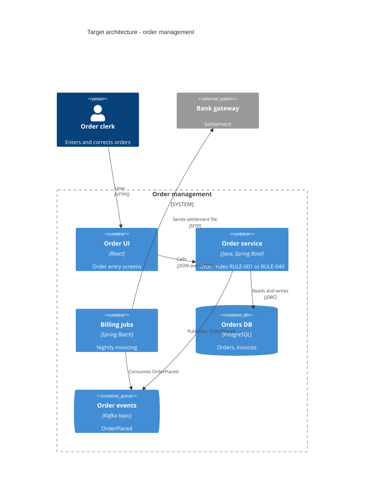

# C4 container reference

Condensed from softaworks/agent-toolkit `skills/mermaid-diagrams/references/c4-diagrams.md` and
`skills/c4-architecture/references/{c4-syntax,common-mistakes}.md` (MIT, see `../LICENSE-softaworks`),
rewritten to the rules of this skill. Used for the target architecture of a modernization brief and a
reimagined system. Kintsugi uses `C4Container` only (and `C4Context` for a one-box system context);
internals are drawn as flowcharts, not `C4Component`.

## Elements

| Macro | Element |
|---|---|
| `Person(per_id, "Name", "Description")` | a user role (`Person_Ext` outside the organization) |
| `System_Ext(ext_id, "Name", "Description")` | an external system the target talks to |
| `Container(ctr_id, "Name", "Technology", "Responsibility")` | a deployable unit: app, service, job runner |
| `ContainerDb(ctr_id, "Name", "Technology", "Holds")` | a database or file store |
| `ContainerQueue(ctr_id, "Name", "Technology", "Carries")` | a queue or topic |
| `Container_Ext(…)`, `ContainerDb_Ext(…)` | the same, owned by someone else |
| `System_Boundary(bnd_id, "Name") { … }` | the system being built, around its containers |

The first argument is a sanitized id; every other argument is a quoted string.

## Relationships

`Rel(from, to, "What", "Protocol")`: one direction, labelled with what flows and how. Prefer two `Rel`
lines over `BiRel` when the two directions carry different things. `Rel_D`, `Rel_R`, `Rel_L`, `Rel_U`
hint the layout. Every element a `Rel` names must be defined.

## Example

## Common mistakes

- **Classes or libraries as containers.** A container is deployable on its own; a shared library is part
  of each container that uses it and is usually left out.
- **One hub for the message broker.** Draw the topics or queues that carry each flow, not one "Kafka"
  box every container points at.
- **Unlabelled or vague relationships** ("uses" everywhere). Say what flows and over what protocol.
- **Internals of external systems.** An external system is one box.
- **Deployment details** (nodes, clusters, regions) in a container view: leave them to the text.
- **Too many elements.** Keep a view under about 15 elements where possible and never above 25; split
  by bounded context and draw one view per context.
- **No legend.** State in the surrounding text what the boundary and the colours (if any) mean.
