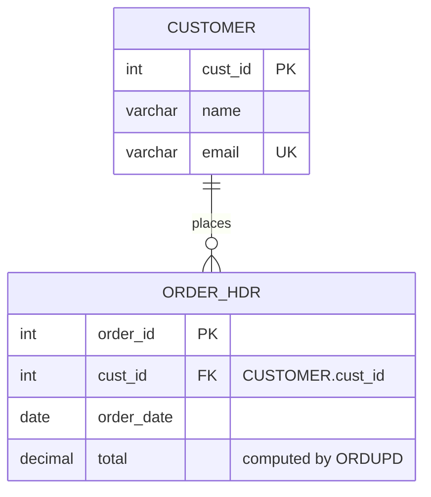
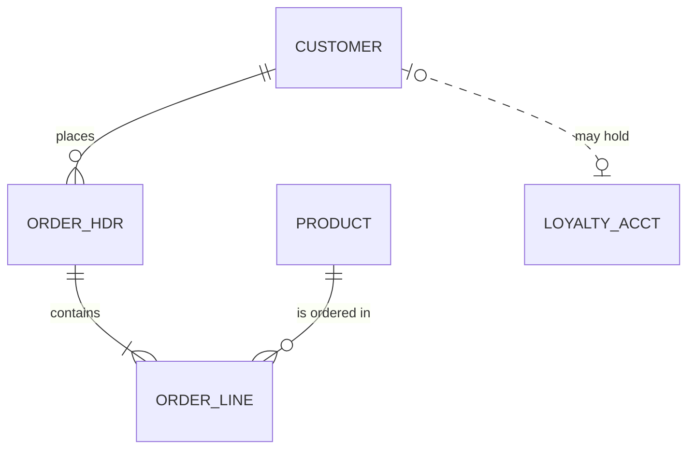

# Entity relationship reference

Condensed from softaworks/agent-toolkit `skills/mermaid-diagrams/references/erd-diagrams.md` (MIT, see
`../LICENSE-softaworks`), rewritten to the rules of this skill. Used for `data-model.md`,
`DATA_OBJECTS.md` and the domain model of a reimagined system.

## Entities and attributes

- Entity names: letters, digits, `_` and `-`, starting with a letter; UPPER_SNAKE by convention.
  Sanitize legacy names (`ORDER-HDR.CPY` becomes `ORDER_HDR`) and keep the original in the text.
- Attribute lines: `type name`, then optional keys `PK`, `FK`, `UK` (comma separated: `PK, FK`), then an
  optional quoted comment. Types are one word (`varchar`, `decimal`, `pic_x_20`); put details such as
  lengths or COBOL pictures in the comment.
- Show the key attributes and the ones the text discusses, not every column.

## Relationships

`LEFT <cardinality>--<cardinality> RIGHT : label`

| Left | Right | Means |
|---|---|---|
| `\|\|` | `\|\|` | exactly one |
| `\|o` | `o\|` | zero or one |
| `}o` | `o{` | zero or more |
| `}\|` | `\|{` | one or more |

- `--` is an identifying relationship (the child cannot exist without the parent), `..` non-identifying.
- Every relationship has a label: one word bare (`places`), more than one word quoted (`"is billed to"`).

## Pitfalls

- Cardinality tokens are fixed: `}o--x` or `|>` are not Mermaid.
- A relationship without `: label` does not parse.
- Spaces in entity names are not allowed; quote nothing on the entity side.
- More than about 25 entities or 40 relationships: split by domain, one diagram per domain plus the
  relationships that cross domains.
