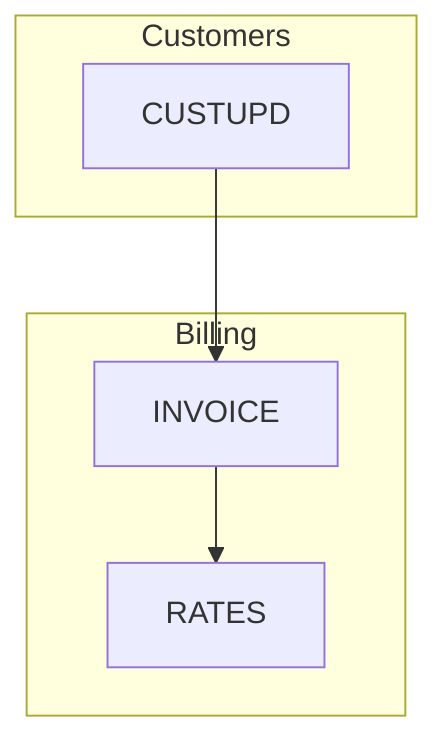
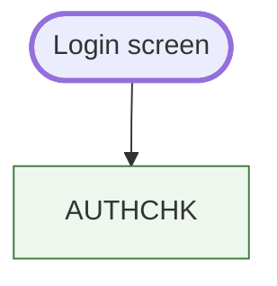
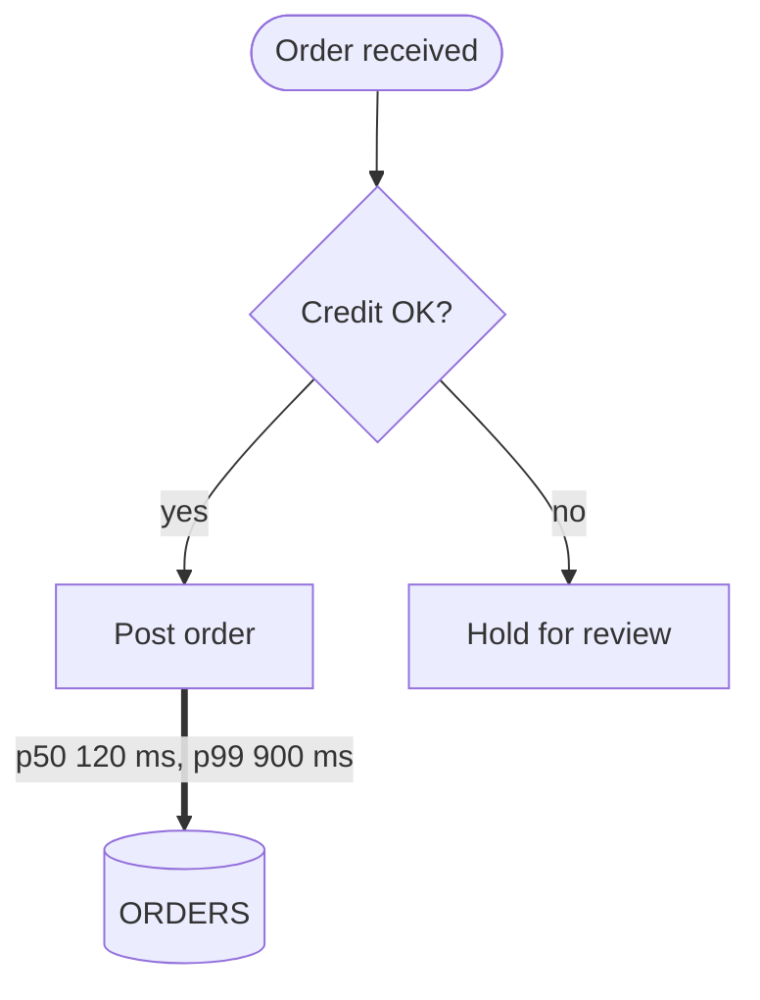
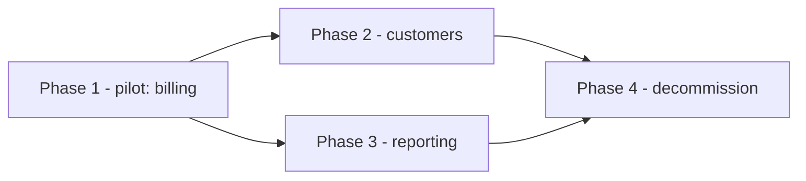

# Flowchart reference

Condensed from softaworks/agent-toolkit `skills/mermaid-diagrams/references/flowcharts.md` (MIT, see
`../LICENSE-softaworks`), rewritten to the rules of this skill: sanitized ids, quoted labels, no
inline styles. Used for `ARCHITECTURE.mmd`, `call-graph.mmd`, `data-lineage.mmd`, `critical-path.mmd`,
module graphs and phase plans.

## Header and direction

`flowchart TB` (or `TD`) top to bottom, `LR` left to right, `BT`, `RL`. The header is the first line.

## Node shapes

| Shape | Syntax | Use for |
|---|---|---|
| Rectangle | `svc_a["Text"]` | programs, services, steps |
| Rounded | `svc_a("Text")` | user-facing steps |
| Stadium | `ui_a(["Text"])` | start and end of a flow |
| Subroutine | `svc_a[["Text"]]` | shared library routine, copybook |
| Cylinder | `db_a[("Text")]` | data stores (tables, files, queues) |
| Circle | `ev_a(("Text"))` | events, junctions |
| Decision | `chk_a{"Text?"}` | branches on the critical path |
| Hexagon | `job_a{{"Text"}}` | batch jobs, schedulers |
| Parallelogram | `io_a[/"Text"/]` | inputs and outputs (files, reports) |

Every label is quoted, even plain words, so a later edit cannot break the diagram.

## Edges

| Syntax | Meaning |
|---|---|
| `a --> b` | arrow (calls, writes, sequence) |
| `a --- b` | line without arrow (association) |
| `a -.-> b` | dotted arrow (reads, optional or async) |
| `a ==> b` | thick arrow (the critical path) |
| `a -->\|"label"\| b` | labelled edge; quote anything beyond letters, digits, spaces, `.`, `,`, `-` |
| `a --> b & c` | fan-out: two edges (counts as two against the limit) |

Do not use the inline text form `a -- text --> b`; always use `-->|"text"|`.

## Subgraphs

- Every subgraph has an id and a quoted title: `subgraph dom_x["Title"]`, closed by `end`.
- A `direction` inside a subgraph is ignored when its nodes link outside it; do not rely on it.
- Link nodes, not subgraph ids; nested subgraphs that are themselves linked break the layout.

## Classes

`:::name` on a node or `class id1,id2 name` assign a class; every class needs a `classDef`. Use classes
for meaning (kind, entry point, critical step), not decoration; avoid `style` lines.

## Patterns

Decision on a critical path:

Phase plan (never a gantt):

## Pitfalls

- Keywords as ids (`end`, `default`, `class`, `style`, …) and ids starting with `o` or `x` break edges.
- A `%%` comment after a statement on the same line is a syntax error; comments go on their own line.
- Unquoted parentheses, brackets, colons, semicolons or quotes inside a label end the shape early.
- More than 40 edges or about 25 nodes: collapse to domain level or split (see SKILL.md).
