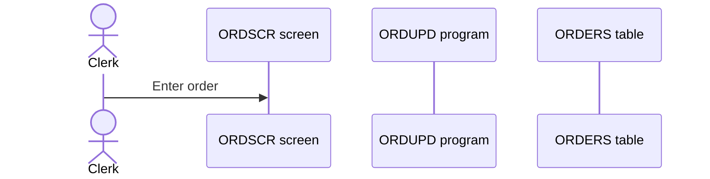
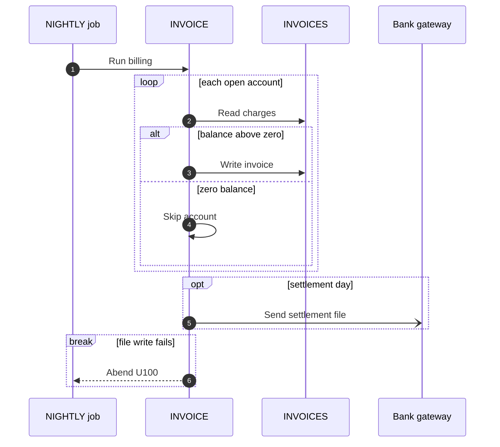

# Sequence diagram reference

Condensed from softaworks/agent-toolkit `skills/mermaid-diagrams/references/sequence-diagrams.md`
(MIT, see `../LICENSE-softaworks`), rewritten to the rules of this skill. Used for the main flows of
a unit in an AS-IS specification: one scenario per diagram, at most 12 participants.

## Participants

- `actor` for people and outside callers, `participant` for programs, screens, stores and systems.
- Declare every participant up front, in reading order (caller to store), with a sanitized id and a
  readable alias after `as`. The alias is plain text: no quotes, `;` as `#59;`.

## Messages

| Arrow | Meaning |
|---|---|
| `a->>b: text` | call or request (synchronous) |
| `a-->>b: text` | return or response |
| `a-)b: text` | asynchronous message (queue, event, fire and forget) |
| `a-xb: text` | failed or rejected call |
| `a->>+b` / `b-->>-a` | activate / deactivate `b` (optional) |
| `a->>a: text` | internal step |

Message text is unquoted: write `;` as `#59;`, `#` as `#35;`; keep it short and cite rule ids
(`Reject (RULE-014)`).

## Blocks

Every block closes with `end`.

| Block | Use for |
|---|---|
| `alt … else … end` | branches (one `alt`, any number of `else`) |
| `opt … end` | a step that happens only under a condition |
| `loop … end` | repetition (per record, per line, retry) |
| `par … and … end` | work in parallel |
| `critical … option … end` | a step that must succeed, with its handled failures |
| `break … end` | early exit (error, abend) |

## Notes and numbering

- `autonumber` as the first statement numbers the messages; cite the numbers in the text.
- `Note over svc_a,db_b: text` or `Note right of svc_a: text` for facts the arrows cannot show.

## Pitfalls

- A raw `;` in message or note text ends the statement: use `#59;`.
- A participant id that is a keyword (`end`, `opt`, `loop`) breaks the diagram: prefix it.
- Every `alt`, `opt`, `loop`, `par`, `critical`, `break`, `rect` and `box` needs its `end`.
- More than 12 participants: group stores or programs behind one participant, or split the flow.
