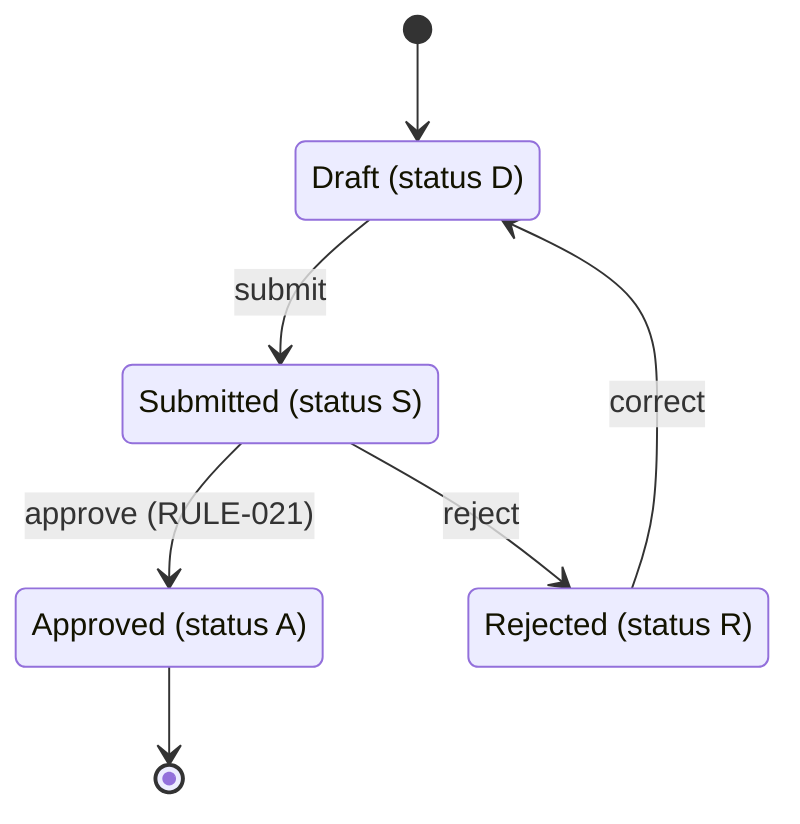
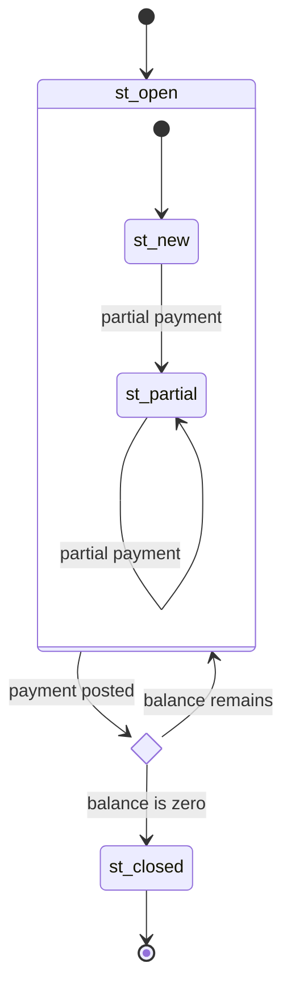

# State diagram reference

Kintsugi's own reference for `stateDiagram-v2`, written for this skill. Used for lifecycles the code
implements: the status values of an order, an account or a batch run and the transitions between them.

## Basics

- `[*]` is the start (as a source) or the end (as a target).
- State ids follow the id rules of the skill (`st_` prefix); the description after `id : text` is
  plain text that may hold spaces. Use it for the legacy status code.
- Transition labels after ` : ` name the event or the program that triggers it, and the rule id when one
  applies. Write `;` as `#59;`.

## Composite states and choices

- `state st_x { … }` groups sub-states; every `{` needs its `}` on its own line.
- `state chk_x <<choice>>` is a decision; `<<fork>>` and `<<join>>` split and merge parallel paths.
- `note right of st_x : text` adds a fact the transitions cannot show.

## Pitfalls

- Keywords and ids starting with `o` or `x` break transitions: keep the `st_` prefix.
- A state the code never reaches is a finding: draw it only if the code defines it, and say so.
- More than about 25 states or 40 transitions: split the lifecycle by phase.
