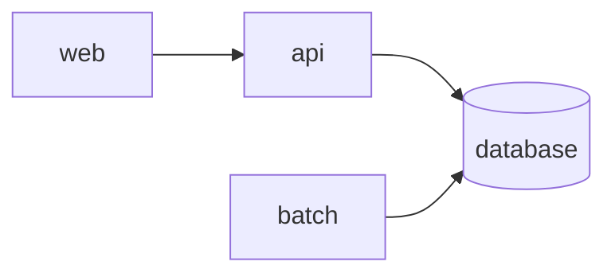

# Application design

The target design of this application: what it is made of, how the pieces talk, who owns which data and where each part of the old system goes. The design every application shares (principles, technology, security, quality targets) is in `../../../02-architecture/`; this document says only what is specific to `{{app}}`.

## Components and repositories

| Component | Responsibility | Repository | Unit kinds it receives |
| --- | --- | --- | --- |
| <!-- web --> | <!-- the screens --> | <!-- org/{{app}}-ui --> | screen |
| <!-- api --> | <!-- the operations and rules --> | <!-- org/{{app}}-api --> | api, report, event, integration, module |
| <!-- batch --> | <!-- the scheduled jobs --> | <!-- org/{{app}}-batch --> | batch-job |
| <!-- database --> | <!-- the schema: the data objects of the units --> | <!-- org/{{app}}-db --> | none |

The component names are the ones declared on the target repositories in `kintsugi.yaml`.

## Interfaces

| Id | From | To | What it carries | Defined in |
| --- | --- | --- | --- | --- |
| <!-- INT-001 --> | <!-- web --> | <!-- api --> | <!-- the invoice operations --> | <!-- the `api` unit designs, API-001 to API-010 --> |

Permanent interfaces follow `../../../02-architecture/integration.md`; those that disappear with the legacy system are in `../../../03-transition/coexistence.md`.

## Data ownership

| Entity | Owner component | Shared data definition |
| --- | --- | --- |
| <!-- Invoice --> | <!-- api --> | - |
| <!-- Customer --> | <!-- another application --> | <!-- ../../../03-transition/shared-data/customer-master.md --> |

## Mapping of the old system to the new

Where each module of the legacy system goes.

| Legacy module | Target component | Units | Notes |
| --- | --- | --- | --- |
| <!-- invoices --> | <!-- web, api --> | <!-- the units under 02-modern/invoices/ --> | <!-- --> |

## Design sets scoped to this application

| Set | Document | Purpose |
| --- | --- | --- |
| <!-- a set of scope `application` --> | `_design/<set>/<file>.md` | <!-- --> |

## Decisions and open questions

| Item | Kind | Record or owner |
| --- | --- | --- |
| <!-- the invoice search keeps the legacy sort order --> | decision | <!-- ADR number --> |
| <!-- who owns the customer entity --> | open question | <!-- name --> |
