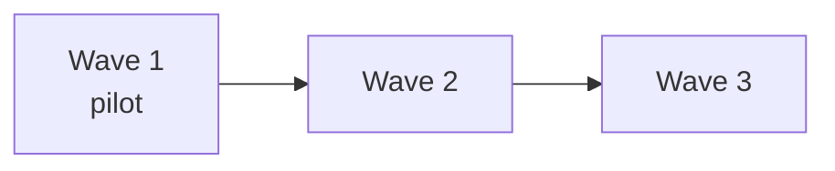

# Wave plan

Which units move in which wave, what a wave needs before it starts and what it must achieve before it ends. Decided at gate G1 and revised at each wave's end.

## Waves

| Wave | Goal | Applications | Units | Start | End | Gate |
| --- | --- | --- | --- | --- | --- | --- |
| 1 | <!-- pilot: prove the method on a small, representative slice --> | <!-- billing-web --> | <!-- 12 --> | <!-- date --> | <!-- date --> | <!-- G3 --> |
| 2 | <!-- --> | <!-- --> | <!-- --> | <!-- --> | <!-- --> | <!-- --> |

## Entry and exit criteria

| Wave | Entry (before it starts) | Exit (before the next starts) |
| --- | --- | --- |
| 1 | <!-- standards and templates agreed; common components designed; team trained --> | <!-- every unit merged; parity KPI met; lessons recorded --> |

## Units per wave

| Wave | Unit | Kind | Complexity | Depends on | Owner |
| --- | --- | --- | --- | --- | --- |
| 1 | <!-- billing-web/invoices/invoice-search --> | screen | medium | <!-- billing-web/common/invoice-dto --> | <!-- name --> |

The units of an application are in its catalog (`10-applications/<app>/01-legacy/_catalog/`); the unit's own wave is also in its card.

## Dependencies between waves

<!-- Replace with the real order; name the unit or shared component that forces it. -->

## Capacity

| Wave | Team | Capacity (units per month) | Assumptions |
| --- | --- | --- | --- |
| 1 | <!-- --> | <!-- --> | <!-- --> |
