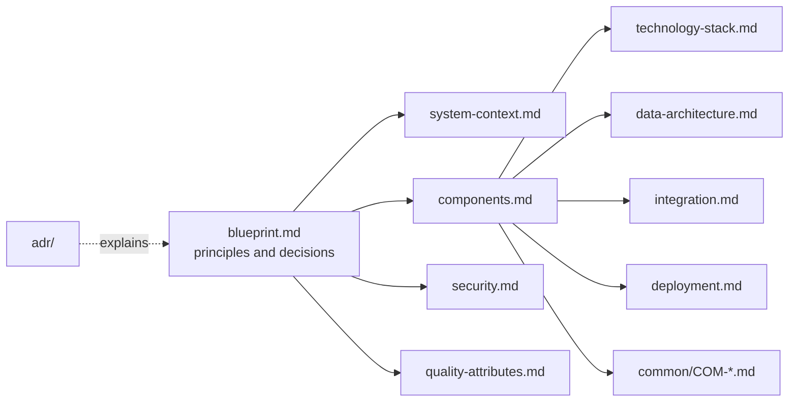

# `02-architecture/`

- Written by: people (the architecture leads and the foundation team, with the runtime's architecture support)
- Serves: P2 target specification; decided at gate G2 in the portal
- Auto-commit: no — content arrives as pull requests

The project-level target architecture, shared by every application. Read it in this order: the blueprint says what the target is and why, the documents after it say how each concern is solved.

| File | Answers | Read it for |
| --- | --- | --- |
| `blueprint.md` | What is the target and what are the rules of the design? | principles, style, scope, the decisions that shape everything else, risks and assumptions |
| `system-context.md` | Who and what does the system talk to? | actors, external systems, the boundary of the system |
| `components.md` | What is it made of? | components, responsibilities, repositories, dependencies |
| `technology-stack.md` | With what is it built? | the technology choice per concern, each with its reason |
| `data-architecture.md` | Where does the data live and who owns it? | stores, ownership, flows, retention |
| `integration.md` | How do the parts and the outside world talk? | interfaces, protocols, messages, error and retry rules |
| `security.md` | How is it protected? | identity, access, data protection, audit |
| `quality-attributes.md` | How well must it work? | measurable targets for performance, availability, recoverability, and how each is verified |
| `deployment.md` | Where and how does it run? | environments, topology, delivery pipeline, observability, recovery |
| `common/` | What does every unit reuse? | the common components, one `COM-<AREA>-<NN>.md` each |
| `adr/` | Why was it decided this way? | the architecture decision records of this project |

How the legacy and the target systems live side by side, and how the data moves, is in `../03-transition/`. What is specific to one application is in `../10-applications/<app>/02-modern/design.md`.

## How the documents fit together

## Writing rules

- A decision is written once, in the document that owns it, and cited from the others by file name and heading; an id (`COM-…`, `ADR-…`) never changes once approved.
- Every statement a unit's design depends on is checkable: a number with a unit, a name, a path. "Fast" and "secure" are not requirements; `quality-attributes.md` says how.
- A choice that is not obvious or is hard to reverse gets an ADR in `adr/` and a link from the document that states it.
- These files start as skeletons: the headings and tables are the format the project asks for; replace the guidance in each section with the project's content, and delete a section that does not apply instead of leaving it empty.

Kintsugi does not generate these files; the design checks of the units read `common/` to resolve `COM-` ids.
