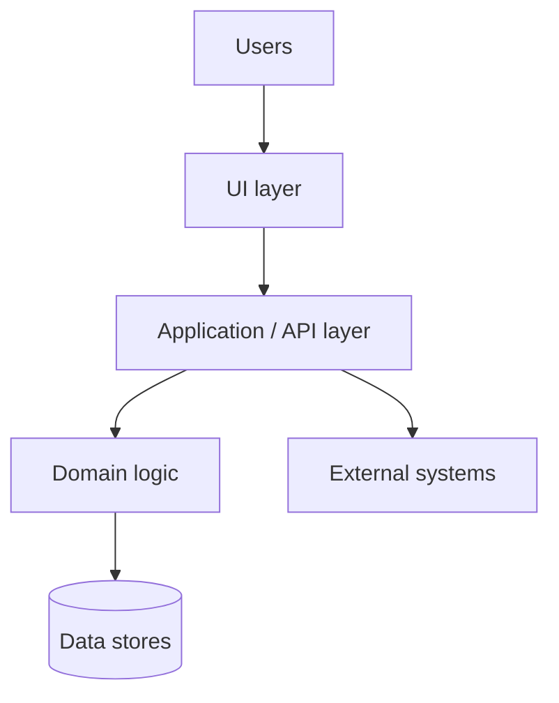

# Target architecture blueprint

The entry point to the target architecture: what the target is, the rules its design follows, and the decisions that shape the rest. Other documents in this folder go into each concern; this one stays short enough to read in ten minutes.

## Purpose and scope

<!-- One paragraph: what system this is, who it serves and what the migration replaces. Then say what is in scope and what is not. -->

| In scope | Out of scope |
| --- | --- |
| <!-- applications and capabilities the target covers --> | <!-- what stays on the legacy system or is dropped --> |

## Architectural drivers

What the architecture must satisfy, in priority order. Quality targets are in [quality-attributes.md](quality-attributes.md).

| # | Driver | Source | Consequence for the design |
| --- | --- | --- | --- |
| 1 | <!-- business goal, regulation or constraint --> | <!-- charter, requirement id, ADR --> | <!-- what it forces --> |

## Principles

Short rules every design follows, each with the reason; a unit's design cites the principle instead of deciding again.

| Id | Principle | Reason | Implication |
| --- | --- | --- | --- |
| P-01 | <!-- e.g. a unit owns its data --> | <!-- why --> | <!-- what a designer must do or never do --> |

## Architecture style

<!-- The overall shape (layered monolith, modular monolith, services, event-driven) and why it fits the drivers. -->

<!-- Replace the diagram with the target's own; the components are detailed in components.md. -->

## Key decisions

The decisions that shape everything else; each links to its record.

| Decision | Choice | Record |
| --- | --- | --- |
| <!-- e.g. runtime platform --> | <!-- choice --> | `adr/<number>-<title>.md` |

## Cross-cutting concerns

Where each concern is solved, so a unit's design looks it up instead of inventing it.

| Concern | Solved in | Common component |
| --- | --- | --- |
| Authentication and authorisation | [security.md](security.md) | <!-- COM-AUTH-01 --> |
| Logging and audit | [security.md](security.md), [deployment.md](deployment.md) | <!-- COM-LOG-01 --> |
| Error handling | [integration.md](integration.md) | <!-- COM-ERR-01 --> |
| Transactions and data access | [data-architecture.md](data-architecture.md) | <!-- COM-DATA-01 --> |
| Configuration and secrets | [deployment.md](deployment.md) | <!-- COM-CFG-01 --> |

## Risks and assumptions

Risks the architecture carries, and what it assumes to be true. A risk that needs a proof of concept to retire says so here, with the question the proof answers and the result that retires it.

| Id | Risk or assumption | Impact | Likelihood | Mitigation or check | Owner |
| --- | --- | --- | --- | --- | --- |
| R-01 | <!-- risk --> | high / medium / low | high / medium / low | <!-- what reduces it, or the proof that retires it --> | <!-- name --> |

## Open questions

| Question | Raised by | Needed by | Status |
| --- | --- | --- | --- |
| <!-- what is not decided yet --> | <!-- name --> | <!-- gate or date --> | open |
