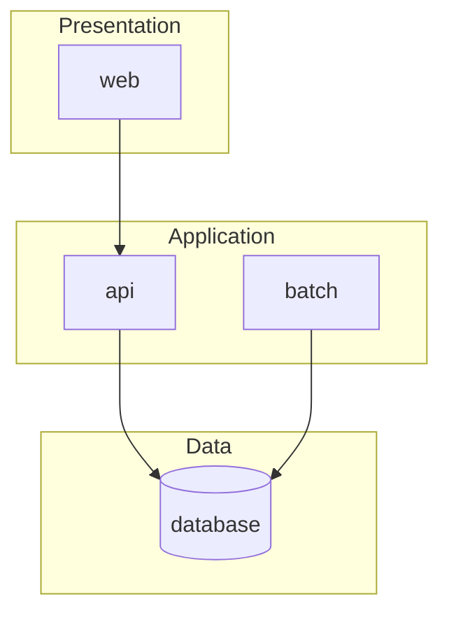

# Components

What the target is made of: each component, what it is responsible for, the repository it lives in and what it depends on. The component names are the ones declared as `component:` on the target repositories in `kintsugi.yaml`.

## Component diagram

<!-- Replace with the target's components; keep the dependency direction the layering rules allow. -->

## Component catalog

| Component | Responsibility | Repository | Technology | Owner | Depends on |
| --- | --- | --- | --- | --- | --- |
| <!-- web --> | <!-- what it is responsible for, in one sentence --> | <!-- org/project-web-ui --> | <!-- see technology-stack.md --> | <!-- team --> | <!-- api --> |

## Layering and dependency rules

| Rule | Statement | Enforced by |
| --- | --- | --- |
| L-01 | <!-- e.g. the UI layer calls only the API layer --> | <!-- review rule id, build check --> |

## Unit kind to component

Which component each kind of unit lands in, so a unit's design knows where its code goes.

| Unit kind | Component | Folder or module in the repository |
| --- | --- | --- |
| screen | <!-- web --> | <!-- src/pages --> |
| api | <!-- api --> | <!-- src/controllers --> |
| batch-job | <!-- batch --> | <!-- src/jobs --> |
| db-object | <!-- database --> | <!-- migrations/ --> |
| report | <!-- api or reporting --> | <!-- src/reports --> |

## Common components

The components every unit reuses are in [common/](common/README.md), one file each. List here which area each covers.

| Area | Component | Purpose |
| --- | --- | --- |
| <!-- AUTH --> | <!-- COM-AUTH-01 --> | <!-- sign-in and role checks --> |
