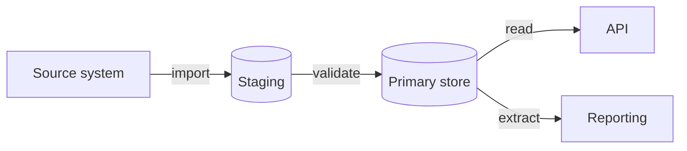

# Data architecture

Where the data lives, who owns it and how it moves. The data that several applications share is defined in `../03-transition/shared-data/`; how existing data reaches the target is in `../03-transition/data-migration.md`.

## Data stores

| Store | Kind | Holds | Owner component | Size and growth | Backup |
| --- | --- | --- | --- | --- | --- |
| <!-- primary database --> | relational / document / file / cache | <!-- what --> | <!-- component --> | <!-- rows or GB, per year --> | <!-- schedule and retention --> |

## Ownership

Every entity has one owner, the only component that writes it; the others read it through the owner's interface.

| Entity | Owner | Readers | Access path | Master data |
| --- | --- | --- | --- | --- |
| <!-- Invoice --> | <!-- api --> | <!-- web, batch --> | <!-- API-001 and later --> | yes / no |

## Data flow

<!-- Replace with the target's flows: where data enters, how it is transformed, where it leaves. -->

## Data classification

| Class | Examples | Rule |
| --- | --- | --- |
| public | <!-- --> | <!-- no restriction --> |
| internal | <!-- --> | <!-- inside the organisation --> |
| confidential | <!-- --> | <!-- need to know; masked in logs --> |
| restricted | <!-- --> | <!-- encrypted at rest and in transit; access audited --> |

## Transactions and consistency

| Concern | Decision |
| --- | --- |
| Transaction boundary | <!-- per request, per unit of work, per batch commit unit --> |
| Consistency across components | <!-- strong, eventual, with the compensation rule --> |
| Concurrency | <!-- optimistic or pessimistic locking, and where --> |
| Identifiers | <!-- how keys are generated and never reused --> |

## Retention and archiving

| Data | Kept for | Then | Basis |
| --- | --- | --- | --- |
| <!-- --> | <!-- period --> | archive / delete | <!-- regulation or policy --> |
