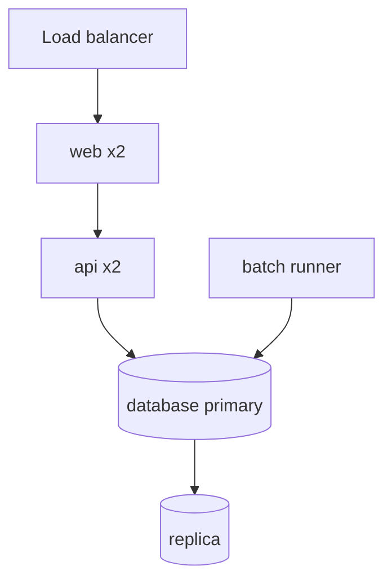

# Deployment

Where and how the target runs: the environments, the topology, the way a change reaches production, and how the system is observed and recovered.

## Environments

| Environment | Purpose | Data | Who deploys | Differences from production |
| --- | --- | --- | --- | --- |
| development | <!-- daily work --> | synthetic | <!-- developers --> | <!-- smaller, shared --> |
| test | <!-- automated and manual tests --> | masked copy | <!-- pipeline --> | <!-- --> |
| staging | <!-- rehearsal and acceptance --> | masked copy at production size | <!-- pipeline --> | <!-- none intended --> |
| production | <!-- live --> | live | <!-- pipeline, after approval --> | - |

## Topology

<!-- Replace with the production topology: nodes, networks, zones, the number of instances of each component. -->

## Runtime platform

| Component | Runs on | Instances | Resources | Scaling |
| --- | --- | --- | --- | --- |
| <!-- api --> | <!-- container platform, VM --> | <!-- 2 --> | <!-- CPU, memory --> | <!-- manual, autoscale on CPU --> |

## Delivery pipeline

| Stage | What happens | Gate |
| --- | --- | --- |
| Build | <!-- compile, unit tests, static analysis --> | <!-- must pass --> |
| Package | <!-- image or artifact, versioned --> | <!-- signed --> |
| Deploy to test | <!-- automatic --> | <!-- smoke test --> |
| Deploy to production | <!-- approved release --> | <!-- approval by --> |
| Roll back | <!-- how to return to the previous version --> | <!-- criteria --> |

## Configuration and secrets

| Item | Where it is set | Changed by |
| --- | --- | --- |
| Environment settings | <!-- config store, environment variables --> | <!-- pipeline --> |
| Secrets | <!-- secret store; see security.md --> | <!-- operations --> |

## Observability

| Signal | Collected with | Kept | Alerts on |
| --- | --- | --- | --- |
| Logs | <!-- tool --> | <!-- period --> | <!-- error rate, a named error code --> |
| Metrics | <!-- tool --> | <!-- period --> | <!-- the targets of quality-attributes.md --> |
| Traces | <!-- tool --> | <!-- period --> | <!-- slow requests --> |

## Backup and recovery

| What | How often | Restore tested | Recovery target |
| --- | --- | --- | --- |
| <!-- primary database --> | <!-- daily full, hourly log --> | <!-- every quarter --> | Q-04 |
