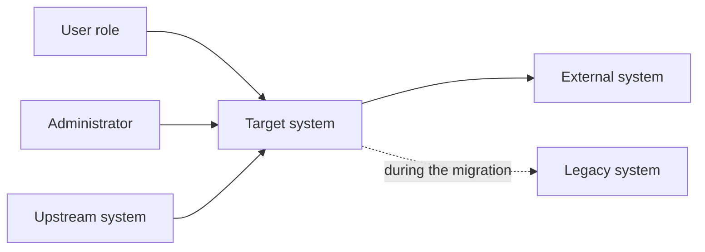

# System context

The system as a black box: who uses it and which other systems it exchanges data with. The boundary drawn here is the one the components, the integration and the security documents refine.

## Context diagram

<!-- Replace the nodes with the project's actors and systems; keep one arrow per distinct exchange. -->

## Actors

| Actor | Kind | Goal | Uses |
| --- | --- | --- | --- |
| <!-- role, for example Billing clerk --> | person / system | <!-- what they achieve --> | <!-- screens, APIs, files --> |

## External systems

| System | Direction | Exchange | Protocol | Owner | Criticality |
| --- | --- | --- | --- | --- | --- |
| <!-- name --> | in / out / both | <!-- what is sent or received --> | <!-- REST, message, file, database link --> | <!-- team --> | high / medium / low |

## System boundary

<!-- What the system is responsible for and what it explicitly is not (what stays with the systems above). -->

| Inside the boundary | Outside the boundary |
| --- | --- |
| <!-- capabilities the system owns --> | <!-- capabilities that other systems own --> |

## Assumptions

<!-- What the context assumes about the systems around it (availability, data quality, formats); each assumption that can break the design is also a row of the risk table in blueprint.md. -->
