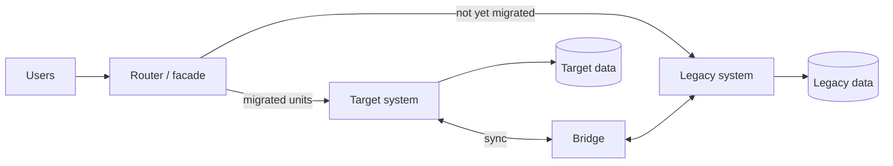

# Coexistence

How the legacy and the target systems run side by side during the migration: who serves a request, who owns the data, how the two stay in step and under which conditions a unit is cut over. Everything here is temporary; each bridge has a removal date.

## Strategy

<!-- One paragraph: the migration approach (big bang, wave by wave, strangler by unit) and why it fits the drivers in ../02-architecture/blueprint.md. -->

<!-- Replace with the project's own picture. -->

## Routing

| Unit or area | Served by (now) | Served by (after cut-over) | Switch | Switched by |
| --- | --- | --- | --- | --- |
| <!-- billing-web/invoices/invoice-search --> | legacy | target | <!-- feature flag, route rule --> | <!-- team --> |

## Data ownership during the migration

At every moment exactly one system owns each entity: the only one that writes it.

| Entity | Owner before | Owner after | Switch point | Synchronisation until then |
| --- | --- | --- | --- | --- |
| <!-- Invoice --> | legacy | target | <!-- wave 2 cut-over --> | <!-- one-way copy every 5 minutes --> |

## Bridges and adapters

| Id | Purpose | Direction | Mechanism | Owner | Removed when |
| --- | --- | --- | --- | --- | --- |
| BR-01 | <!-- keep customer data in step --> | legacy → target | <!-- change capture, file drop, API --> | <!-- team --> | <!-- the customer unit is cut over --> |

## Cut-over

For each unit, in the order of the wave plan (`../00-project/portfolio/wave-plan.md`).

| Step | Action | Responsible | Duration | Check before going on |
| --- | --- | --- | --- | --- |
| 1 | <!-- freeze changes in the legacy unit --> | <!-- --> | <!-- --> | <!-- parity tests pass --> |
| 2 | <!-- run the final data sync --> | <!-- --> | <!-- --> | <!-- reconciliation clean (see data-migration.md) --> |
| 3 | <!-- switch the route --> | <!-- --> | <!-- --> | <!-- smoke test passes --> |
| 4 | <!-- watch --> | <!-- --> | <!-- the hypercare period --> | <!-- error and latency within targets --> |

## Rollback

| Trigger | Action | Data | Decided by |
| --- | --- | --- | --- |
| <!-- a defect of severity high in the first hours --> | <!-- switch the route back --> | <!-- how writes made in the target are carried back --> | <!-- name --> |

## Retiring the legacy system

| Item | Condition | Date |
| --- | --- | --- |
| <!-- legacy unit --> | <!-- no traffic for 30 days, data archived --> | <!-- --> |
